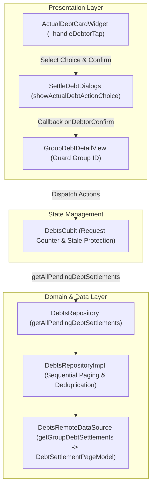

# Kế hoạch Triển khai Khắc phục Luồng Công nợ (DEBT-01, DEBT-02, DEBT-03)

> **For agentic workers:** REQUIRED SUB-SKILL: Use superpowers:executing-plans or superpowers:subagent-driven-development to implement this plan task-by-task. Steps use checkbox (`- [ ]`) syntax for tracking.

**Goal:** Khắc phục triệt để 3 vấn đề trong luồng công nợ theo tài liệu review [FairShare_Debt_Remediation_Plan.md](file:///d:/App/group_spending_app/documents/FairShare_Debt_Remediation_Plan.md): chống race condition ghi đè nhóm (DEBT-01), tải đầy đủ yêu cầu tất toán chờ xác nhận qua phân trang (DEBT-02), và hỗ trợ từ chối nhận tiền đối với nợ thực tế (DEBT-03).

**Architecture:** Sử dụng request ID sequence và snapshot verification tại `DebtsCubit` kết hợp group ID validation tại `GroupDebtDetailView`; bổ sung model phân trang `DebtSettlementPageModel`/`DebtSettlementPageEntity` và hàm `getAllPendingDebtSettlements` lặp tuần tự có khử trùng; bổ sung `showActualDebtActionChoice` trong `SettleDebtDialogs` kích hoạt `confirmDebtSettled(debtor.splitId, confirmed: false)`.

**Tech Stack:** Flutter (Dart 3.x), flutter_bloc (Cubit), Dio, Material 3, l10n.

**Spec:** [FairShare_Debt_Remediation_Plan.md](file:///d:/App/group_spending_app/documents/FairShare_Debt_Remediation_Plan.md) & [Mobile_Debt_API_Integration_Guide.md](file:///d:/App/group_spending_app/documents/Mobile_Debt_API_Integration_Guide.md)

---

## Global Constraints

- **Tối giản mã nguồn**: Giữ nguyên cấu trúc phân tầng (`data` / `domain` / `presentation`). Tái sử dụng tối đa logic và chuỗi l10n hiện có (`confirmReceivedAction`, `rejectReceivedAction`, `confirmReceiveDebtTitle`, `rejectReceiveDebtTitle`, v.v.).
- **Không thay đổi hợp đồng backend**: Endpoint xác nhận/từ chối nợ thực tế tuân thủ `POST /debts/{splitId}/confirm?confirmed=true|false`, không gửi kèm `reason` (vốn chỉ dành cho `POST /debt-settlements/{settlementId}/confirm`).
- **Bảo toàn tính tương thích**: Tất cả 49 tests hiện có trong `test/features/debts` cùng các test dashboard liên quan phải tiếp tục pass 100%.

---

## Review Focus

1. **Race condition khi chuyển nhóm nhanh (A → B → A hoặc A → Back → B)**: Phản hồi chậm của nhóm trước không được ghi đè state, không được tắt skeleton/loading của nhóm sau và không hiển thị thông báo lỗi sai ngữ cảnh.
2. **Hủy nhóm / Reset khi request đang bay**: Gọi `selectGroup(null)` hoặc `reset()` trong lúc đang gọi API phải vô hiệu hóa toàn bộ callback cập nhật state của request đó.
3. **Phân trang vô hạn hoặc trùng lặp ID đợt tất toán**: Khi API trả về `last=false` nhưng `content` rỗng hoặc server có các bản ghi trùng lặp giữa các trang, vòng lặp phải dừng an toàn và tập hợp kết quả không chứa trùng lặp ID.
4. **Lỗi một trang trong chuỗi phân trang**: Nếu trang 2 bị lỗi mạng, không được trả về danh sách một phần của trang 1 như thể là danh sách hoàn chỉnh; Cubit phải báo lỗi và giữ state ổn định trước đó.
5. **Thao tác lặp lại khi submit xác nhận/từ chối nợ**: Nút thao tác phải bị chặn khi `isActionSubmitting` đang diễn ra, và phải kiểm tra `context.mounted` trước khi gọi callback sau dialog.

---

## User Review Required

> [!NOTE]
> Giao diện lựa chọn cho `DebtAction.confirm` ở nợ thực tế: Người dùng sẽ thấy hộp thoại lựa chọn giữa 2 phương án:
> 1. **"Xác nhận nhận tiền"** (màu xanh thương hiệu / emerald, icon Check).
> 2. **"Từ chối"** (màu đỏ cảnh báo, icon X).
> Khi chọn một trong hai phương án, app sẽ mở tiếp dialog xác nhận tương ứng (`SettleDebtDialogs.showConfirmSettled` với `confirmed: true` hoặc `confirmed: false`) trước khi gửi API. Nếu người dùng đóng hoặc bấm Hủy ở bất kỳ bước nào, không có request nào được gửi.

---

## Open Questions

Không có câu hỏi mở chặn triển khai — các yêu cầu và hợp đồng API đã được quy định chi tiết trong [FairShare_Debt_Remediation_Plan.md](file:///d:/App/group_spending_app/documents/FairShare_Debt_Remediation_Plan.md) và [Mobile_Debt_API_Integration_Guide.md](file:///d:/App/group_spending_app/documents/Mobile_Debt_API_Integration_Guide.md).

---

## Proposed Changes



### Component 1: Domain & Data Models (DEBT-02)

Thêm model và entity kết quả phân trang cho debt settlements.

#### [MODIFY] [`debt_settlement_entity.dart`](file:///C:/Users/quang/.gemini/antigravity/worktrees/group_spending_app/plan_debt_remediation_flow/lib/features/debts/domain/entities/debt_settlement_entity.dart)
- Bổ sung `DebtSettlementPageEntity`:
```dart
class DebtSettlementPageEntity {
  final List<DebtSettlementEntity> content;
  final int pageNumber;
  final int totalPages;
  final int totalElements;
  final bool last;

  const DebtSettlementPageEntity({
    required this.content,
    required this.pageNumber,
    required this.totalPages,
    required this.totalElements,
    required this.last,
  });
}
```

#### [MODIFY] [`debt_settlement_model.dart`](file:///C:/Users/quang/.gemini/antigravity/worktrees/group_spending_app/plan_debt_remediation_flow/lib/features/debts/data/models/debt_settlement_model.dart)
- Bổ sung `DebtSettlementPageModel` kế thừa hoặc chuyển đổi sang `DebtSettlementPageEntity`:
```dart
class DebtSettlementPageModel extends DebtSettlementPageEntity {
  const DebtSettlementPageModel({
    required super.content,
    required super.pageNumber,
    required super.totalPages,
    required super.totalElements,
    required super.last,
  });

  factory DebtSettlementPageModel.fromJson(Map<String, dynamic> json) {
    final rawContent = json['content'] as List<dynamic>? ?? [];
    final content = rawContent
        .whereType<Map<String, dynamic>>()
        .map((item) => DebtSettlementModel.fromJson(item))
        .toList();
    final pageable = json['pageable'] as Map<String, dynamic>?;
    final pageNumber = (pageable?['pageNumber'] as num?)?.toInt() ??
        (json['pageNumber'] as num?)?.toInt() ??
        0;
    final totalPages = (json['totalPages'] as num?)?.toInt() ?? 1;
    final totalElements =
        (json['totalElements'] as num?)?.toInt() ?? content.length;
    final last = (json['last'] as bool?) ?? (pageNumber >= totalPages - 1);

    return DebtSettlementPageModel(
      content: content,
      pageNumber: pageNumber,
      totalPages: totalPages,
      totalElements: totalElements,
      last: last,
    );
  }
}
```

#### [MODIFY] [`debts_remote_data_source.dart`](file:///C:/Users/quang/.gemini/antigravity/worktrees/group_spending_app/plan_debt_remediation_flow/lib/features/debts/data/datasources/debts_remote_data_source.dart)
- Cập nhật `getGroupDebtSettlements`: trả về `Future<DebtSettlementPageModel>` thay vì `List<DebtSettlementModel>`. Parse từ `data['data'] as Map<String, dynamic>`.

#### [MODIFY] [`debts_repository.dart`](file:///C:/Users/quang/.gemini/antigravity/worktrees/group_spending_app/plan_debt_remediation_flow/lib/features/debts/domain/repositories/debts_repository.dart)
- Đổi kiểu trả về của `getGroupDebtSettlements` thành `Future<DebtSettlementPageEntity>`.
- Bổ sung phương thức: `Future<List<DebtSettlementEntity>> getAllPendingDebtSettlements(int groupId);`.

#### [MODIFY] [`debts_repository_impl.dart`](file:///C:/Users/quang/.gemini/antigravity/worktrees/group_spending_app/plan_debt_remediation_flow/lib/features/debts/data/repositories/debts_repository_impl.dart)
- Cập nhật `getGroupDebtSettlements` ủy quyền cho remoteDataSource.
- Cài đặt `getAllPendingDebtSettlements(int groupId)`:
  - Vòng lặp tuần tự từ `page = 0`.
  - Gọi `remoteDataSource.getGroupDebtSettlements(groupId, status: 'WAITING_FOR_CONFIRMATION', page: page, size: 20)`.
  - Khử trùng theo `settlement.id` bằng `Set<int> seenIds`.
  - Dừng khi `pageResult.last == true || pageResult.content.isEmpty || pageResult.pageNumber >= pageResult.totalPages - 1`.
  - Nếu gặp lỗi ở bất kỳ trang nào, ném lỗi ra ngoài (không nuốt lỗi để tránh cập nhật danh sách khuyết).

---

### Component 2: DebtsCubit & Race Condition Protection (DEBT-01 & DEBT-02)

#### [MODIFY] [`debts_cubit.dart`](file:///C:/Users/quang/.gemini/antigravity/worktrees/group_spending_app/plan_debt_remediation_flow/lib/features/debts/presentation/cubit/debts_cubit.dart)
- Thêm trường `int _activeGroupRequestId = 0;`.
- Trong `selectGroup(int? groupId, {String? groupName})`:
  - `_activeGroupRequestId++;`
  - Nếu `groupId == null`: emit `clearSelectedGroup: true, clearGroupDetails: true, isDetailLoading: false`.
  - Nếu `groupId != null`: emit `selectedGroupId`, `selectedGroupName`, `isDetailLoading: true`, `clearGroupDetails: isDifferentGroup`, sau đó gọi `loadGroupDebts(groupId)`.
- Trong `reset()`:
  - `_activeGroupRequestId++;`
  - emit `const DebtsState()`.
- Trong `loadGroupDebts(int groupId, {bool silent = false})`:
  - Kiểm tra guard: nếu `state.selectedGroupId != null && state.selectedGroupId != groupId`, thoát ngay.
  - Nếu `state.selectedGroupId == null`, cập nhật `selectedGroupId: groupId`.
  - Chụp snapshot request:
    ```dart
    final currentRequestId = ++_activeGroupRequestId;
    final capturedGroupId = groupId;
    final capturedFilter = state.actualDebtStatusFilter;
    final requestEpoch = sessionCoordinator?.sessionEpoch ?? 0;
    ```
  - Gọi repository tải song song:
    - `getGroupSimplifiedDebts(groupId)`
    - `getGroupActualDebts(groupId, status: capturedFilter)`
    - `getAllPendingDebtSettlements(groupId)` (sử dụng method mới của DEBT-02)
  - Trước khi cập nhật state sau `await` (áp dụng cho cả khối thành công lẫn `on AppException` và `catch (e)`):
    ```dart
    final isValid = !isClosed &&
        (sessionCoordinator == null || sessionCoordinator!.sessionEpoch == requestEpoch) &&
        currentRequestId == _activeGroupRequestId &&
        state.selectedGroupId == capturedGroupId &&
        state.actualDebtStatusFilter == capturedFilter;
    if (!isValid) return;
    ```
  - Chỉ khi `isValid == true` mới cập nhật dữ liệu, tắt `isDetailLoading: false`, hoặc set `errorMessage`.
- Trong `setActualDebtStatusFilter(String? status)`:
  - emit `actualDebtStatusFilter: status`.
  - Nếu `state.selectedGroupId != null`, `await loadGroupDebts(state.selectedGroupId!, silent: true)`.

---

### Component 3: Presentation UI Guards & Settle Debt Dialogs (DEBT-01 & DEBT-03)

#### [MODIFY] [`settle_debt_dialogs.dart`](file:///C:/Users/quang/.gemini/antigravity/worktrees/group_spending_app/plan_debt_remediation_flow/lib/features/debts/presentation/widgets/settle_debt_dialogs.dart)
- Bổ sung hàm static `showActualDebtActionChoice(BuildContext context, {required String debtorName, required String formattedAmount})`:
  - Hiển thị AlertDialog với tiêu đề xác nhận nhận tiền từ `debtorName` (`formattedAmount`).
  - Nút 1: "Xác nhận nhận tiền" (`tr.confirmReceivedAction`) -> trả về `true`.
  - Nút 2: "Từ chối" (`tr.rejectReceivedAction`) -> trả về `false`.
  - Nút Đóng / Hủy (`tr.cancel`) -> trả về `null`.

#### [MODIFY] [`actual_debt_card_widget.dart`](file:///C:/Users/quang/.gemini/antigravity/worktrees/group_spending_app/plan_debt_remediation_flow/lib/features/debts/presentation/widgets/actual_debt_card_widget.dart)
- Thêm trường `final bool isSubmitting;` (mặc định `false`).
- Trong `_handleDebtorTap(BuildContext context, ActualDebtorEntity debtor)`:
  - Nếu `isSubmitting`, return ngay để chống double tap.
  - Khi `debtor.action == DebtAction.confirm`:
    - Mở `showActualDebtActionChoice`:
      ```dart
      final choice = await SettleDebtDialogs.showActualDebtActionChoice(
        context,
        debtorName: debtor.name,
        formattedAmount: formattedAmount,
      );
      if (choice == null || !context.mounted) return;

      final confirmed = await SettleDebtDialogs.showConfirmSettled(
        context,
        debtorName: debtor.name,
        formattedAmount: formattedAmount,
        confirmed: choice,
      );
      if (confirmed == true && context.mounted) {
        onDebtorConfirm?.call(debtor, choice);
      }
      ```

#### [MODIFY] [`group_debt_detail_view.dart`](file:///C:/Users/quang/.gemini/antigravity/worktrees/group_spending_app/plan_debt_remediation_flow/lib/features/debts/presentation/screens/group_debt_detail_view.dart)
- Lọc bảo vệ dữ liệu theo `groupId`:
  - `userBalance`: chỉ dùng từ `simplifiedDebts`/`actualDebts` nếu `groupId == widget.groupId`.
  - `simplifiedList`: `userBalance.groupId == widget.groupId ? ... : []`.
  - `actualList`: `userBalance.groupId == widget.groupId ? ... : []`.
  - `pendingSettlements`: `state.pendingSettlements.where((s) => s.groupId == widget.groupId).toList()`.
- Truyền `isSubmitting: state.isActionSubmitting` vào `ActualDebtCardWidget`.
- Trong `onDebtorConfirm: (debtor, confirmed)`:
  - Kiểm tra `if (state.isActionSubmitting) return;` trước khi gọi `cubit.confirmDebtSettled`.

---

### Component 4: Test Updates & New Test Cases

#### [MODIFY] Mocks trong các file test:
- `test/features/dashboard/dashboard_cubit_test.dart`: Cập nhật `FakeDebtsRepository` để cài đặt `getGroupDebtSettlements` và `getAllPendingDebtSettlements`.
- `test/features/debts/presentation/cubit/debts_cubit_test.dart`: Cập nhật `MockDebtsRepository`.
- `test/features/debts/presentation/screens/debts_screen_test.dart`: Cập nhật `FakeDebtsRepo`.
- `test/features/debts/presentation/screens/group_debt_detail_view_test.dart`: Cập nhật `_MockDebtsRepo`.
- `test/features/debts/data/datasources/debts_remote_data_source_test.dart`: Cập nhật test `getGroupDebtSettlements` trả về `DebtSettlementPageModel`.

#### [NEW] [`debts_cubit_remediation_test.dart`](file:///C:/Users/quang/.gemini/antigravity/worktrees/group_spending_app/plan_debt_remediation_flow/test/features/debts/presentation/cubit/debts_cubit_remediation_test.dart)
Tạo file test chuyên sâu kiểm tra toàn bộ ma trận nghiệm thu của DEBT-01 và DEBT-02:
- **01-A**: A chậm, B nhanh; A hoàn tất sau B -> state chỉ giữ dữ liệu B.
- **01-B**: A lỗi sau B thành công -> không hiện lỗi A, không đổi loading của B.
- **01-C**: Hai request cùng nhóm, request mới xong trước -> kết quả request mới được giữ.
- **01-D**: Bỏ chọn / reset / đổi session -> không khôi phục state nhóm cũ.
- **01-E**: A -> bỏ chọn -> A trong khi lần mở A đầu chưa xong -> chỉ phản hồi của lần mở A sau cùng được chấp nhận.
- **02-A & 02-B**: Tải nhiều trang WAITING_FOR_CONFIRMATION (>20 bản ghi) lặp qua tất cả các trang.
- **02-C & 02-D**: Dừng đúng khi hết trang và khử trùng lặp bản ghi có cùng settlement ID.
- **02-E**: Trang 2 lỗi -> ném lỗi và không nhận trang 1 làm kết quả hoàn tất.

#### [NEW] [`actual_debt_card_remediation_test.dart`](file:///C:/Users/quang/.gemini/antigravity/worktrees/group_spending_app/plan_debt_remediation_flow/test/features/debts/presentation/widgets/actual_debt_card_remediation_test.dart)
Kiểm tra ma trận nghiệm thu DEBT-03:
- **03-A**: Chủ nợ chọn "Đã nhận tiền" -> gọi `onDebtorConfirm(debtor, true)`.
- **03-B**: Chủ nợ chọn "Từ chối" -> gọi `onDebtorConfirm(debtor, false)`.
- **03-C**: Hủy / đóng dialog ở bước lựa chọn hoặc bước xác nhận -> không gọi callback.
- **03-F**: Không thể tap khi `isSubmitting == true`.

---

## Verification Plan

### Automated Tests
1. **Kiểm tra cục bộ từng phần**:
   - `flutter test test/features/debts/data/datasources/debts_remote_data_source_test.dart`
   - `flutter test test/features/debts/presentation/cubit/debts_cubit_remediation_test.dart`
   - `flutter test test/features/debts/presentation/widgets/actual_debt_card_remediation_test.dart`
2. **Kiểm tra hồi quy toàn bộ feature công nợ**:
   - `flutter test --no-pub test/features/debts`
3. **Kiểm tra phân tích mã tĩnh**:
   - `flutter analyze`

### Manual Verification
1. **DEBT-01 (Mạng chậm / Chuyển nhóm liên tục)**:
   - Vào danh sách nhóm công nợ, bấm mở Nhóm A, ngay lập tức bấm Quay lại và mở Nhóm B.
   - Xác nhận: Không có khoảnh khắc nào Nhóm B hiển thị chi tiết hay thành viên nợ của Nhóm A.
2. **DEBT-02 (Phân trang danh sách chờ)**:
   - Mở một nhóm có nhiều hơn 20 đợt tất toán lịch sử và có yêu cầu cũ đang chờ duyệt.
   - Xác nhận: Thẻ đợt tất toán chờ xác nhận vẫn hiển thị đầy đủ ở đầu tab Nợ tối giản, không bị bỏ sót.
3. **DEBT-03 (Từ chối nhận tiền nợ thực tế)**:
   - Đăng nhập với tài khoản chủ nợ, vào tab "Nợ thực tế".
   - Bấm vào khoản nợ có trạng thái "Xác nhận nhận tiền".
   - Kiểm tra hiển thị dialog 2 lựa chọn: "Xác nhận nhận tiền" và "Từ chối".
   - Chọn "Từ chối" và xác nhận: Khoản nợ quay trở về trạng thái "Chờ thanh toán" (PENDING).
