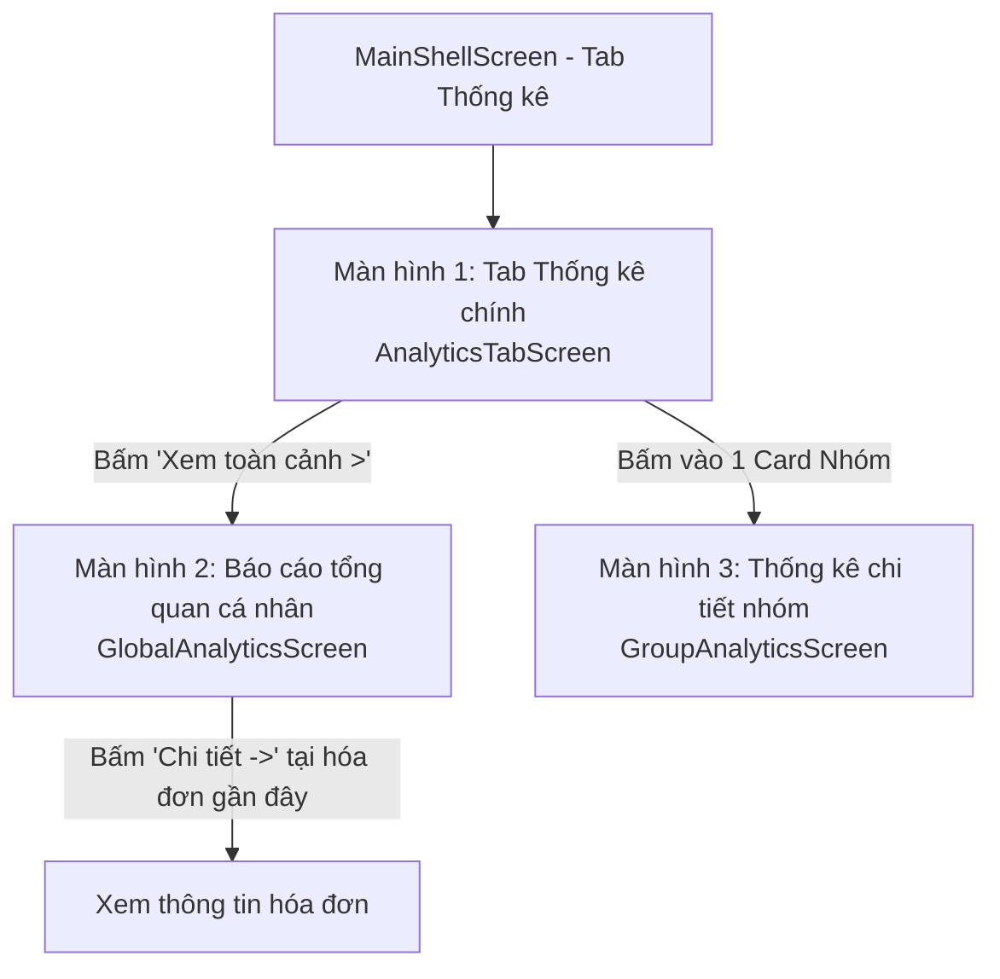

# Kế hoạch Triển khai Luồng Màn hình Tab Thống kê (FairShare Analytics Feature)

**Tài liệu tham chiếu:**
- Thiết kế giao diện: 5 ảnh chụp màn hình UI thực tế (`media_1790564329765.png` -> `media_1790564419883.png`).
- Đặc tả API: [Mobile_Statistics_API_Integration_Guide.md](file:///C:/Users/quang/.gemini/antigravity/worktrees/group_spending_app/plan_statistics_screen_flows/documents/Mobile_Statistics_API_Integration_Guide.md).
- Quy chuẩn triển khai: [.agents/workflows/quang-feature.md](file:///C:/Users/quang/.gemini/antigravity/worktrees/group_spending_app/plan_statistics_screen_flows/.agents/workflows/quang-feature.md).
- Quyết định đã chốt: Hoãn API 3.6 (Báo cáo tháng / Daily Trend) & API 3.7 (Xuất CSV) sang pha sau; điều hướng sang màn hình Thống kê nhóm riêng biệt (`/groups/:groupId/analytics`).

---

## 1. Ngữ cảnh & Phạm vi Chức năng (Scope & Context)

### 1.1. Mục tiêu cốt lõi
Triển khai toàn diện luồng màn hình Tab Thống kê (Analytics) theo đúng 5 ảnh mockup UI, tích hợp các API Backend tương ứng với tiêu chí tối ưu hóa mã nguồn cao nhất (Senior Dev / Ponytail mode: Tái sử dụng tối đa, không thêm dependency dư thừa, xử lý đúng vòng đời và ranh giới kiến trúc).

### 1.2. Ba màn hình chính & Luồng tương tác



#### Màn hình 1: Tab Thống kê chính (`AnalyticsTabScreen`)
*Nguồn giao diện: `media_1790564329765.png`*
- **Header:** Giữ nguyên `AppHeader()` chung (Avatar, Lời chào, Theme switch, Language switch, Notification bell).
- **Phân đoạn tiêu đề:** Icon `LucideIcons.barChart3` + "Báo cáo & Thống kê".
- **Thẻ KPI tổng quan nhanh (3 mini cards):**
  - "Tổng chi tất cả nhóm": `totalSpendingVnd` (Format qua `CurrencyUtils.formatVnd`, tự co giãn/ellipsis).
  - "Số nhóm tham gia": `activeGroupCount` ("3 nhóm").
  - "Số hóa đơn đã ghi": `totalExpenses` ("6 hóa đơn").
  - *API liên kết:* `GET /expenses/statistics/overview` (Mục 3.1).
- **Banner Báo cáo tổng quan:**
  - Card nền tím nhạt, icon layer/biểu đồ, text "Báo cáo tổng quan", nút hành động "Xem toàn cảnh >".
  - *Tương tác:* Bấm vào push sang Màn hình 2 (`GlobalAnalyticsScreen`).
- **Thanh tìm kiếm & Bộ lọc nhóm:**
  - Search bar: "Tìm kiếm nhóm theo tên, danh mục...".
  - Filter chips: "Tất cả ({count})", "Đang hoạt động", "Đã lưu trữ".
- **Danh sách nhóm chi tiêu:**
  - Section title: "DANH SÁCH NHÓM CHI TIÊU" kèm tổng số nhóm (`3 nhóm`).
  - Danh sách card nhóm: Icon danh mục, Tên nhóm, Mũi tên `>`, dòng "Tổng chi tiêu" + số tiền format VNĐ (`6.830.000 đ`).
  - *Tái sử dụng:* `GroupsRepository.getMyGroups()` (đã có sẵn trong `groups` feature, `GroupModel` đã hỗ trợ sẵn trường `totalSpendingVnd`).
  - *Tương tác:* Bấm vào nhóm điều hướng sang Màn hình 3 (`GroupAnalyticsScreen`) qua route `/groups/:groupId/analytics`.

#### Màn hình 2: Báo cáo tổng quan cá nhân (`GlobalAnalyticsScreen`)
*Nguồn giao diện: `media_1790564351611.png` & `media_1790564389941.png`*
- **Header:** Nút Back (`<`), Tiêu đề "Báo cáo tổng quan", Phụ đề "Tổng hợp tất cả nhóm đang tham gia".
- **Bộ lọc chu kỳ thời gian (Period Chips Bar):**
  - "Tháng 09/2026" (`THIS_MONTH` - mặc định), "Tháng trước" (`LAST_MONTH`), "Quý 3/2026" (`CURRENT_QUARTER`), "Cả năm..." (`BY_YEAR` kèm Year Picker).
- **Section "CHỈ SỐ TÀI CHÍNH NHÓM" (2x2 Grid KPI):**
  - *API liên kết:* `GET /expenses/statistics/details?period=...&year=...` (Mục 3.2).
  - Card 1: Tổng tiền chi tiêu (`totalSpendingVnd`), badge tăng/giảm (`↑ 4.5%`), phụ đề "Chi tiêu chung cả nhóm".
  - Card 2: Bình quân đầu người (`averageSpendingPerPersonVnd`), badge thành viên (`÷ 8 bạn` - `totalUniqueMembers`), phụ đề "Mỗi thành viên chia đều".
  - Card 3: Số khoản chi (`totalExpenseCount`), badge "Hóa đơn", phụ đề "Đã ghi nhận & đối soát".
  - Card 4: Tỷ lệ tất toán (`debtSettlementRate`), badge `82%`, progress bar, phụ đề "Công nợ nhóm" | "Còn 18% tồn".
- **Section "PHÂN BỐ THEO DANH MỤC CHI TIÊU":**
  - Stacked horizontal segmented bar (thanh ngang bo góc chia màu theo % các danh mục).
  - Danh sách breakdown chi tiết từng danh mục: Icon, Tên danh mục, Tỷ lệ phần trăm (%), Số tiền VNĐ.
- **Section "BẢNG XẾP HẠNG ĐÓNG GÓP" (Global Leaderboard):**
  - *API liên kết:* `GET /expenses/statistics/leaderboard?period=...&year=...` (Mục 3.3).
  - Danh sách thành viên đóng góp nhiều nhất: Huy chương Vàng / Bạc / Đồng cho Top 1-2-3, Avatar, Họ tên, Tỷ lệ %, Số tiền đóng góp VNĐ. Gắn cờ "(Tôi)" nếu là người dùng hiện tại.
- **Section "HÓA ĐƠN CHI TIÊU GẦN ĐÂY":**
  - *API liên kết:* `GET /expenses/history?timeFilter=...` (Mục 3.8).
  - Danh sách hóa đơn gần đây: Icon hóa đơn, Tên chi tiêu, Ngày giờ + Người trả, Số tiền VNĐ, Link "Chi tiết →".

#### Màn hình 3: Thống kê chi tiết theo nhóm (`GroupAnalyticsScreen`)
*Nguồn giao diện: `media_1790564404089.png` & `media_1790564419883.png`*
- **Route:** `/groups/:groupId/analytics`
- **Header:** Nút Back (`<`), Tiêu đề: Tên nhóm ("Chung cư Sunrise Room"), Phụ đề: Thể loại • Số thành viên ("Căn hộ chung • 5 thành viên").
- **Bộ lọc chu kỳ thời gian:** Tương tự ("Tháng này", "Tháng trước", "Quý này", "Cả năm...").
- **Section "CHỈ SỐ TÀI CHÍNH NHÓM" (2x2 Grid KPI):**
  - *API liên kết:* `GET /expenses/statistics/groups/{groupId}?period=...&year=...` (Mục 3.4).
  - 4 Card tương tự nhưng đóng gói trong phạm vi nhóm được chọn.
- **Section "PHÂN BỐ THEO DANH MỤC CHI TIÊU":**
  - Thanh phân bổ ngang nhiều màu + danh sách breakdown theo danh mục của nhóm (`categoryDistributions`).
- **Section "ĐÓNG GÓP & CHI TIÊU THÀNH VIÊN" (Group Leaderboard):**
  - *API liên kết:* `GET /expenses/statistics/groups/{groupId}/leaderboard?period=...&year=...` (Mục 3.5).
  - Bảng xếp hạng nội bộ các thành viên trong nhóm theo số tiền đã chi trả trước (`contributedAmountVnd`).

> [!NOTE]
> **Quyết định phạm vi (Scope Decision):**
> API 3.6 (Báo cáo tháng & Xu hướng ngày) và API 3.7 (Xuất CSV) tạm thời được hoãn sang pha mở rộng tiếp theo, tập trung hoàn thiện chính xác 3 màn hình cốt lõi theo 5 ảnh mockup.

---

## 2. Ranh giới Kiến trúc & Tổ chức Mã nguồn (Clean Architecture)

Tuân thủ nghiêm ngặt quy tắc Feature-First Clean Architecture:

```text
lib/features/analytics/
├── data/
│   ├── datasources/
│   │   └── analytics_remote_data_source.dart      # Gọi ApiClient, không logic UI
│   ├── models/
│   │   ├── personal_overview_model.dart            # API 3.1 DTO
│   │   ├── expense_statistics_details_model.dart   # API 3.2 & 3.4 DTO
│   │   ├── leaderboard_member_model.dart           # API 3.3 & 3.5 DTO
│   │   └── expense_history_item_model.dart         # API 3.8 DTO
│   └── repositories/
│       └── analytics_repository_impl.dart          # Triển khai hợp đồng domain
├── domain/
│   ├── entities/
│   │   ├── personal_overview_entity.dart           # Pure Dart, không import Flutter/Dio
│   │   ├── expense_statistics_entity.dart
│   │   ├── leaderboard_entity.dart
│   │   └── expense_history_entity.dart
│   └── repositories/
│       └── analytics_repository.dart               # Contract thuần Dart
└── presentation/
    ├── cubit/
    │   ├── analytics_tab_cubit.dart                # State & logic Tab Thống kê chính
    │   ├── analytics_tab_state.dart
    │   ├── global_analytics_cubit.dart             # State & logic Báo cáo tổng quan
    │   ├── global_analytics_state.dart
    │   ├── group_analytics_cubit.dart              # State & logic Thống kê theo nhóm
    │   └── group_analytics_state.dart
    ├── screens/
    │   ├── analytics_tab_screen.dart               # Màn hình Tab chính
    │   ├── global_analytics_screen.dart            # Màn hình Báo cáo tổng quan
    │   └── group_analytics_screen.dart             # Màn hình Thống kê nhóm
    └── widgets/
        ├── analytics_kpi_card.dart                 # Thẻ KPI 2x2 tái sử dụng
        ├── analytics_period_bar.dart               # Thanh chọn chu kỳ THIS_MONTH / LAST_MONTH / ...
        ├── category_distribution_bar.dart          # Thanh tỉ lệ phần trăm danh mục nhiều màu
        ├── category_distribution_list.dart         # Danh sách chi tiết danh mục
        ├── leaderboard_section.dart                # Bảng xếp hạng đóng góp (Top 1, 2, 3 huy chương)
        ├── recent_expenses_section.dart            # Danh sách hóa đơn chi tiêu gần đây
        └── analytics_group_card.dart               # Card nhóm hiển thị trong Tab chính
```

---

## 3. Bản đồ Tích hợp API Đã Chốt (Final API Mapping Matrix)

| Màn hình | Section trên UI | API Endpoint | Query Params / Path | Mô tả ánh xạ dữ liệu |
| :--- | :--- | :--- | :--- | :--- |
| **Tab Thống kê** | 3 Card KPI đầu trang | `GET /expenses/statistics/overview` | Không có | `totalSpendingVnd`, `activeGroupCount`, `totalExpenses` |
| **Tab Thống kê** | Danh sách nhóm chi tiêu | `GET /groups` *(Tái sử dụng)* | `filter=ALL/ACTIVE/ARCHIVED`, `search` | Nạp từ `GroupsRepository.getMyGroups()`, hiển thị `name`, `totalSpendingVnd`, `category` |
| **Báo cáo tổng quan** | 4 Card Chỉ số tài chính | `GET /expenses/statistics/details` | `period` (`THIS_MONTH`), `year` | `totalSpendingVnd`, `averageSpendingPerPersonVnd`, `totalExpenseCount`, `debtSettlementRate` |
| **Báo cáo tổng quan** | Phân bố danh mục | `GET /expenses/statistics/details` | (chung response trên) | Mảng `categoryDistributions`: `categoryName`, `percentage`, `amountVnd` |
| **Báo cáo tổng quan** | Bảng xếp hạng chi tiêu | `GET /expenses/statistics/leaderboard` | `period`, `year` | Mảng `leaderboard`: `rank`, `fullName`, `avatarUrl`, `contributedAmountVnd`, `percentage` |
| **Báo cáo tổng quan** | Hóa đơn gần đây | `GET /expenses/history` | `timeFilter=ALL/THIS_MONTH` | Mảng `data`: `title`, `groupName`, `expenseDate`, `totalAmountVnd`, `paidByUserName` |
| **Thống kê nhóm** | 4 Card Chỉ số nhóm | `GET /expenses/statistics/groups/{groupId}` | `period`, `year` | `totalSpendingVnd`, `averageSpendingPerPersonVnd`, `totalExpenseCount`, `debtSettlementRate` |
| **Thống kê nhóm** | Phân bố danh mục nhóm | `GET /expenses/statistics/groups/{groupId}` | (chung response trên) | `categoryDistributions` trong nhóm |
| **Thống kê nhóm** | Đóng góp thành viên | `GET /expenses/statistics/groups/{groupId}/leaderboard` | `period`, `year` | Danh sách thành viên trong nhóm, xếp theo `contributedAmountVnd` |

---

## 4. Thiết kế State, Chống Race Condition & Quản lý Phiên (State & Session Design)

Tuân thủ nghiêm ngặt các điều khoản từ `quang-feature.md`:
1. **Quản lý Vòng đời & Phiên (Session Epoch):**
   - Mọi thao tác nạp dữ liệu từ Cubit đều ghi nhận `sessionEpoch` từ `SessionCoordinator`.
   - Nếu `sessionEpoch` thay đổi (do chuyển tài khoản, logout), các response đang bay về sẽ tự động bị bỏ qua, không ghi đè vào state mới.
2. **Loại bỏ Race Condition khi đổi Bộ lọc:**
   - Dùng generation counter / cancel token khi người dùng đổi liên tục giữa các chu kỳ (`THIS_MONTH` -> `LAST_MONTH` -> `CURRENT_QUARTER`).
   - Chỉ response tương ứng với chu kỳ đang chọn cuối cùng mới được phép cập nhật state.
3. **Cơ chế Refresh & Không mất dữ liệu cũ:**
   - Khi kéo vuốt làm mới (Pull-to-refresh): set `isRefreshing: true`. Giữ nguyên dữ liệu cũ trên màn hình. Nếu tải lỗi, hiển thị Snackbar/Toast báo lỗi nhưng không xóa trắng màn hình về 0.
4. **Đồng bộ Liên Feature (DataSyncCoordinator):**
   - Lắng nghe sự kiện từ `DataSyncCoordinator`: Khi người dùng thêm khoản chi mới hoặc thanh toán nợ, Tab Thống kê tự động làm mới số liệu trong nền.

---

## 5. Thiết kế Cây Widget & Tối ưu Giao diện (Widget Tree & Design System)

1. **Tuân thủ quy tắc Lazy Senior Dev (Ponytail Mode):**
   - **Thanh phân bổ danh mục (Category Distribution Bar):** Vẽ thanh ngang phân bổ bằng Widget `LayoutBuilder` kết hợp các `Container` bo góc chia màu thương hiệu theo tỷ lệ `percentage`. Không cài thêm dependency cồng kềnh, nhẹ mượt, chuẩn 100% với mockup!
   - **Tái sử dụng màu & style:** Dùng `context.colors` (`AppThemeColors`) và `AppTextStyle` (Font Nunito) hỗ trợ hoàn hảo cả Chế độ Sáng (Light Mode #F8FAFC) và Chế độ Tối (Dark Mode #0F172A).
   - **Định dạng tiền tệ:** Dùng `CurrencyUtils.formatVnd(...)` đã có sẵn, gắn chặt với các trường có hậu tố `Vnd` từ API backend.
2. **Phân rã Widget theo trách nhiệm:**
   - Màn hình (`Screen`) chỉ quản lý bố cục, kết nối State từ Cubit và xử lý điều hướng.
   - Thẻ KPI (`AnalyticsKpiCard`) đóng gói hiển thị icon, giá trị, nhãn và subtitle.
   - Bảng xếp hạng (`LeaderboardSection`) tách biệt thành StatelessWidget nhận danh sách `LeaderboardMemberEntity`.
   - Không lạm dụng việc gom toàn bộ code thành các hàm `_build...` dài ngoằng trong một file.

---

## 6. Quốc tế hóa (i18n) & Bổ sung từ điển (ARB)

Bổ sung đầy đủ các khóa localization vào `app_vi.arb` và `app_en.arb`:
- `tabAnalyticsTitle`: "Báo cáo & Thống kê" / "Reports & Statistics"
- `totalSpendingAllGroups`: "Tổng chi tất cả nhóm" / "Total spending all groups"
- `activeGroupsCount`: "Số nhóm tham gia" / "Active groups joined"
- `totalInvoicesRecorded`: "Số hóa đơn đã ghi" / "Recorded expenses"
- `overallReportBannerTitle`: "Báo cáo tổng quan" / "Overall Report"
- `viewOverallReportAction`: "Xem toàn cảnh" / "View Overview"
- `groupSpendingListSection`: "DANH SÁCH NHÓM CHI TIÊU" / "GROUP SPENDING LIST"
- `financialMetricsSection`: "CHỈ SỐ TÀI CHÍNH NHÓM" / "FINANCIAL METRICS"
- `averageSpendingPerPerson`: "Bình quân đầu người" / "Average per person"
- `expenseCountLabel`: "Số khoản chi" / "Expense count"
- `debtSettlementRate`: "Tỷ lệ tất toán" / "Settlement rate"
- `categoryDistributionSection`: "PHÂN BỐ THEO DANH MỤC CHI TIÊU" / "CATEGORY DISTRIBUTION"
- `memberContributionSection`: "ĐÓNG GÓP & CHI TIÊU THÀNH VIÊN" / "MEMBER CONTRIBUTIONS"
- `recentExpensesSection`: "HÓA ĐƠN CHI TIÊU GẦN ĐÂY" / "RECENT EXPENSES"
- `periodThisMonth`: "Tháng này" / "This month"
- `periodLastMonth`: "Tháng trước" / "Last month"
- `periodCurrentQuarter`: "Quý này" / "This quarter"
- `periodByYear`: "Cả năm" / "Full year"

---

## 7. Kế hoạch Kiểm chứng & Rủi ro (Testing & Verification Strategy)

1. **Kiểm chứng Model & Data Parsing (`test/features/analytics/data/`):**
   - Unit test kiểm tra parse JSON phản hồi thành công từ backend cho cả 4 API model.
   - Kiểm tra trường hợp thiếu trường, giá trị rỗng/null, format số tiền `Vnd`.
2. **Kiểm chứng Cubit & State Transitions (`test/features/analytics/presentation/cubit/`):**
   - Test các chu kỳ trạng thái: `initial -> loading -> success`.
   - Test xử lý lỗi mạng (`AppException`) và khả năng giữ dữ liệu khi `isRefreshing`.
   - Test chặn request cũ qua `sessionEpoch` và race condition khi chuyển đổi `period` nhanh.
3. **Kiểm chứng Giao diện & Tương tác (`test/features/analytics/presentation/screens/`):**
   - Widget test cho `AnalyticsTabScreen`: Render đầy đủ 3 thẻ KPI, Banner tổng quan, Search bar, Filter chips, Danh sách nhóm.
   - Test chuyển đổi tab và điều hướng sang `GlobalAnalyticsScreen` và `GroupAnalyticsScreen`.
   - Test hiển thị đúng Light Mode và Dark Mode.
4. **Kiểm tra hồi quy toàn dự án:**
   - Chạy `flutter test` đảm bảo toàn bộ 87 tests hiện có tiếp tục pass 100%.
   - Chạy `flutter analyze` đảm bảo không có cảnh báo hay lỗi cú pháp.

---

## 8. Lộ trình Triển khai Chi tiết (Phases Roadmap)

| Giai đoạn | Nhiệm vụ chính | Sản phẩm đầu ra |
| :--- | :--- | :--- |
| **Pha 1: Data & Domain Layer** | - Định nghĩa Domain Entities & Repository Contract.<br>- Xây dựng Models & Mappers tương ứng với các API Endpoints.<br>- Xây dựng `AnalyticsRemoteDataSource` & `AnalyticsRepositoryImpl`. | Các file trong `domain/` và `data/` kèm bộ Unit test model parsing đầy đủ. |
| **Pha 2: Cubit & DI Setup** | - Tạo `AnalyticsTabCubit`, `GlobalAnalyticsCubit`, `GroupAnalyticsCubit`.<br>- Lắp ráp Repository & Cubit vào `app.dart` và `MainShellScreen`.<br>- Cập nhật `app_routes.dart` đăng ký các route mới (`/analytics/overview`, `/groups/:groupId/analytics`). | Tầng logic nghiệp vụ hoàn chỉnh kèm Unit test Cubit. |
| **Pha 3: Màn hình Tab Thống kê chính** | - Xây dựng `AnalyticsTabScreen` thay thế placeholder ở tab index 3.<br>- Xây dựng 3 mini KPI cards, Banner Báo cáo tổng quan, Filter bar và danh sách nhóm chi tiêu. | Tab Thống kê hoạt động mượt mà khớp 100% `media_1790564329765.png`. |
| **Pha 4: Màn hình Báo cáo tổng quan** | - Xây dựng `GlobalAnalyticsScreen`.<br>- Xây dựng `PeriodFilterBar`, 4 Card KPI (2x2), `CategoryDistributionBar`, Leaderboard vinh danh Top 1-2-3 và Danh sách Hóa đơn gần đây. | Màn hình Báo cáo tổng quan hoàn chỉnh khớp `media_1790564351611.png` và `media_1790564389941.png`. |
| **Pha 5: Màn hình Thống kê chi tiết nhóm** | - Xây dựng `GroupAnalyticsScreen` độc lập.<br>- Hiển thị số liệu nhóm theo kỳ, tỷ lệ phân bổ danh mục của nhóm, và bảng xếp hạng thành viên trong nhóm. | Màn hình Thống kê nhóm hoàn chỉnh khớp `media_1790564404089.png` và `media_1790564419883.png`. |
| **Pha 6: Hoàn thiện & Bàn giao** | - Bổ sung đầy đủ từ điển `app_vi.arb` và `app_en.arb`.<br>- Viết Widget Tests cho cả 3 màn hình.<br>- Chạy `flutter test` và `flutter analyze`. | Bản release hoàn hảo, sạch mã lỗi, sẵn sàng sử dụng. |
