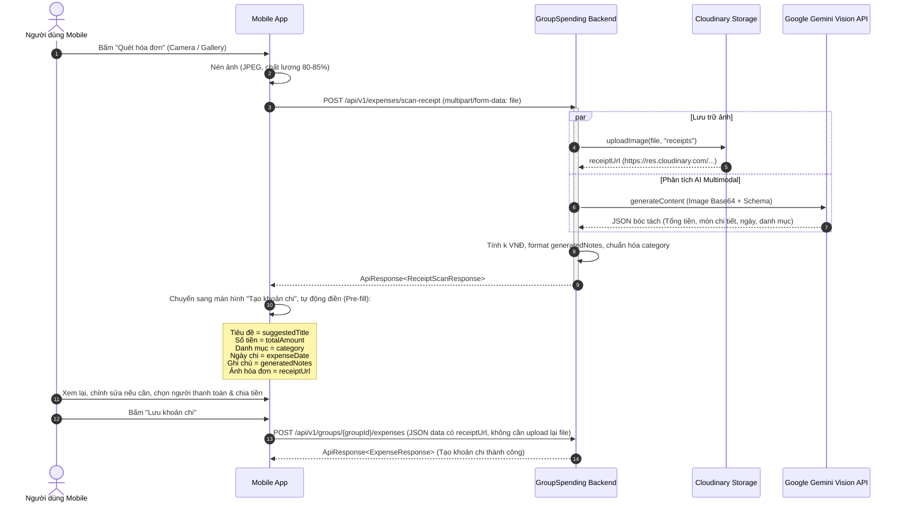

# TÀI LIỆU ĐẶC TẢ TÍCH HỢP API QUÉT HÓA ĐƠN BẰNG AI (MOBILE)

**Dự án:** Group Spending & Reminder (Quản lý & Nhắc nhở Chi tiêu Nhóm)  
**Phân hệ:** Quét & Nhận diện Hóa đơn Chi tiêu bằng AI (AI Receipt OCR & Smart Extraction)  
**Nền tảng mục tiêu:** Mobile App (iOS / Android / Flutter / React Native)  
**Phiên bản tài liệu:** v1.0.0  
**Ngày cập nhật:** 2026-10-09  

---

## MỤC LỤC
1. [Tổng quan tính năng & Luồng trải nghiệm người dùng](#1-tổng-quan-tính-năng--luồng-trải-nghiệm-người-dùng)
2. [Kiến trúc luồng tích hợp (Sequence Diagram)](#2-kiến-trúc-luồng-tích-hợp-sequence-diagram)
3. [Đặc tả Endpoint Quét Hóa Đơn (POST /expenses/scan-receipt)](#3-đặc-tả-endpoint-quét-hóa-đơn-post-expensesscan-receipt)
   - [3.1. Thông tin Endpoint](#31-thông-tin-endpoint)
   - [3.2. Yêu cầu đầu vào (Request)](#32-yêu-cầu-đầu-vào-request)
   - [3.3. Dữ liệu đầu ra (Response)](#33-dữ-liệu-đầu-ra-response)
   - [3.4. Chi tiết các trường dữ liệu trả về](#34-chi-tiết-các-trường-dữ-liệu-trả-về)
4. [Ví dụ thực tế phản hồi theo từng loại hóa đơn](#4-ví-dụ-thực-tế-phản-hồi-theo-từng-loại-hóa-đơn)
   - [4.1. Hóa đơn dịch vụ đồ uống / Ăn uống (Food & Beverage)](#41-hóa-đơn-dịch-vụ-đồ-uống--ăn-uống-food--beverage)
   - [4.2. Hóa đơn siêu thị / Tạp hóa (WinMart / Bách Hóa Xanh)](#42-hóa-đơn-siêu-thị--tạp-hóa-winmart--bách-hóa-xanh)
   - [4.3. Hóa đơn điện tử tiện ích (EVN / Tiền nước)](#43-hóa-đơn-điện-tử-tiện-ích-evn--tiền-nước)
   - [4.4. Hóa đơn mờ / Không nhận diện được (Low Confidence Fallback)](#44-hóa-đơn-mờ--không-nhận-diện-được-low-confidence-fallback)
5. [Hướng dẫn tích hợp luồng 2 bước trên Mobile App (Best Practices)](#5-hướng-dẫn-tích-hợp-luồng-2-bước-trên-mobile-app-best-practices)
   - [5.1. Nén ảnh phía Client trước khi gửi](#51-nén-ảnh-phía-client-trước-khi-gửi)
   - [5.2. Pre-fill dữ liệu vào Form Tạo Khoản Chi](#52-pre-fill-dữ-liệu-vào-form-tạo-khoản-chi)
   - [5.3. Tái sử dụng receiptUrl khi gọi POST /groups/{groupId}/expenses](#53-tái-sử-dụng-receipturl-khi-gọi-post-groupsgroupidexpenses)
6. [Bảng mã lỗi (Error Codes)](#6-bảng-mã-lỗi-error-codes)

---

## 1. TỔNG QUAN TÍNH NĂNG & LUỒNG TRẢI NGHIỆM NGƯỜI DÙNG

Tính năng **AI Receipt Scanner** hỗ trợ người dùng chụp ảnh hóa đơn từ Camera hoặc chọn ảnh chụp có sẵn trong Thư viện (Gallery) để AI tự động:
1. **Trích xuất tổng số tiền phải trả**: Nhận diện số tiền VNĐ gốc và tự động quy đổi sang đơn vị chuẩn `k VNĐ` của ứng dụng.
2. **Liệt kê chi tiết các món/dịch vụ**: Bóc tách tên sản phẩm, số lượng, đơn giá và tự động định dạng thành văn bản ghi chú đẹp mắt (`generatedNotes`).
3. **Tự động suy luận thể loại chi tiêu**: Ánh xạ thông minh vào các nhóm chi tiêu chuẩn hóa của hệ thống (`Food`, `Transport`, `Shopping`, `Entertaiment`, `Housing`, `Grocerise`, `Healthcare`, `Others`).
4. **Gợi ý tiêu đề và ngày chi**: Tự động lấy tên cửa hàng/siêu thị và ngày in trên hóa đơn.
5. **Lưu trữ ảnh đám mây Cloudinary**: Tự động upload ảnh lưu trữ và trả về `receiptUrl` để Mobile App không cần upload ảnh lại lần thứ hai.

---

## 2. KIẾN TRÚC LUỒNG TÍCH HỢP (SEQUENCE DIAGRAM)



---

## 3. ĐẶC TẢ ENDPOINT QUÉT HÓA ĐƠN (POST /expenses/scan-receipt)

### 3.1. Thông tin Endpoint
- **Phương thức:** `POST`
- **Đường dẫn (URL):** `/api/v1/expenses/scan-receipt`
- **Yêu cầu xác thực:** Bắt buộc Access Token (`Authorization: Bearer <accessToken>`)
- **Content-Type:** `multipart/form-data`
- **Accept:** `application/json`

### 3.2. Yêu cầu đầu vào (Request)

| Tên trường | Kiểu dữ liệu | Bắt buộc | Mô tả |
| :--- | :--- | :---: | :--- |
| `file` | `MultipartFile` (Binary) | **Có** | File ảnh hóa đơn (JPEG, PNG, WEBP, HEIC), kích thước tối đa 10MB. |

### 3.3. Dữ liệu đầu ra (Response)

```json
{
  "success": true,
  "message": "Quét hóa đơn thành công",
  "data": {
    "merchantName": "Highlands Coffee",
    "suggestedTitle": "Ăn uống Highlands Coffee",
    "totalAmount": 155,
    "totalAmountVnd": 154500,
    "rawTotalAmount": "154.500 đ",
    "category": "Food",
    "categoryReasoning": "Hóa đơn dịch vụ đồ uống và cafe tại Highlands Coffee",
    "expenseDate": "2026-10-09",
    "confidence": "HIGH",
    "lineItems": [
      {
        "itemName": "Trà sen vàng (Size L)",
        "quantity": 2,
        "unitPriceVnd": 55000,
        "totalPriceVnd": 110000
      },
      {
        "itemName": "Bánh mì que pate",
        "quantity": 1,
        "unitPriceVnd": 19000,
        "totalPriceVnd": 19000
      }
    ],
    "generatedNotes": "[Highlands Coffee]\nChi tiết các món/mục:\n- 2x Trà sen vàng (Size L): 110.000đ\n- Bánh mì que pate: 19.000đ\n---\nTổng cộng: 154.500đ",
    "receiptUrl": "https://res.cloudinary.com/demo/image/upload/v1728448800/receipts/bill_abc123.jpg"
  },
  "timestamp": "2026-10-09T04:10:00Z"
}
```

### 3.4. Chi tiết các trường dữ liệu trả về

| Tên trường | Kiểu dữ liệu | Ý nghĩa & Hướng dẫn sử dụng trên Mobile |
| :--- | :--- | :--- |
| `merchantName` | `String` | Tên nhà cung cấp / cửa hàng xuất bill (hoặc `null` nếu không tìm thấy). |
| `suggestedTitle` | `String` | Tiêu đề gợi ý ngắn gọn. **Điền trực tiếp vào ô `title`** của form tạo khoản chi. |
| `totalAmount` | `Long` | Tổng tiền quy đổi sang đơn vị rút gọn **(k VNĐ)** theo chuẩn backend. **Điền trực tiếp vào ô `totalAmount`** của `CreateExpenseRequest`. *(Ví dụ: `155` = 155.000 VNĐ)*. |
| `totalAmountVnd` | `Long` | Tổng số tiền đầy đủ tính theo đơn vị VNĐ (Ví dụ: `154500`). Dùng để hiển thị nhãn phụ tiền tệ chính xác cho người dùng kiểm tra. |
| `rawTotalAmount` | `String` | Chuỗi ký tự số tiền nguyên gốc đọc được trên hóa đơn (Ví dụ: `"154.500 đ"`). |
| `category` | `ExpenseCategoryType` | Thể loại chi tiêu chuẩn hóa (`Food`, `Transport`, `Shopping`, `Entertaiment`, `Housing`, `Grocerise`, `Healthcare`, `Others`). **Dùng để tự động chọn giá trị trong combo box Thể loại**. |
| `categoryReasoning`| `String` | Lý do AI chọn thể loại này (Hiển thị tooltip hoặc dòng phụ giúp người dùng hiểu vì sao AI chọn). |
| `expenseDate` | `LocalDate` (`YYYY-MM-DD`) | Ngày chi tiêu trên hóa đơn. **Điền trực tiếp vào ô chọn ngày** của form. |
| `confidence` | `String` | Mức độ tin cậy: `"HIGH"`, `"MEDIUM"`, `"LOW"`. |
| `lineItems` | `Array<ReceiptLineItemDto>`| Danh sách các sản phẩm/dịch vụ chi tiết bóc tách được từ hóa đơn. |
| `generatedNotes` | `String` | Đoạn văn bản format sẵn chứa chi tiết các món và tổng tiền. **Điền trực tiếp vào ô Ghi chú (`notes`)** của form. |
| `receiptUrl` | `String` | Đường dẫn ảnh trên Cloudinary. **Hiển thị ảnh xem trước** và truyền vào trường `receiptUrl` trong payload tạo khoản chi. |

---

## 4. VÍ DỤ THỰC TẾ PHẢN HỒI THEO TỪNG LOẠI HÓA ĐƠN

### 4.1. Hóa đơn dịch vụ đồ uống / Ăn uống (Food & Beverage)
```json
{
  "merchantName": "The Coffee House",
  "suggestedTitle": "Ăn uống The Coffee House",
  "totalAmount": 105,
  "totalAmountVnd": 105000,
  "rawTotalAmount": "105.000 đ",
  "category": "Food",
  "categoryReasoning": "Hóa đơn dịch vụ ăn uống và đồ uống",
  "expenseDate": "2026-10-09",
  "confidence": "HIGH",
  "lineItems": [
    { "itemName": "Cà phê sữa đá (L)", "quantity": 1, "unitPriceVnd": 45000, "totalPriceVnd": 45000 },
    { "itemName": "Trà đào cam sả (M)", "quantity": 1, "unitPriceVnd": 60000, "totalPriceVnd": 60000 }
  ],
  "generatedNotes": "[The Coffee House]\nChi tiết các món/mục:\n- Cà phê sữa đá (L): 45.000đ\n- Trà đào cam sả (M): 60.000đ\n---\nTổng cộng: 105.000đ",
  "receiptUrl": "https://res.cloudinary.com/demo/image/upload/v1234/receipts/bill1.jpg"
}
```

### 4.2. Hóa đơn siêu thị / Tạp hóa (WinMart / Bách Hóa Xanh)
```json
{
  "merchantName": "WinMart+",
  "suggestedTitle": "Mua thực phẩm WinMart+",
  "totalAmount": 86,
  "totalAmountVnd": 86200,
  "rawTotalAmount": "86.200 đ",
  "category": "Grocerise",
  "categoryReasoning": "Hóa đơn mua thực phẩm và nhu yếu phẩm tại siêu thị WinMart+",
  "expenseDate": "2026-10-09",
  "confidence": "HIGH",
  "lineItems": [
    { "itemName": "Sữa chua Vinamilk 4 hộp", "quantity": 1, "unitPriceVnd": 28000, "totalPriceVnd": 28000 },
    { "itemName": "Bánh mì sandwich", "quantity": 1, "unitPriceVnd": 22000, "totalPriceVnd": 22000 },
    { "itemName": "Trứng gà tươi hộp 10 quả", "quantity": 1, "unitPriceVnd": 36200, "totalPriceVnd": 36200 }
  ],
  "generatedNotes": "[WinMart+]\nChi tiết các món/mục:\n- Sữa chua Vinamilk 4 hộp: 28.000đ\n- Bánh mì sandwich: 22.000đ\n- Trứng gà tươi hộp 10 quả: 36.200đ\n---\nTổng cộng: 86.200đ",
  "receiptUrl": "https://res.cloudinary.com/demo/image/upload/v1234/receipts/bill2.jpg"
}
```

### 4.3. Hóa đơn điện tử tiện ích (EVN / Tiền nước)
```json
{
  "merchantName": "Tổng công ty Điện lực Hà Nội - EVN",
  "suggestedTitle": "Tiền điện EVN T10",
  "totalAmount": 650,
  "totalAmountVnd": 650000,
  "rawTotalAmount": "650.000 đ",
  "category": "Housing",
  "categoryReasoning": "Hóa đơn tiền điện sinh hoạt định kỳ",
  "expenseDate": "2026-10-05",
  "confidence": "HIGH",
  "lineItems": [],
  "generatedNotes": "[Tổng công ty Điện lực Hà Nội - EVN]\nTổng tiền: 650.000đ",
  "receiptUrl": "https://res.cloudinary.com/demo/image/upload/v1234/receipts/evn_bill.jpg"
}
```

### 4.4. Hóa đơn mờ / Không nhận diện được (Low Confidence Fallback)
Khi ảnh bị mờ, chụp lệch góc hoặc không nhận dạng được chữ số, Backend **vẫn giữ lại `receiptUrl`** và trả về `confidence: "LOW"`:
```json
{
  "merchantName": null,
  "suggestedTitle": "Khoản chi mới",
  "totalAmount": null,
  "totalAmountVnd": null,
  "rawTotalAmount": null,
  "category": "Others",
  "categoryReasoning": "Không nhận diện được nội dung tự động do lỗi kết nối hoặc ảnh mờ. Vui lòng tự nhập thông tin.",
  "expenseDate": "2026-10-09",
  "confidence": "LOW",
  "lineItems": [],
  "generatedNotes": "",
  "receiptUrl": "https://res.cloudinary.com/demo/image/upload/v1234/receipts/blurred_bill.jpg"
}
```
> 💡 **Khuyến nghị Mobile UI:** Nếu `confidence == "LOW"`, ứng dụng hiển thị thông báo nhẹ: *"Ảnh mờ hoặc không nhận dạng được chữ. Ảnh đã được lưu, vui lòng tự nhập số tiền và tiêu đề."* mà **không làm gián đoạn trải nghiệm** của người dùng.

---

## 5. HƯỚNG DẪN TÍCH HỢP LUỒNG 2 BƯỚC TRÊN MOBILE APP (BEST PRACTICES)

### 5.1. Nén ảnh phía Client trước khi gửi
- Các thiết bị điện thoại đời mới có camera độ phân giải cao chụp ảnh nặng từ 6MB - 15MB.
- Trước khi gửi qua multipart, Mobile App nên resize ảnh:
  - Chiều dài cạnh tối đa: `2048px`.
  - Chất lượng nén JPEG: `80% - 85%`.
  - Dung lượng sau nén thường chỉ khoảng `500KB - 1.5MB`, giúp tốc độ tải lên và thời gian phản hồi AI nhanh gấp 3 lần.

### 5.2. Pre-fill dữ liệu vào Form Tạo Khoản Chi
Khi nhận được kết quả từ `/expenses/scan-receipt`:
1. Điều hướng người dùng đến màn hình **Tạo Khoản Chi**.
2. Điền sẵn các trường:
   - `Tiêu đề (title)` = `data.suggestedTitle`
   - `Tổng số tiền (totalAmount)` = `data.totalAmount`
   - `Thể loại chi tiêu (category)` = `data.category` (hiển thị icon và tên tương ứng)
   - `Ngày chi tiêu (expenseDate)` = `data.expenseDate`
   - `Ghi chú (notes)` = `data.generatedNotes`
   - `Ảnh đính kèm` = hiển thị ảnh từ `data.receiptUrl`
3. Cho phép người dùng chỉnh sửa bất kỳ trường nào nếu muốn thay đổi.

### 5.3. Tái sử dụng receiptUrl khi gọi POST /groups/{groupId}/expenses
Khi người dùng bấm **Xác nhận tạo khoản chi**, Mobile gọi API tạo khoản chi hiện có:
- **Endpoint:** `POST /api/v1/groups/{groupId}/expenses`
- **Request Part `data` (JSON):**
  ```json
  {
    "title": "Ăn uống Highlands Coffee",
    "totalAmount": 155,
    "paidByUserId": 1,
    "category": "Food",
    "splitOption": "EQUAL_ALL",
    "expenseDate": "2026-10-09",
    "notes": "[Highlands Coffee]\nChi tiết các món/mục:\n- 2x Trà sen vàng (Size L): 110.000đ\n- Bánh mì que pate: 19.000đ\n---\nTổng cộng: 154.500đ",
    "receiptUrl": "https://res.cloudinary.com/demo/image/upload/v1728448800/receipts/bill_abc123.jpg"
  }
  ```
- **Request Part `receipt` (File):** **Bỏ trống (null)** vì ảnh đã được lưu trữ trên Cloudinary từ bước scan trước đó!

---

## 6. BẢNG MÃ LỖI (ERROR CODES)

| HTTP Status | Mã lỗi (`code`) | Mô tả | Hướng xử lý UI trên Mobile |
| :---: | :--- | :--- | :--- |
| `400 Bad Request` | `RECEIPT_FILE_INVALID` | Tệp tải lên rỗng hoặc không phải định dạng ảnh hợp lệ. | Báo người dùng chọn lại tệp ảnh hợp lệ. |
| `400 Bad Request` | `RECEIPT_OCR_FAILED` | Không thể trích xuất thông tin hóa đơn. | Hiển thị thông báo gợi ý chụp lại góc thẳng và đủ sáng hơn. |
| `503 Service Unavailable` | `AI_SERVICE_UNAVAILABLE`| Dịch vụ AI tạm thời gián đoạn. | Báo người dùng thử lại sau hoặc chuyển sang nhập tay. |
