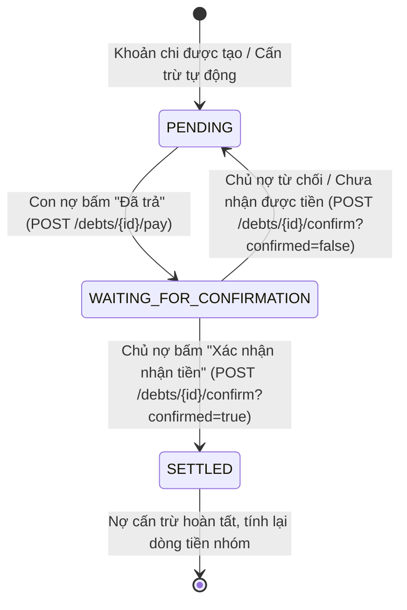

# TÀI LIỆU ĐẶC TẢ TÍCH HỢP API QUẢN LÝ CÔNG NỢ & THANH TOÁN (MOBILE)

**Dự án:** Group Spending & Reminder (Quản lý & Nhắc nhở Chi tiêu Nhóm)  
**Phân hệ:** Quản lý Công nợ & Quyết toán (Debt & Settlement Management)  
**Nền tảng mục tiêu:** Mobile App (iOS / Android / Flutter / React Native)  
**Phiên bản tài liệu:** v1.0.0  
**Ngày cập nhật:** 2026-09-28  

---

## MỤC LỤC
1. [Quy chuẩn chung & Định dạng dữ liệu](#1-quy-chuẩn-chung--định-dạng-dữ-liệu)
   - [1.1. Base URL & Authentication](#11-base-url--authentication)
   - [1.2. Cấu trúc phản hồi chung (ApiResponse Pattern)](#12-cấu-trúc-phản-hồi-chung-apiresponse-pattern)
   - [1.3. Bảng Enum dùng chung](#13-bảng-enum-dùng-chung)
   - [1.4. Quy ước tiền tệ & Đơn vị tính](#14-quy-ước-tiền-tệ--đơn-vị-tính)
2. [Mô hình nghiệp vụ & Luồng tương tác (Business Flow)](#2-mô-hình-nghiệp-vụ--luồng-tương-tác-business-flow)
   - [2.1. Quy trình quyết toán công nợ 2 bước (2-Step Settlement Lifecycle)](#21-quy-trình-quyết-toán-công-nợ-2-bước-2-step-settlement-lifecycle)
   - [2.2. Hai góc nhìn công nợ trong nhóm (Dual Debt Views)](#22-hai-góc-nhìn-công-nợ-trong-nhóm-dual-debt-views)
   - [2.3. Cơ chế phân quyền hành động thông minh (`action: DebtAction`)](#23-cơ-chế-phân-quyền-hành-động-thông-minh-action-debtaction)
3. [Đặc tả chi tiết các API Endpoints](#3-đặc-tả-chi-tiết-các-api-endpoints)
   - [3.1. Lấy tổng quan số dư công nợ của người dùng (Get User Balance Overview)](#31-lấy-tổng-quan-số-dư-công-nợ-của-người-dùng-get-user-balance-overview)
   - [3.2. Lấy danh sách công nợ tối giản theo nhóm (Get Group Simplified Debts)](#32-lấy-danh-sách-công-nợ-tối-giản-theo-nhóm-get-group-simplified-debts)
   - [3.3. Lấy kết quả tình hình nợ thực tế theo nhóm (Get Group Actual Debts)](#33-lấy-kết-quả-tình-hình-nợ-thực-tế-theo-nhóm-get-group-actual-debts)
   - [3.4. Con nợ đánh dấu đã trả tiền (Mark Debt As Paid)](#34-con-nợ-đánh-dấu-đã-trả-tiền-mark-debt-as-paid)
   - [3.5. Chủ nợ xác nhận hoặc từ chối đã nhận tiền (Confirm Debt Settled)](#35-chủ-nợ-xác-nhận-hoặc-từ-chối-đã-nhận-tiền-confirm-debt-settled)
   - [3.6. Gửi thông báo nhắc nợ thủ công (Send Debt Reminder)](#36-gửi-thông-báo-nhắc-nợ-thủ-công-send-debt-reminder)
   - [3.7. Các API bổ trợ liên quan đến công nợ (Auxiliary APIs)](#37-các-api-bổ-trợ-liên-quan-đến-công-nợ-auxiliary-apis)
5. [Bảng mã lỗi (Error Codes) & Hướng dẫn xử lý UI](#5-bảng-mã-lỗi-error-codes--hướng-dẫn-xử-lý-ui)

---

## 1. QUY CHUẨN CHUNG & ĐỊNH DẠNG DỮ LIỆU

### 1.1. Base URL & Authentication

- **Base URL:** `https://api.groupspending.xyz/api/v1` (Production) hoặc `http://<host>:8080/api/v1` (Local / Staging)
- **Tất cả các API công nợ bắt buộc phải truyền Access Token qua Header:**
  ```http
  Authorization: Bearer <accessToken>
  Content-Type: application/json; charset=UTF-8
  Accept: application/json
  ```

---

### 1.2. Cấu trúc phản hồi chung (ApiResponse Pattern)

Mọi phản hồi từ máy chủ đều tuân theo chuẩn đóng gói sau:

#### Phản hồi thành công (HTTP 200 OK):
```json
{
  "success": true,
  "message": "Thành công",
  "data": { ... },
  "timestamp": "2026-09-28T08:00:00Z"
}
```

#### Phản hồi thất bại do lỗi nghiệp vụ hoặc phân quyền (HTTP 400 / 403 / 404):
```json
{
  "success": false,
  "message": "Chỉ chủ nợ mới có quyền xác nhận đã nhận tiền",
  "errors": null,
  "timestamp": "2026-09-28T08:00:00Z"
}
```

---

### 1.3. Bảng Enum dùng chung

#### `DebtStatus` (Trạng thái khoản nợ)

| Enum Key | Ý nghĩa nghiệp vụ | Trạng thái hiển thị gợi ý |
| :--- | :--- | :--- |
| `PENDING` | Khoản nợ đang chờ thanh toán (chưa ai trả tiền). | Badge màu Cam: **"Chờ thanh toán"** |
| `WAITING_FOR_CONFIRMATION` | Con nợ đã bấm "Đã trả tiền", đang chờ chủ nợ xác nhận nhận được tiền. | Badge màu Xanh lam: **"Chờ xác nhận"** |
| `SETTLED` | Chủ nợ đã xác nhận nhận tiền, nợ đã được cấn trừ hoàn toàn. | Badge màu Xanh lá: **"Đã tất toán"** |

#### `DebtAction` (Hành động khả dụng cho người dùng hiện tại)
Backend tự động tính toán trường `action` trong từng khoản nợ dựa trên vai trò của người gọi API, giúp Mobile **không cần hardcode logic quyền hạn phức tạp**:

| Enum Key | Ý nghĩa | Mobile UI Widget / Nút bấm tương ứng |
| :--- | :--- | :--- |
| `PAY` | Người gọi là **Con nợ** và khoản nợ đang `PENDING`. | Nút màu xanh/chính: **"Thanh toán / Đã trả"** |
| `CONFIRM` | Người gọi là **Chủ nợ** và khoản nợ đang `WAITING_FOR_CONFIRMATION`. | Nút nổi bật: **"Xác nhận nhận tiền"** (kèm tùy chọn từ chối) |
| `REMIND` | Người gọi là **Chủ nợ** hoặc **Admin nhóm** khi nợ đang `PENDING`. | Nút phụ/icon chuông: **"Nhắc nợ"** |
| `NONE` | Người gọi là bên thứ 3 hoặc khoản nợ đã `SETTLED` / không có quyền can thiệp. | Không hiển thị nút tương tác (chỉ xem thông tin) |

#### Phân loại nợ cá nhân (`PeerDebtSummary.type`)

| Chuỗi giá trị | Ý nghĩa | Màu sắc gợi ý trên UI |
| :--- | :--- | :--- |
| `YOU_OWE` | Người dùng hiện tại đang nợ đối tác (Cần trả). | Đỏ / Cam (`#E53935` / `-`) |
| `OWED_TO_YOU` | Đối tác đang nợ người dùng hiện tại (Cần thu). | Xanh lá (`#43A047` / `+`) |

---

### 1.4. Quy ước tiền tệ & Đơn vị tính

Backend hỗ trợ đồng thời hai đơn vị tiền tệ để tiện lợi cho Mobile:
- **`amount` / `totalOwed` / `youOwe` / `netBalance`:** Đơn vị nghìn Đồng (k VNĐ). Ví dụ: `150` tương ứng 150.000 VNĐ.
- **`amountVnd` / `totalOwedVnd` / `youOweVnd` / `netBalanceVnd`:** Đơn vị VNĐ nguyên vẹn (`amount * 1000`). Ví dụ: `150000`.

> **KHUYẾN NGHỊ CHO MOBILE:**
> 1. Luôn sử dụng các trường có hậu tố **`Vnd`** để định dạng hiển thị với locale của hệ thống (`NumberFormat.currency(locale: 'vi_VN', symbol: '₫')`).
> 2. `netBalanceVnd > 0`: Bạn đang được nhận lại tiền (Số dư ròng dương, hiển thị màu xanh lá).
> 3. `netBalanceVnd < 0`: Bạn đang phải trả tiền nợ (Số dư ròng âm, hiển thị màu đỏ/cam).
> 4. `netBalanceVnd == 0`: Bạn đã cân bằng công nợ.

---

## 2. MÔ HÌNH NGHIỆP VỤ & LUỒNG TƯƠNG TÁC (BUSINESS FLOW)

### 2.1. Quy trình quyết toán công nợ 2 bước (2-Step Settlement Lifecycle)

Hệ thống áp dụng quy trình xác nhận 2 bước chống gian lận (Anti-fraud 2-step verification):



1. **Bước 1 (Con nợ thanh toán):** Con nợ chuyển khoản ngoài thực tế (VietQR / Ngân hàng) hoặc trả tiền mặt cho Chủ nợ. Sau đó bấm **"Đã trả"** trên app (`POST /debts/{id}/pay`). Trạng thái chuyển sang `WAITING_FOR_CONFIRMATION`. Hệ thống gửi Push Notification cho Chủ nợ.
2. **Bước 2 (Chủ nợ xác nhận):** 
   - Nếu đã nhận đủ tiền: Chủ nợ bấm **"Xác nhận nhận tiền"** (`POST /debts/{id}/confirm?confirmed=true`). Nợ chuyển sang `SETTLED`, cấn trừ nợ và cập nhật công nợ nhóm ngay tức thì.
   - Nếu chưa nhận được: Chủ nợ bấm **"Từ chối"** (`POST /debts/{id}/confirm?confirmed=false`). Nợ quay về `PENDING`, gửi Push cảnh báo cho con nợ.

---

### 2.2. Hai góc nhìn công nợ trong nhóm (Dual Debt Views)

Trong mỗi nhóm chi tiêu, Mobile cần cung cấp 2 chế độ xem công nợ (có thể dùng Tab Bar hoặc Segmented Control):

1. **Công nợ tối giản (Simplified Debts - Khuyến nghị xem chính):**
   - Chạy thuật toán tối ưu hóa luồng tiền ròng (*Greedy Cash Flow Simplification*).
   - Tối thiểu hóa số lượng giao dịch chuyển khoản giữa các thành viên trong nhóm.
   - *Ví dụ:* Thành viên A nợ B 100k, B nợ C 100k. Thuật toán tối giản: Chỉ cần A trả trực tiếp cho C 100k (B không cần làm gì).
   - Các khoản nợ trong danh sách này đại diện cho các lệnh chuyển khoản tối ưu nhất.

2. **Công nợ thực tế (Actual Debts):**
   - Danh sách các khoản nợ thực tế được lưu vết trong cơ sở dữ liệu giữa từng cặp thành viên (ai nợ ai bao nhiêu tiền, từ các khoản chi tiêu nào đã trừ đi các khoản đã trả).
   - Cho phép lọc theo trạng thái (`PENDING`, `WAITING_FOR_CONFIRMATION`, `SETTLED`).
   - Phù hợp khi người dùng muốn kiểm tra tính minh bạch và lịch sử chi tiết.

---

### 2.3. Cơ chế phân quyền hành động thông minh (`action: DebtAction`)

Backend tự động gắn trường `action` trong mỗi đối tượng nợ trả về:

| Điều kiện xác định | Giá trị `action` |
| :--- | :--- |
| Nợ đã tất toán (`status == SETTLED`) | `NONE` |
| Nợ đang chờ xác nhận (`status == WAITING_FOR_CONFIRMATION`) và người gọi là **Chủ nợ** | `CONFIRM` |
| Nợ đang chờ xác nhận (`status == WAITING_FOR_CONFIRMATION`) và người gọi **không phải Chủ nợ** | `NONE` |
| Nợ chưa trả (`status == PENDING`) và người gọi là **Con nợ** | `PAY` |
| Nợ chưa trả (`status == PENDING`) và người gọi là **Chủ nợ** hoặc **Admin nhóm** | `REMIND` |
| Các trường hợp còn lại (người thứ 3 trong nhóm) | `NONE` |

---

## 3. ĐẶC TẢ CHI TIẾT CÁC API ENDPOINTS

### 3.1. Lấy tổng quan số dư công nợ của người dùng (Get User Balance Overview)

API này phục vụ màn hình **"Tổng quan Công nợ"** (Dashboard hoặc Tab Tài chính cá nhân). Trả về tổng tiền người dùng đang nợ người khác, tổng tiền người khác nợ mình, số dư ròng, chi tiết công nợ gom theo từng nhóm và danh sách từng đối tác (peer).

- **Method:** `GET`
- **Path:** `/debts/overview`
- **Full URL:** `/api/v1/debts/overview`
- **Header:**
  ```http
  Authorization: Bearer <accessToken>
  ```
- **Mã phản hồi thành công:** `200 OK`
- **Response Body mẫu:**
```json
{
  "success": true,
  "message": "Thành công",
  "data": {
    "totalOwed": 250,
    "totalOwedVnd": 250000,
    "totalReceivable": 600,
    "totalReceivableVnd": 600000,
    "netBalance": 350,
    "netBalanceVnd": 350000,
    "groupBalances": [
      {
        "groupId": 10,
        "groupName": "Nhóm bạn cấp 3",
        "youOwe": 100,
        "youOweVnd": 100000,
        "youAreOwed": 450,
        "youAreOwedVnd": 450000,
        "netBalance": 350,
        "netBalanceVnd": 350000
      },
      {
        "groupId": 12,
        "groupName": "Căn hộ chung cư 402",
        "youOwe": 150,
        "youOweVnd": 150000,
        "youAreOwed": 150,
        "youAreOwedVnd": 150000,
        "netBalance": 0,
        "netBalanceVnd": 0
      }
    ],
    "details": [
      {
        "debtId": 101,
        "groupId": 10,
        "groupName": "Nhóm bạn cấp 3",
        "peerId": 5,
        "peerName": "Trần Thị B",
        "peerAvatar": "https://cdn.example.com/avatar/user5.jpg",
        "amount": 450,
        "amountVnd": 450000,
        "type": "OWED_TO_YOU",
        "status": "PENDING",
        "createdAt": "2026-09-27T10:15:00Z"
      },
      {
        "debtId": 105,
        "groupId": 12,
        "groupName": "Căn hộ chung cư 402",
        "peerId": 8,
        "peerName": "Lê Văn C",
        "peerAvatar": "https://cdn.example.com/avatar/user8.jpg",
        "amount": 150,
        "amountVnd": 150000,
        "type": "YOU_OWE",
        "status": "WAITING_FOR_CONFIRMATION",
        "createdAt": "2026-09-26T15:30:00Z"
      }
    ]
  },
  "timestamp": "2026-09-28T08:05:00Z"
}
```

- **Mô tả các trường dữ liệu quan trọng:**
  - `totalOwedVnd`: Tổng số tiền người dùng cần thanh toán cho mọi người từ tất cả các nhóm.
  - `totalReceivableVnd`: Tổng số tiền người dùng sắp nhận lại từ tất cả mọi người.
  - `netBalanceVnd`: Số dư ròng tổng thể (`totalReceivableVnd - totalOwedVnd`).
  - `groupBalances`: Danh sách phân rã số dư theo từng nhóm người dùng tham gia.
  - `details`: Danh sách các khoản nợ chưa tất toán (`PENDING` và `WAITING_FOR_CONFIRMATION`) kèm đối tác liên quan (`peerId`, `peerName`, `peerAvatar`).

---

### 3.2. Lấy danh sách công nợ tối giản theo nhóm (Get Group Simplified Debts)

Chạy thuật toán luân chuyển dòng tiền nhằm tối ưu hóa số lượng giao dịch chuyển khoản giữa các thành viên trong một nhóm. Đi kèm số dư cá nhân của người dùng trong nhóm này và hành động tương tác (`action`).

- **Method:** `GET`
- **Path:** `/groups/{groupId}/debts/simplified`
- **Full URL:** `/api/v1/groups/{groupId}/debts/simplified`
- **Path Variables:**

| Tên biến | Kiểu dữ liệu | Bắt buộc | Mô tả |
| :--- | :--- | :--- | :--- |
| `groupId` | Long | Có | ID của nhóm cần xem công nợ |

- **Header:**
  ```http
  Authorization: Bearer <accessToken>
  ```
- **Mã phản hồi thành công:** `200 OK`
- **Response Body mẫu:**
```json
{
  "success": true,
  "message": "Thành công",
  "data": {
    "userBalance": {
      "groupId": 10,
      "groupName": "Nhóm bạn cấp 3",
      "youOwe": 0,
      "youOweVnd": 0,
      "youAreOwed": 350,
      "youAreOwedVnd": 350000,
      "netBalance": 350,
      "netBalanceVnd": 350000
    },
    "simplifiedDebts": [
      {
        "debtorId": 2,
        "debtorName": "Nguyễn Văn B",
        "debtorAvatar": "https://cdn.example.com/avatar/user2.jpg",
        "creditorId": 1,
        "creditorName": "Tôi (Người dùng hiện tại)",
        "creditorAvatar": "https://cdn.example.com/avatar/user1.jpg",
        "amount": 350,
        "amountVnd": 350000,
        "action": "REMIND"
      },
      {
        "debtorId": 3,
        "debtorName": "Hoàng Minh C",
        "debtorAvatar": "https://cdn.example.com/avatar/user3.jpg",
        "creditorId": 4,
        "creditorName": "Đặng Thị D",
        "creditorAvatar": "https://cdn.example.com/avatar/user4.jpg",
        "amount": 120,
        "amountVnd": 120000,
        "action": "NONE"
      }
    ]
  },
  "timestamp": "2026-09-28T08:10:00Z"
}
```

- **Mã lỗi thường gặp:**
  - `403 Forbidden`: `NOT_GROUP_MEMBER` - Người dùng không phải thành viên nhóm.
  - `404 Not Found`: `GROUP_NOT_FOUND` - Nhóm không tồn tại.

---

### 3.3. Lấy kết quả tình hình nợ thực tế theo nhóm (Get Group Actual Debts)

Lấy danh sách các khoản nợ thực tế được tính toán và lưu trong CSDL giữa từng cặp thành viên trong nhóm. Hỗ trợ lọc theo trạng thái và trả về `action` cụ thể cho từng khoản nợ.

- **Method:** `GET`
- **Path:** `/groups/{groupId}/debts/actual`
- **Full URL:** `/api/v1/groups/{groupId}/debts/actual`
- **Path Variables:**

| Tên biến | Kiểu dữ liệu | Bắt buộc | Mô tả |
| :--- | :--- | :--- | :--- |
| `groupId` | Long | Có | ID của nhóm |

- **Query Parameters:**

| Tên tham số | Kiểu dữ liệu | Bắt buộc | Mặc định | Mô tả |
| :--- | :--- | :--- | :--- | :--- |
| `status` | String (`DebtStatus`) | Không | *null* (Lấy tất cả) | Bộ lọc trạng thái nợ: `PENDING`, `WAITING_FOR_CONFIRMATION`, `SETTLED` |

- **Header:**
  ```http
  Authorization: Bearer <accessToken>
  ```
- **Mã phản hồi thành công:** `200 OK`
- **Response Body mẫu:**
```json
{
  "success": true,
  "message": "Thành công",
  "data": {
    "userBalance": {
      "groupId": 10,
      "groupName": "Nhóm bạn cấp 3",
      "youOwe": 50,
      "youOweVnd": 50000,
      "youAreOwed": 400,
      "youAreOwedVnd": 400000,
      "netBalance": 350,
      "netBalanceVnd": 350000
    },
    "actualDebts": [
      {
        "id": 101,
        "groupId": 10,
        "debtorId": 1,
        "debtorName": "Tôi (Người dùng hiện tại)",
        "debtorAvatar": "https://cdn.example.com/avatar/user1.jpg",
        "creditorId": 2,
        "creditorName": "Nguyễn Văn B",
        "creditorAvatar": "https://cdn.example.com/avatar/user2.jpg",
        "amount": 50,
        "amountVnd": 50000,
        "status": "PENDING",
        "settledAt": null,
        "createdAt": "2026-09-27T08:00:00Z",
        "action": "PAY"
      },
      {
        "id": 102,
        "groupId": 10,
        "debtorId": 3,
        "debtorName": "Hoàng Minh C",
        "debtorAvatar": "https://cdn.example.com/avatar/user3.jpg",
        "creditorId": 1,
        "creditorName": "Tôi (Người dùng hiện tại)",
        "creditorAvatar": "https://cdn.example.com/avatar/user1.jpg",
        "amount": 200,
        "amountVnd": 200000,
        "status": "WAITING_FOR_CONFIRMATION",
        "settledAt": null,
        "createdAt": "2026-09-27T09:30:00Z",
        "action": "CONFIRM"
      },
      {
        "id": 99,
        "groupId": 10,
        "debtorId": 4,
        "debtorName": "Đặng Thị D",
        "debtorAvatar": "https://cdn.example.com/avatar/user4.jpg",
        "creditorId": 1,
        "creditorName": "Tôi (Người dùng hiện tại)",
        "creditorAvatar": "https://cdn.example.com/avatar/user1.jpg",
        "amount": 100,
        "amountVnd": 100000,
        "status": "SETTLED",
        "settledAt": "2026-09-27T11:00:00Z",
        "createdAt": "2026-09-26T14:00:00Z",
        "action": "NONE"
      }
    ]
  },
  "timestamp": "2026-09-28T08:15:00Z"
}
```

- **Mã lỗi thường gặp:**
  - `403 Forbidden`: `NOT_GROUP_MEMBER` - Người dùng không thuộc nhóm này.
  - `404 Not Found`: `GROUP_NOT_FOUND` - Nhóm không tồn tại.

---

### 3.4. Con nợ đánh dấu đã trả tiền (Mark Debt As Paid)

Sau khi chuyển khoản ngân hàng hoặc trả tiền mặt, con nợ gọi API này để báo đã trả tiền. Khoản nợ chuyển sang `WAITING_FOR_CONFIRMATION` và hệ thống tự động bắn Push Notification cho chủ nợ.

- **Method:** `POST`
- **Path:** `/debts/{debtId}/pay`
- **Full URL:** `/api/v1/debts/{debtId}/pay`
- **Path Variables:**

| Tên biến | Kiểu dữ liệu | Bắt buộc | Mô tả |
| :--- | :--- | :--- | :--- |
| `debtId` | Long | Có | ID của khoản nợ cần thanh toán |

- **Header:**
  ```http
  Authorization: Bearer <accessToken>
  ```
- **Request Body:** Không có.

- **Mã phản hồi thành công:** `200 OK`
- **Response Body mẫu:**
```json
{
  "success": true,
  "message": "Đã gửi yêu cầu xác nhận trả nợ",
  "data": {
    "id": 101,
    "groupId": 10,
    "debtorId": 1,
    "debtorName": "Nguyễn Văn A",
    "debtorAvatar": "https://cdn.example.com/avatar/user1.jpg",
    "creditorId": 2,
    "creditorName": "Trần Văn B",
    "creditorAvatar": "https://cdn.example.com/avatar/user2.jpg",
    "amount": 150,
    "amountVnd": 150000,
    "status": "WAITING_FOR_CONFIRMATION",
    "settledAt": null,
    "createdAt": "2026-09-27T08:00:00Z",
    "action": "NONE"
  },
  "timestamp": "2026-09-28T08:20:00Z"
}
```

- **Mã lỗi thường gặp:**
  - `400 Bad Request`: *"Chỉ người nợ tiền mới có thể đánh dấu 'Đã trả'"* (khi `currentUserId != debtorId`).
  - `400 Bad Request`: *"Khoản nợ này hiện đang ở trạng thái: WAITING_FOR_CONFIRMATION"* hoặc `SETTLED` (khoản nợ không ở `PENDING`).
  - `404 Not Found`: `DEBT_NOT_FOUND` - Khoản nợ không tồn tại.

---

### 3.5. Chủ nợ xác nhận hoặc từ chối đã nhận tiền (Confirm Debt Settled)

Chủ nợ sau khi kiểm tra tài khoản ngân hàng gọi API này để xác nhận đã nhận tiền hoặc từ chối.
- Nếu `confirmed = true`: Trạng thái chuyển sang `SETTLED`, cấn trừ nợ và tính toán lại công nợ nhóm tức thì.
- Nếu `confirmed = false`: Trạng thái quay trở về `PENDING` để con nợ thanh toán lại.

- **Method:** `POST`
- **Path:** `/debts/{debtId}/confirm`
- **Full URL:** `/api/v1/debts/{debtId}/confirm`
- **Path Variables:**

| Tên biến | Kiểu dữ liệu | Bắt buộc | Mô tả |
| :--- | :--- | :--- | :--- |
| `debtId` | Long | Có | ID của khoản nợ |

- **Query Parameters:**

| Tên tham số | Kiểu dữ liệu | Bắt buộc | Mô tả |
| :--- | :--- | :--- | :--- |
| `confirmed` | Boolean | Có | `true`: Xác nhận đã nhận tiền (tất toán nợ).<br>`false`: Từ chối xác nhận (chưa nhận được tiền). |

- **Header:**
  ```http
  Authorization: Bearer <accessToken>
  ```
- **Request Body:** Không có.

- **Mã phản hồi thành công khi `confirmed=true`:** `200 OK`
```json
{
  "success": true,
  "message": "Đã xác nhận nhận tiền thành công",
  "data": {
    "id": 101,
    "groupId": 10,
    "debtorId": 1,
    "debtorName": "Nguyễn Văn A",
    "debtorAvatar": "https://cdn.example.com/avatar/user1.jpg",
    "creditorId": 2,
    "creditorName": "Trần Văn B",
    "creditorAvatar": "https://cdn.example.com/avatar/user2.jpg",
    "amount": 150,
    "amountVnd": 150000,
    "status": "SETTLED",
    "settledAt": "2026-09-28T08:25:30Z",
    "createdAt": "2026-09-27T08:00:00Z",
    "action": "NONE"
  },
  "timestamp": "2026-09-28T08:25:30Z"
}
```

- **Mã phản hồi thành công khi `confirmed=false`:** `200 OK`
```json
{
  "success": true,
  "message": "Đã từ chối xác nhận",
  "data": {
    "id": 101,
    "groupId": 10,
    "debtorId": 1,
    "debtorName": "Nguyễn Văn A",
    "debtorAvatar": "https://cdn.example.com/avatar/user1.jpg",
    "creditorId": 2,
    "creditorName": "Trần Văn B",
    "creditorAvatar": "https://cdn.example.com/avatar/user2.jpg",
    "amount": 150,
    "amountVnd": 150000,
    "status": "PENDING",
    "settledAt": null,
    "createdAt": "2026-09-27T08:00:00Z",
    "action": "REMIND"
  },
  "timestamp": "2026-09-28T08:26:00Z"
}
```

- **Mã lỗi thường gặp:**
  - `400 Bad Request`: *"Chỉ chủ nợ mới có quyền xác nhận đã nhận tiền"* (khi `currentUserId != creditorId`).
  - `404 Not Found`: `DEBT_NOT_FOUND` - Khoản nợ không tồn tại.

---

### 3.6. Gửi thông báo nhắc nợ thủ công (Send Debt Reminder)

Chủ nợ hoặc Admin của nhóm có thể gửi thông báo Push Notification trực tiếp đến điện thoại của con nợ để nhắc nhở thanh toán.

- **Method:** `POST`
- **Path:** `/debts/{debtId}/remind`
- **Full URL:** `/api/v1/debts/{debtId}/remind`
- **Path Variables:**

| Tên biến | Kiểu dữ liệu | Bắt buộc | Mô tả |
| :--- | :--- | :--- | :--- |
| `debtId` | Long | Có | ID của khoản nợ cần nhắc nhở |

- **Header:**
  ```http
  Authorization: Bearer <accessToken>
  ```
- **Request Body:** Không có.

- **Mã phản hồi thành công:** `200 OK`
- **Response Body mẫu:**
```json
{
  "success": true,
  "message": "Đã gửi thông báo nhắc nợ thành công",
  "data": null,
  "timestamp": "2026-09-28T08:30:00Z"
}
```

- **Mã lỗi thường gặp:**
  - `403 Forbidden`: `UNAUTHORIZED` - *"Chỉ chủ nợ hoặc Admin mới có quyền gửi thông báo nhắc nợ"*.
  - `404 Not Found`: `DEBT_NOT_FOUND` - Khoản nợ không tồn tại.

---

### 3.7. Các API bổ trợ liên quan đến công nợ (Auxiliary APIs)

Các API thuộc phân hệ khác nhưng hỗ trợ mật thiết cho màn hình và nghiệp vụ công nợ:

#### 1. Lọc nhóm có công nợ (`GET /api/v1/groups`)
Sử dụng tham số `filter`:
- `GET /api/v1/groups?filter=HAS_DEBT`: Lấy danh sách các nhóm hiện **đang có công nợ** chưa giải quyết (`PENDING` hoặc `WAITING_FOR_CONFIRMATION`) mà người dùng tham gia.
- `GET /api/v1/groups?filter=SETTLED`: Lấy danh sách các nhóm đã **tất toán sạch công nợ** (không còn ai nợ ai).

#### 2. Thống kê tỷ lệ tất toán nợ nhóm (`GET /api/v1/expenses/statistics/groups/{groupId}`)
Trả về các trường hữu ích cho UI Dashboard nhóm:
- `debtSettlementRate`: Tỷ lệ % nợ đã được thanh toán (ví dụ: `85.5%`).
- `settledDebtAmount`: Số tiền nợ đã tất toán.
- `totalDebtAmount`: Tổng số tiền nợ phát sinh trong nhóm.

---

## 4. BẢNG MÃ LỖI (ERROR CODES) & HƯỚNG DẪN XỬ LÝ UI

| HTTP Status | Error Code / Message | Nguyên nhân gây lỗi | Hướng dẫn xử lý trên Mobile UI |
| :---: | :--- | :--- | :--- |
| `400` | *Chỉ người nợ tiền mới có thể đánh dấu 'Đã trả'* | Người bấm nút "Đã trả" không phải là `debtor_user_id`. | Ẩn hoặc disable nút "Đã trả" nếu `action !== "PAY"`. |
| `400` | *Khoản nợ này hiện đang ở trạng thái: ...* | Cố tình bấm "Đã trả" khi nợ đang chờ duyệt (`WAITING_FOR_CONFIRMATION`) hoặc đã xong (`SETTLED`). | Reload lại danh sách nợ để cập nhật trạng thái mới nhất từ server. |
| `400` | *Chỉ chủ nợ mới có quyền xác nhận đã nhận tiền* | Người bấm "Xác nhận nhận tiền" không phải `creditor_user_id`. | Chỉ hiển thị nút xác nhận nếu `action === "CONFIRM"`. |
| `401` | `INVALID_TOKEN` | Token đăng nhập hết hạn hoặc không hợp lệ. | Kích hoạt luồng làm mới token ngầm (Silent Refresh) hoặc đưa người dùng về màn hình Đăng nhập. |
| `403` | `NOT_GROUP_MEMBER` | Người dùng không phải thành viên nhóm chi tiêu. | Hiển thị thông báo Toast và điều hướng quay lại danh sách nhóm. |
| `403` | `UNAUTHORIZED` (*Chỉ chủ nợ hoặc Admin mới có quyền gửi thông báo nhắc nợ*) | Thành viên bình thường không phải chủ nợ bấm nhắc nợ. | Ẩn icon chuông / nút Nhắc nợ nếu `action !== "REMIND"`. |
| `404` | `DEBT_NOT_FOUND` | Khoản nợ đã bị xóa hoặc `debtId` không tồn tại trong hệ thống. | Hiển thị Toast thông báo: *"Khoản nợ này không tồn tại hoặc đã được cập nhật"*, tự động refresh danh sách nợ. |
| `404` | `GROUP_NOT_FOUND` | Nhóm không tồn tại hoặc đã bị xóa vĩnh viễn. | Điều hướng quay về danh sách nhóm. |

---
