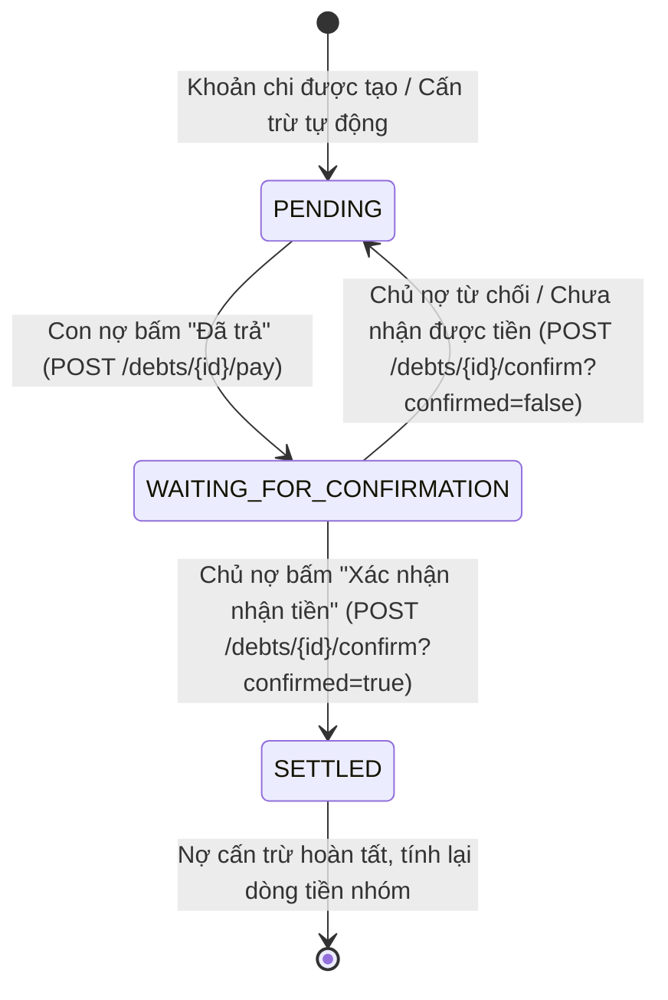

# TÀI LIỆU ĐẶC TẢ TÍCH HỢP API QUẢN LÝ CÔNG NỢ & THANH TOÁN (MOBILE)

**Dự án:** Group Spending & Reminder (Quản lý & Nhắc nhở Chi tiêu Nhóm)  
**Phân hệ:** Quản lý Công nợ & Quyết toán (Debt & Settlement Management)  
**Nền tảng mục tiêu:** Mobile App (iOS / Android / Flutter / React Native)  
**Phiên bản tài liệu:** v1.0.0  
**Ngày cập nhật:** 2026-09-28  

---

## MỤC LỤC
1. [Quy chuẩn chung & Định dạng dữ liệu](#1-quy-chuẩn-chung--định-dạng-dữ-liệu)
   - [1.1. Base URL & Authentication](#11-base-url--authentication)
   - [1.2. Cấu trúc phản hồi chung (ApiResponse Pattern)](#12-cấu-trúc-phản-hồi-chung-apiresponse-pattern)
   - [1.3. Bảng Enum dùng chung](#13-bảng-enum-dùng-chung)
   - [1.4. Quy ước tiền tệ & Đơn vị tính](#14-quy-ước-tiền-tệ--đơn-vị-tính)
2. [Mô hình nghiệp vụ & Luồng tương tác (Business Flow)](#2-mô-hình-nghiệp-vụ--luồng-tương-tác-business-flow)
   - [2.1. Quy trình quyết toán công nợ 2 bước (2-Step Settlement Lifecycle)](#21-quy-trình-quyết-toán-công-nợ-2-bước-2-step-settlement-lifecycle)
   - [2.2. Hai góc nhìn công nợ trong nhóm (Dual Debt Views)](#22-hai-góc-nhìn-công-nợ-trong-nhóm-dual-debt-views)
   - [2.3. Cơ chế phân quyền hành động thông minh (`action: DebtAction`)](#23-cơ-chế-phân-quyền-hành-động-thông-minh-action-debtaction)
3. [Đặc tả chi tiết các API Endpoints](#3-đặc-tả-chi-tiết-các-api-endpoints)
   - [3.1. Lấy tổng quan số dư công nợ của người dùng (Get User Balance Overview)](#31-lấy-tổng-quan-số-dư-công-nợ-của-người-dùng-get-user-balance-overview)
   - [3.2. Lấy danh sách công nợ tối giản theo nhóm (Get Group Simplified Debts)](#32-lấy-danh-sách-công-nợ-tối-giản-theo-nhóm-get-group-simplified-debts)
   - [3.3. Lấy kết quả tình hình nợ thực tế theo nhóm (Get Group Actual Debts)](#33-lấy-kết-quả-tình-hình-nợ-thực-tế-theo-nhóm-get-group-actual-debts)
   - [3.4. Con nợ đánh dấu đã trả tiền (Mark Debt As Paid)](#34-con-nợ-đánh-dấu-đã-trả-tiền-mark-debt-as-paid)
   - [3.5. Chủ nợ xác nhận hoặc từ chối đã nhận tiền (Confirm Debt Settled)](#35-chủ-nợ-xác-nhận-hoặc-từ-chối-đã-nhận-tiền-confirm-debt-settled)
   - [3.6. Gửi thông báo nhắc nợ thủ công (Send Debt Reminder)](#36-gửi-thông-báo-nhắc-nợ-thủ-công-send-debt-reminder)
   - [3.7. Các API bổ trợ liên quan đến công nợ (Auxiliary APIs)](#37-các-api-bổ-trợ-liên-quan-đến-công-nợ-auxiliary-apis)
   - [3.8. Gửi thông báo nhắc nợ tối giản (Send Simplified Debt Reminder)](#38-gửi-thông-báo-nhắc-nợ-tối-giản-send-simplified-debt-reminder)
   - [3.9. Xem trước cấn trừ nợ tối giản (Simplified Debt Payment Preview)](#39-xem-trước-cấn-trừ-nợ-tối-giản-simplified-debt-payment-preview)
   - [3.10. Thanh toán nợ tối giản (Pay Simplified Debt)](#310-thanh-toán-nợ-tối-giản-pay-simplified-debt)
   - [3.11. Xác nhận hoặc từ chối tất toán công nợ (Confirm Debt Settlement)](#311-xác-nhận-hoặc-từ-chối-tất-toán-công-nợ-confirm-debt-settlement)
   - [3.12. Lấy chi tiết đợt tất toán (Get Debt Settlement Detail)](#312-lấy-chi-tiết-đợt-tất-toán-get-debt-settlement-detail)
   - [3.13. Lấy lịch sử các đợt tất toán trong nhóm (Get Group Debt Settlements)](#313-lấy-lịch-sử-các-đợt-tất-toán-trong-nhóm-get-group-debt-settlements)
4. [Bảng mã lỗi (Error Codes) & Hướng dẫn xử lý UI](#4-bảng-mã-lỗi-error-codes--hướng-dẫn-xử-lý-ui)

---

## 1. QUY CHUẨN CHUNG & ĐỊNH DẠNG DỮ LIỆU

### 1.1. Base URL & Authentication

- **Base URL:** `https://api.groupspending.xyz/api/v1` (Production) hoặc `http://<host>:8080/api/v1` (Local / Staging)
- **Tất cả các API công nợ bắt buộc phải truyền Access Token qua Header:**
  ```http
  Authorization: Bearer <accessToken>
  Content-Type: application/json; charset=UTF-8
  Accept: application/json
  ```

---

### 1.2. Cấu trúc phản hồi chung (ApiResponse Pattern)

Mọi phản hồi từ máy chủ đều tuân theo chuẩn đóng gói sau:

#### Phản hồi thành công (HTTP 200 OK):
```json
{
  "success": true,
  "message": "Thành công",
  "data": { ... },
  "timestamp": "2026-09-28T08:00:00Z"
}
```

#### Phản hồi thất bại do lỗi nghiệp vụ hoặc phân quyền (HTTP 400 / 403 / 404):
```json
{
  "success": false,
  "message": "Chỉ chủ nợ mới có quyền xác nhận đã nhận tiền",
  "errors": null,
  "timestamp": "2026-09-28T08:00:00Z"
}
```

---

### 1.3. Bảng Enum dùng chung

#### `DebtStatus` (Trạng thái khoản nợ)

| Enum Key | Ý nghĩa nghiệp vụ | Trạng thái hiển thị gợi ý |
| :--- | :--- | :--- |
| `PENDING` | Khoản nợ đang chờ thanh toán (chưa ai trả tiền). | Badge màu Cam: **"Chờ thanh toán"** |
| `WAITING_FOR_CONFIRMATION` | Con nợ đã bấm "Đã trả tiền", đang chờ chủ nợ xác nhận nhận được tiền. | Badge màu Xanh lam: **"Chờ xác nhận"** |
| `SETTLED` | Chủ nợ đã xác nhận nhận tiền, nợ đã được cấn trừ hoàn toàn. | Badge màu Xanh lá: **"Đã tất toán"** |

#### `DebtAction` (Hành động khả dụng cho người dùng hiện tại)
Backend tự động tính toán trường `action` trong từng khoản nợ dựa trên vai trò của người gọi API, giúp Mobile **không cần hardcode logic quyền hạn phức tạp**:

| Enum Key | Ý nghĩa | Mobile UI Widget / Nút bấm tương ứng |
| :--- | :--- | :--- |
| `PAY` | Người gọi là **Con nợ** và khoản nợ đang `PENDING`. | Nút màu xanh/chính: **"Thanh toán / Đã trả"** |
| `CONFIRM` | Người gọi là **Chủ nợ** và khoản nợ đang `WAITING_FOR_CONFIRMATION`. | Nút nổi bật: **"Xác nhận nhận tiền"** (kèm tùy chọn từ chối) |
| `REMIND` | Người gọi là **Chủ nợ** hoặc **Admin nhóm** khi nợ đang `PENDING`. | Nút phụ/icon chuông: **"Nhắc nợ"** |
| `NONE` | Người gọi là bên thứ 3 hoặc khoản nợ đã `SETTLED` / không có quyền can thiệp. | Không hiển thị nút tương tác (chỉ xem thông tin) |

---

### 1.4. Quy ước tiền tệ & Đơn vị tính

Backend hỗ trợ đồng thời hai đơn vị tiền tệ để tiện lợi cho Mobile:
- **`amount` / `totalOwed` / `youOwe` / `netBalance`:** Đơn vị nghìn Đồng (k VNĐ). Ví dụ: `150` tương ứng 150.000 VNĐ.
- **`amountVnd` / `totalOwedVnd` / `youOweVnd` / `netBalanceVnd`:** Đơn vị VNĐ nguyên vẹn (`amount * 1000`). Ví dụ: `150000`.

> **KHUYẾN NGHỊ CHO MOBILE:**
> 1. Luôn sử dụng các trường có hậu tố **`Vnd`** để định dạng hiển thị với locale của hệ thống (`NumberFormat.currency(locale: 'vi_VN', symbol: '₫')`).
> 2. `netBalanceVnd > 0`: Bạn đang được nhận lại tiền (Số dư ròng dương, hiển thị màu xanh lá).
> 3. `netBalanceVnd < 0`: Bạn đang phải trả tiền nợ (Số dư ròng âm, hiển thị màu đỏ/cam).
> 4. `netBalanceVnd == 0`: Bạn đã cân bằng công nợ.

---

## 2. MÔ HÌNH NGHIỆP VỤ & LUỒNG TƯƠNG TÁC (BUSINESS FLOW)

### 2.1. Quy trình quyết toán công nợ 2 bước (2-Step Settlement Lifecycle)

Hệ thống áp dụng quy trình xác nhận 2 bước chống gian lận (Anti-fraud 2-step verification):



1. **Bước 1 (Con nợ thanh toán):** Con nợ chuyển khoản ngoài thực tế (VietQR / Ngân hàng) hoặc trả tiền mặt cho Chủ nợ. Sau đó bấm **"Đã trả"** trên app (`POST /debts/{id}/pay`). Trạng thái chuyển sang `WAITING_FOR_CONFIRMATION`. Hệ thống gửi Push Notification cho Chủ nợ.
2. **Bước 2 (Chủ nợ xác nhận):** 
   - Nếu đã nhận đủ tiền: Chủ nợ bấm **"Xác nhận nhận tiền"** (`POST /debts/{id}/confirm?confirmed=true`). Nợ chuyển sang `SETTLED`, cấn trừ nợ và cập nhật công nợ nhóm ngay tức thì.
   - Nếu chưa nhận được: Chủ nợ bấm **"Từ chối"** (`POST /debts/{id}/confirm?confirmed=false`). Nợ quay về `PENDING`, gửi Push cảnh báo cho con nợ.

---

### 2.2. Hai góc nhìn công nợ trong nhóm (Dual Debt Views)

Trong mỗi nhóm chi tiêu, Mobile cần cung cấp 2 chế độ xem công nợ (có thể dùng Tab Bar hoặc Segmented Control):

1. **Công nợ tối giản (Simplified Debts - Khuyến nghị xem chính):**
   - Chạy thuật toán tối ưu hóa luồng tiền ròng (*Greedy Cash Flow Simplification*).
   - Tối thiểu hóa số lượng giao dịch chuyển khoản giữa các thành viên trong nhóm.
   - *Ví dụ:* Thành viên A nợ B 100k, B nợ C 100k. Thuật toán tối giản: Chỉ cần A trả trực tiếp cho C 100k (B không cần làm gì).
   - Các khoản nợ trong danh sách này đại diện cho các lệnh chuyển khoản tối ưu nhất.

2. **Công nợ thực tế (Actual Debts):**
   - Danh sách các khoản nợ thực tế được lưu vết trong cơ sở dữ liệu giữa từng cặp thành viên (ai nợ ai bao nhiêu tiền, từ các khoản chi tiêu nào đã trừ đi các khoản đã trả).
   - Cho phép lọc theo trạng thái (`PENDING`, `WAITING_FOR_CONFIRMATION`, `SETTLED`).
   - Phù hợp khi người dùng muốn kiểm tra tính minh bạch và lịch sử chi tiết.

---

### 2.3. Cơ chế phân quyền hành động thông minh (`action: DebtAction`)

Backend tự động gắn trường `action` trong mỗi đối tượng nợ trả về:

| Điều kiện xác định | Giá trị `action` |
| :--- | :--- |
| Nợ đã tất toán (`status == SETTLED`) | `NONE` |
| Nợ đang chờ xác nhận (`status == WAITING_FOR_CONFIRMATION`) và người gọi là **Chủ nợ** | `CONFIRM` |
| Nợ đang chờ xác nhận (`status == WAITING_FOR_CONFIRMATION`) và người gọi **không phải Chủ nợ** | `NONE` |
| Nợ chưa trả (`status == PENDING`) và người gọi là **Con nợ** | `PAY` |
| Nợ chưa trả (`status == PENDING`) và người gọi là **Chủ nợ** hoặc **Admin nhóm** | `REMIND` |
| Các trường hợp còn lại (người thứ 3 trong nhóm) | `NONE` |

---

## 3. ĐẶC TẢ CHI TIẾT CÁC API ENDPOINTS

### 3.1. Lấy tổng quan số dư công nợ của người dùng (Get User Balance Overview)

API này phục vụ màn hình **"Tổng quan Công nợ"** (Dashboard hoặc Tab Tài chính cá nhân). Trả về tổng tiền người dùng đang nợ người khác và tổng tiền người khác nợ mình từ tất cả các nhóm.

- **Method:** `GET`
- **Path:** `/debts/overview`
- **Full URL:** `/api/v1/debts/overview`
- **Header:**
  ```http
  Authorization: Bearer <accessToken>
  ```
- **Mã phản hồi thành công:** `200 OK`
- **Response Body mẫu:**
```json
{
  "success": true,
  "message": "Thành công",
  "data": {
    "totalOwed": 80,
    "totalOwedVnd": 80000,
    "totalReceivable": 120,
    "totalReceivableVnd": 120000
  },
  "timestamp": "2026-09-28T08:05:00Z"
}
```

- **Mô tả các trường dữ liệu quan trọng:**
  - `totalOwed`: Tổng số tiền người dùng đang nợ từ tất cả các nhóm (đơn vị: k VNĐ).
  - `totalOwedVnd`: Tổng số tiền người dùng đang nợ quy đổi VNĐ đầy đủ (`totalOwed * 1000`).
  - `totalReceivable`: Tổng số tiền người dùng được nhận từ tất cả các nhóm (đơn vị: k VNĐ).
  - `totalReceivableVnd`: Tổng số tiền người dùng được nhận quy đổi VNĐ đầy đủ (`totalReceivable * 1000`).

---

### 3.2. Lấy danh sách công nợ tối giản theo nhóm (Get Group Simplified Debts)

Chạy thuật toán luân chuyển dòng tiền nhằm tối ưu hóa số lượng giao dịch chuyển khoản giữa các thành viên trong một nhóm. Đi kèm số dư cá nhân của người dùng trong nhóm này và hành động tương tác (`action`).

- **Method:** `GET`
- **Path:** `/groups/{groupId}/debts/simplified`
- **Full URL:** `/api/v1/groups/{groupId}/debts/simplified`
- **Path Variables:**

| Tên biến | Kiểu dữ liệu | Bắt buộc | Mô tả |
| :--- | :--- | :--- | :--- |
| `groupId` | Long | Có | ID của nhóm cần xem công nợ |

- **Header:**
  ```http
  Authorization: Bearer <accessToken>
  ```
- **Mã phản hồi thành công:** `200 OK`
- **Response Body mẫu:**
```json
{
  "success": true,
  "message": "Thành công",
  "data": {
    "userBalance": {
      "groupId": 10,
      "groupName": "Nhóm bạn cấp 3",
      "youOwe": 0,
      "youOweVnd": 0,
      "youAreOwed": 350,
      "youAreOwedVnd": 350000,
      "netBalance": 350,
      "netBalanceVnd": 350000
    },
    "simplifiedDebts": [
      {
        "debtorId": 2,
        "debtorName": "Nguyễn Văn B",
        "debtorAvatar": "https://cdn.example.com/avatar/user2.jpg",
        "creditorId": 1,
        "creditorName": "Tôi (Người dùng hiện tại)",
        "creditorAvatar": "https://cdn.example.com/avatar/user1.jpg",
        "amount": 350,
        "amountVnd": 350000,
        "action": "REMIND"
      },
      {
        "debtorId": 3,
        "debtorName": "Hoàng Minh C",
        "debtorAvatar": "https://cdn.example.com/avatar/user3.jpg",
        "creditorId": 4,
        "creditorName": "Đặng Thị D",
        "creditorAvatar": "https://cdn.example.com/avatar/user4.jpg",
        "amount": 120,
        "amountVnd": 120000,
        "action": "NONE"
      }
    ]
  },
  "timestamp": "2026-09-28T08:10:00Z"
}
```

- **Mã lỗi thường gặp:**
  - `403 Forbidden`: `NOT_GROUP_MEMBER` - Người dùng không phải thành viên nhóm.
  - `404 Not Found`: `GROUP_NOT_FOUND` - Nhóm không tồn tại.

---

### 3.3. Lấy kết quả tình hình nợ thực tế theo nhóm (Get Group Actual Debts)

Lấy danh sách các khoản chi tiêu và phân bổ nợ chi tiết giữa các thành viên trong nhóm, phục vụ hiển thị trực tiếp danh sách thẻ chi tiêu kèm phân bổ con nợ. Hỗ trợ combo box bộ lọc theo trạng thái nợ (`ALL`, `PENDING`, `WAITING_FOR_CONFIRMATION`, `SETTLED`) và trả về `action` cụ thể cho từng con nợ.

- **Method:** `GET`
- **Path:** `/groups/{groupId}/debts/actual`
- **Full URL:** `/api/v1/groups/{groupId}/debts/actual`
- **Path Variables:**

| Tên biến | Kiểu dữ liệu | Bắt buộc | Mô tả |
| :--- | :--- | :--- | :--- |
| `groupId` | Long | Có | ID của nhóm |

- **Query Parameters:**

| Tên tham số | Kiểu dữ liệu | Bắt buộc | Mặc định | Mô tả |
| :--- | :--- | :--- | :--- | :--- |
| `status` | String (`DebtStatusFilter`) | Không | `ALL` | Combo box bộ chọn trạng thái nợ: `ALL` (Tất cả), `PENDING` (Chưa thanh toán), `WAITING_FOR_CONFIRMATION` (Chờ xác nhận), `SETTLED` (Đã tất toán) |

- **Header:**
  ```http
  Authorization: Bearer <accessToken>
  ```
- **Mã phản hồi thành công:** `200 OK`
- **Response Body mẫu:**
```json
{
  "success": true,
  "message": "Thành công",
  "data": {
    "userBalance": {
      "groupId": 10,
      "groupName": "Nhóm bạn cấp 3",
      "youOwe": 150,
      "youOweVnd": 150000,
      "youAreOwed": 640,
      "youAreOwedVnd": 640000,
      "netBalance": 490,
      "netBalanceVnd": 490000
    },
    "actualDebts": [
      {
        "expenseId": 1,
        "title": "Lẩu Haidilao cuối tuần",
        "categoryName": "Ăn uống",
        "categoryIcon": "restaurant",
        "totalAmount": 1280,
        "totalAmountVnd": 1280000,
        "expenseDate": "2026-09-10",
        "createdAt": "2026-09-10T19:30:00Z",
        "paidByUserId": 1,
        "paidByUserName": "Nguyễn Nhật Minh",
        "paidByUserAvatar": "https://cdn.example.com/avatar/user1.jpg",
        "isPaidByMe": true,
        "debtorCount": 3,
        "debtors": [
          {
            "splitId": 101,
            "userId": 2,
            "name": "An",
            "avatarUrl": "https://cdn.example.com/avatar/user2.jpg",
            "isMe": false,
            "amount": 320,
            "amountVnd": 320000,
            "status": "SETTLED",
            "action": "NONE"
          },
          {
            "splitId": 102,
            "userId": 3,
            "name": "Hương",
            "avatarUrl": "https://cdn.example.com/avatar/user3.jpg",
            "isMe": false,
            "amount": 320,
            "amountVnd": 320000,
            "status": "PENDING",
            "action": "REMIND"
          },
          {
            "splitId": 103,
            "userId": 4,
            "name": "Linh",
            "avatarUrl": "https://cdn.example.com/avatar/user4.jpg",
            "isMe": false,
            "amount": 320,
            "amountVnd": 320000,
            "status": "WAITING_FOR_CONFIRMATION",
            "action": "CONFIRM"
          }
        ]
      },
      {
        "expenseId": 2,
        "title": "Tiền Internet & Truyền hình FPT",
        "categoryName": "Nhà ở & Điện nước",
        "categoryIcon": "home",
        "totalAmount": 450,
        "totalAmountVnd": 450000,
        "expenseDate": "2026-09-08",
        "createdAt": "2026-09-08T10:15:00Z",
        "paidByUserId": 2,
        "paidByUserName": "Trần Văn An",
        "paidByUserAvatar": "https://cdn.example.com/avatar/user2.jpg",
        "isPaidByMe": false,
        "debtorCount": 2,
        "debtors": [
          {
            "splitId": 104,
            "userId": 1,
            "name": "Minh",
            "avatarUrl": "https://cdn.example.com/avatar/user1.jpg",
            "isMe": true,
            "amount": 150,
            "amountVnd": 150000,
            "status": "PENDING",
            "action": "PAY"
          },
          {
            "splitId": 105,
            "userId": 5,
            "name": "Tuấn",
            "avatarUrl": "https://cdn.example.com/avatar/user5.jpg",
            "isMe": false,
            "amount": 150,
            "amountVnd": 150000,
            "status": "PENDING",
            "action": "NONE"
          }
        ]
      }
    ]
  },
  "timestamp": "2026-09-28T08:15:00Z"
}
```

- **Mã lỗi thường gặp:**
  - `403 Forbidden`: `NOT_GROUP_MEMBER` - Người dùng không thuộc nhóm này.
  - `404 Not Found`: `GROUP_NOT_FOUND` - Nhóm không tồn tại.

---

### 3.4. Con nợ đánh dấu đã trả tiền (Mark Debt As Paid)

Sau khi chuyển khoản ngân hàng hoặc trả tiền mặt, con nợ gọi API này để báo đã trả tiền. Khoản nợ chuyển sang `WAITING_FOR_CONFIRMATION` và hệ thống tự động bắn Push Notification cho chủ nợ.

- **Method:** `POST`
- **Path:** `/debts/{debtId}/pay`
- **Full URL:** `/api/v1/debts/{debtId}/pay`
- **Path Variables:**

| Tên biến | Kiểu dữ liệu | Bắt buộc | Mô tả |
| :--- | :--- | :--- | :--- |
| `debtId` | Long | Có | ID của khoản nợ cần thanh toán |

- **Header:**
  ```http
  Authorization: Bearer <accessToken>
  ```
- **Request Body:** Không có.

- **Mã phản hồi thành công:** `200 OK`
- **Response Body mẫu:**
```json
{
  "success": true,
  "message": "Đã gửi yêu cầu xác nhận trả nợ",
  "data": {
    "id": 101,
    "groupId": 10,
    "debtorId": 1,
    "debtorName": "Nguyễn Văn A",
    "debtorAvatar": "https://cdn.example.com/avatar/user1.jpg",
    "creditorId": 2,
    "creditorName": "Trần Văn B",
    "creditorAvatar": "https://cdn.example.com/avatar/user2.jpg",
    "amount": 150,
    "amountVnd": 150000,
    "status": "WAITING_FOR_CONFIRMATION",
    "settledAt": null,
    "createdAt": "2026-09-27T08:00:00Z",
    "action": "NONE"
  },
  "timestamp": "2026-09-28T08:20:00Z"
}
```

- **Mã lỗi thường gặp:**
  - `400 Bad Request`: *"Chỉ người nợ tiền mới có thể đánh dấu 'Đã trả'"* (khi `currentUserId != debtorId`).
  - `400 Bad Request`: *"Khoản nợ này hiện đang ở trạng thái: WAITING_FOR_CONFIRMATION"* hoặc `SETTLED` (khoản nợ không ở `PENDING`).
  - `404 Not Found`: `DEBT_NOT_FOUND` - Khoản nợ không tồn tại.

---

### 3.5. Chủ nợ xác nhận hoặc từ chối đã nhận tiền (Confirm Debt Settled)

Chủ nợ sau khi kiểm tra tài khoản ngân hàng gọi API này để xác nhận đã nhận tiền hoặc từ chối.
- Nếu `confirmed = true`: Trạng thái chuyển sang `SETTLED`, cấn trừ nợ và tính toán lại công nợ nhóm tức thì.
- Nếu `confirmed = false`: Trạng thái quay trở về `PENDING` để con nợ thanh toán lại.

- **Method:** `POST`
- **Path:** `/debts/{debtId}/confirm`
- **Full URL:** `/api/v1/debts/{debtId}/confirm`
- **Path Variables:**

| Tên biến | Kiểu dữ liệu | Bắt buộc | Mô tả |
| :--- | :--- | :--- | :--- |
| `debtId` | Long | Có | ID của khoản nợ |

- **Query Parameters:**

| Tên tham số | Kiểu dữ liệu | Bắt buộc | Mô tả |
| :--- | :--- | :--- | :--- |
| `confirmed` | Boolean | Có | `true`: Xác nhận đã nhận tiền (tất toán nợ).<br>`false`: Từ chối xác nhận (chưa nhận được tiền). |

- **Header:**
  ```http
  Authorization: Bearer <accessToken>
  ```
- **Request Body:** Không có.

- **Mã phản hồi thành công khi `confirmed=true`:** `200 OK`
```json
{
  "success": true,
  "message": "Đã xác nhận nhận tiền thành công",
  "data": {
    "id": 101,
    "groupId": 10,
    "debtorId": 1,
    "debtorName": "Nguyễn Văn A",
    "debtorAvatar": "https://cdn.example.com/avatar/user1.jpg",
    "creditorId": 2,
    "creditorName": "Trần Văn B",
    "creditorAvatar": "https://cdn.example.com/avatar/user2.jpg",
    "amount": 150,
    "amountVnd": 150000,
    "status": "SETTLED",
    "settledAt": "2026-09-28T08:25:30Z",
    "createdAt": "2026-09-27T08:00:00Z",
    "action": "NONE"
  },
  "timestamp": "2026-09-28T08:25:30Z"
}
```

- **Mã phản hồi thành công khi `confirmed=false`:** `200 OK`
```json
{
  "success": true,
  "message": "Đã từ chối xác nhận",
  "data": {
    "id": 101,
    "groupId": 10,
    "debtorId": 1,
    "debtorName": "Nguyễn Văn A",
    "debtorAvatar": "https://cdn.example.com/avatar/user1.jpg",
    "creditorId": 2,
    "creditorName": "Trần Văn B",
    "creditorAvatar": "https://cdn.example.com/avatar/user2.jpg",
    "amount": 150,
    "amountVnd": 150000,
    "status": "PENDING",
    "settledAt": null,
    "createdAt": "2026-09-27T08:00:00Z",
    "action": "REMIND"
  },
  "timestamp": "2026-09-28T08:26:00Z"
}
```

- **Mã lỗi thường gặp:**
  - `400 Bad Request`: *"Chỉ chủ nợ mới có quyền xác nhận đã nhận tiền"* (khi `currentUserId != creditorId`).
  - `404 Not Found`: `DEBT_NOT_FOUND` - Khoản nợ không tồn tại.

---

### 3.6. Gửi thông báo nhắc nợ thủ công (Send Debt Reminder)

Chủ nợ hoặc Admin của nhóm có thể gửi thông báo Push Notification trực tiếp đến điện thoại của con nợ để nhắc nhở thanh toán.

- **Method:** `POST`
- **Path:** `/debts/{debtId}/remind`
- **Full URL:** `/api/v1/debts/{debtId}/remind`
- **Path Variables:**

| Tên biến | Kiểu dữ liệu | Bắt buộc | Mô tả |
| :--- | :--- | :--- | :--- |
| `debtId` | Long | Có | ID của khoản nợ cần nhắc nhở |

- **Header:**
  ```http
  Authorization: Bearer <accessToken>
  ```
- **Request Body:** Không có.

- **Mã phản hồi thành công:** `200 OK`
- **Response Body mẫu:**
```json
{
  "success": true,
  "message": "Đã gửi thông báo nhắc nợ thành công",
  "data": null,
  "timestamp": "2026-09-28T08:30:00Z"
}
```

- **Mã lỗi thường gặp:**
  - `403 Forbidden`: `UNAUTHORIZED` - *"Chỉ chủ nợ hoặc Admin mới có quyền gửi thông báo nhắc nợ"*.
  - `404 Not Found`: `DEBT_NOT_FOUND` - Khoản nợ không tồn tại.

---

### 3.7. Các API bổ trợ liên quan đến công nợ (Auxiliary APIs)

Các API thuộc phân hệ khác nhưng hỗ trợ mật thiết cho màn hình và nghiệp vụ công nợ:

#### 1. Lọc nhóm có công nợ (`GET /api/v1/groups`)
Sử dụng tham số `filter`:
- `GET /api/v1/groups?filter=HAS_DEBT`: Lấy danh sách các nhóm hiện **đang có công nợ** chưa giải quyết (`PENDING` hoặc `WAITING_FOR_CONFIRMATION`) mà người dùng tham gia.
- `GET /api/v1/groups?filter=SETTLED`: Lấy danh sách các nhóm đã **tất toán sạch công nợ** (không còn ai nợ ai).

#### 2. Thống kê tỷ lệ tất toán nợ nhóm (`GET /api/v1/expenses/statistics/groups/{groupId}`)
Trả về các trường hữu ích cho UI Dashboard nhóm:
- `debtSettlementRate`: Tỷ lệ % nợ đã được thanh toán (ví dụ: `85.5%`).
- `settledDebtAmount`: Số tiền nợ đã tất toán.
- `totalDebtAmount`: Tổng số tiền nợ phát sinh trong nhóm.

---

### 3.8. Gửi thông báo nhắc nợ tối giản (Send Simplified Debt Reminder)

Chủ nợ hoặc Admin của nhóm có thể gửi thông báo nhắc nợ dựa trên kết quả cấn trừ nợ tối giản giữa hai thành viên trong nhóm.

- **Method:** `POST`
- **Path:** `/groups/{groupId}/debts/simplified/remind`
- **Full URL:** `/api/v1/groups/{groupId}/debts/simplified/remind`
- **Path Variables:**
  - `groupId` (Long): ID của nhóm
- **Header:**
  ```http
  Authorization: Bearer <accessToken>
  Content-Type: application/json
  ```
- **Request Body:**
```json
{
  "debtorId": 2,
  "creditorId": 1,
  "expectedAmount": 350
}
```
- **Mô tả các trường trong Request Body:**
  - `debtorId` (Long, bắt buộc, > 0): ID của con nợ (người cần thanh toán).
  - `creditorId` (Long, bắt buộc, > 0): ID của chủ nợ (người nhận tiền).
  - `expectedAmount` (Long, bắt buộc, > 0): Số tiền nợ đang hiển thị trên client (đơn vị: nghìn VNĐ, ví dụ `350` tương ứng 350.000 VNĐ). Backend sẽ đối chiếu với kết quả tính toán nợ tối giản thời gian thực để đảm bảo dữ liệu hiển thị trên Mobile không bị cũ/lệch.
  *(Ghi chú: Tin nhắn nhắc nợ được hệ thống tự động chuẩn hóa để đảm bảo tính nhất quán và chống spam).*

- **Quyền hạn:** Người gọi API phải là Chủ nợ (`creditorId`) hoặc Admin của nhóm (không được là chính con nợ).
- **Mã phản hồi thành công (HTTP 200 OK):**
```json
{
  "success": true,
  "message": "Đã gửi yêu cầu nhắc nợ",
  "data": null,
  "timestamp": "2026-10-19T13:10:00Z"
}
```
- **Mã lỗi thường gặp:**
  - `400 Bad Request`: `INVALID_DEBT_REMINDER` - Người nợ và người nhận trùng nhau (`debtorId == creditorId`).
  - `400 Bad Request`: `SIMPLIFIED_DEBT_CHANGED` - Số tiền nợ hoặc giao dịch tối giản giữa 2 thành viên đã thay đổi hoặc không còn tồn tại.
  - `403 Forbidden`: `UNAUTHORIZED` - Chỉ chủ nợ hoặc Admin mới có quyền gửi thông báo nhắc nợ.
  - `403 Forbidden`: `NOT_GROUP_MEMBER` - Người dùng không phải thành viên nhóm.

---

### 3.9. Xem trước cấn trừ nợ tối giản (Simplified Debt Payment Preview)

Trước khi con nợ bấm thanh toán, Mobile gọi API này để hệ thống tính toán phân bổ giải nợ chi tiết (multi-hop/direct) và cấp một `planToken` có hiệu lực 15 phút.

- **Method:** `POST`
- **Path:** `/groups/{groupId}/debts/simplified/payment-preview`
- **Full URL:** `/api/v1/groups/{groupId}/debts/simplified/payment-preview`
- **Path Variables:**
  - `groupId` (Long): ID của nhóm
- **Header:**
  ```http
  Authorization: Bearer <accessToken>
  Content-Type: application/json
  ```
- **Request Body:**
```json
{
  "creditorId": 2,
  "expectedAmount": 150
}
```
- **Mô tả các trường trong Request Body:**
  - `creditorId` (Long, bắt buộc, > 0): ID của chủ nợ (người nhận tiền).
  - `expectedAmount` (Long, bắt buộc, > 0): Số tiền dự kiến thanh toán (đơn vị nghìn VNĐ, ví dụ `150` tương ứng 150.000 VNĐ).

- **Quyền hạn:** Người gọi API phải là Con nợ trong giao dịch tối giản.
- **Mã phản hồi thành công (HTTP 200 OK):**
```json
{
  "success": true,
  "message": "Lập kế hoạch thanh toán thành công",
  "data": {
    "planToken": "eyJhbGciOiJIUzI1NiIsInR5cCI6IkpXVCJ9...",
    "groupId": 10,
    "debtorId": 1,
    "debtorName": "Nguyễn Văn A",
    "creditorId": 2,
    "creditorName": "Trần Văn B",
    "creditorAvatar": "https://cdn.example.com/avatar/user2.jpg",
    "amount": 150,
    "amountVnd": 150000,
    "expiresAt": "2026-10-19T13:25:00Z",
    "allocatedSplits": [
      {
        "expenseSplitId": 12,
        "expenseId": 5,
        "expenseTitle": "Ăn tối lẩu Haidilao",
        "expenseDate": "2026-10-15",
        "payerId": 2,
        "payerName": "Trần Văn B",
        "participantId": 1,
        "participantName": "Nguyễn Văn A",
        "originalAmount": 150,
        "originalAmountVnd": 150000,
        "settledAmount": 0,
        "settledAmountVnd": 0,
        "remainingAmount": 150,
        "remainingAmountVnd": 150000,
        "allocatedAmount": 150,
        "allocatedAmountVnd": 150000,
        "allocationType": "DIRECT"
      }
    ]
  },
  "timestamp": "2026-10-19T13:10:00Z"
}
```
> **LƯU Ý QUAN TRỌNG CHO MOBILE:**
> Mobile cần lưu giá trị `planToken` nhận được từ phản hồi này để gửi kèm trong yêu cầu xác nhận thanh toán ở API `3.10`. `planToken` có thời hạn 15 phút (`expiresAt`).

- **Mã lỗi thường gặp:**
  - `400 Bad Request`: `SIMPLIFIED_DEBT_CHANGED` - Khoản nợ tối giản không tồn tại hoặc số tiền yêu cầu thanh toán không khớp với nợ tối giản hiện tại.
  - `403 Forbidden`: `NOT_GROUP_MEMBER` - Người dùng không phải thành viên nhóm.

---

### 3.10. Thanh toán nợ tối giản (Pay Simplified Debt)

Con nợ bấm xác nhận thanh toán nợ tối giản sau khi đã chuyển khoản ngoài thực tế. Hệ thống sử dụng `planToken` đã cấp để tạo một yêu cầu tất toán (`DebtSettlement`) ở trạng thái `WAITING_FOR_CONFIRMATION`, đồng thời tạm khóa (`RESERVED`) các khoản `ExpenseSplit` tương ứng và tự động gửi Push Notification yêu cầu xác nhận tới Chủ nợ.

- **Method:** `POST`
- **Path:** `/groups/{groupId}/debts/simplified/pay`
- **Full URL:** `/api/v1/groups/{groupId}/debts/simplified/pay`
- **Path Variables:**
  - `groupId` (Long): ID của nhóm
- **Header:**
  ```http
  Authorization: Bearer <accessToken>
  Content-Type: application/json
  Idempotency-Key: <UUID>
  ```
  *(Ghi chú: Header `Idempotency-Key` là tùy chọn nhưng được khuyến nghị sử dụng để tránh tạo trùng đợt tất toán khi người dùng ấn nhiều lần hoặc mạng gián đoạn).*
- **Request Body:**
```json
{
  "planToken": "eyJhbGciOiJIUzI1NiIsInR5cCI6IkpXVCJ9..."
}
```
- **Mô tả trường:**
  - `planToken` (String, bắt buộc): Chuỗi token kế hoạch thanh toán được cấp từ API `3.9 (payment-preview)`.

- **Quyền hạn:** Người gọi API phải là Con nợ trong kế hoạch thanh toán.
- **Mã phản hồi thành công (HTTP 201 Created):**
```json
{
  "success": true,
  "message": "Đã gửi yêu cầu xác nhận trả nợ",
  "data": {
    "id": 501,
    "groupId": 10,
    "debtorId": 1,
    "debtorName": "Nguyễn Văn A",
    "debtorAvatar": "https://cdn.example.com/avatar/user1.jpg",
    "creditorId": 2,
    "creditorName": "Trần Văn B",
    "creditorAvatar": "https://cdn.example.com/avatar/user2.jpg",
    "amount": 150,
    "amountVnd": 150000,
    "status": "WAITING_FOR_CONFIRMATION",
    "rejectionReason": null,
    "createdAt": "2026-10-19T13:10:00Z",
    "resolvedAt": null,
    "action": "NONE",
    "allocatedSplits": [
      {
        "expenseSplitId": 12,
        "expenseId": 5,
        "expenseTitle": "Ăn tối lẩu Haidilao",
        "expenseDate": "2026-10-15",
        "payerId": 2,
        "payerName": "Trần Văn B",
        "participantId": 1,
        "participantName": "Nguyễn Văn A",
        "originalAmount": 150,
        "originalAmountVnd": 150000,
        "settledAmount": 0,
        "settledAmountVnd": 0,
        "remainingAmount": 150,
        "remainingAmountVnd": 150000,
        "allocatedAmount": 150,
        "allocatedAmountVnd": 150000,
        "allocationType": "DIRECT"
      }
    ]
  },
  "timestamp": "2026-10-19T13:10:00Z"
}
```
- **Thông báo tự động gửi tới Chủ nợ:**
  - Loại: `NotificationType.DEBT_PAY_REQUEST`
  - Tiêu đề: `"Xác nhận thanh toán nợ"`
  - Nội dung: `"<Tên con nợ> đã chuyển khoản <amountVnd> VNĐ. Vui lòng kiểm tra và xác nhận 'Đã nhận'!"`
  - Target: `"DEBT_SETTLEMENT"`, kèm `settlementId` và metadata liên quan.
- **Mã lỗi thường gặp:**
  - `400 Bad Request`: `SIMPLIFIED_DEBT_CHANGED` - Kế hoạch thanh toán đã hết hạn (sau 15 phút), không tồn tại, hoặc các khoản chi tiêu liên quan đã bị thay đổi. Cần gọi lại preview để lấy token mới.
  - `400 Bad Request`: `INVALID_DEBT_SETTLEMENT` - Token thanh toán không khớp với người dùng hoặc nhóm hiện tại.
  - `400 Bad Request`: `GROUP_ARCHIVED` - Nhóm đã bị lưu trữ.
  - `403 Forbidden`: `NOT_GROUP_MEMBER` - Người dùng không phải thành viên nhóm.

---

### 3.11. Xác nhận hoặc từ chối tất toán công nợ (Confirm Debt Settlement)

Chủ nợ kiểm tra tài khoản ngân hàng và bấm xác nhận nhận tiền (`confirmed=true`) hoặc từ chối (`confirmed=false`).
- Khi chấp thuận (`true`): Trạng thái chuyển thành `SETTLED`, các split được cộng vĩnh viễn vào `settledAmount` (COMMITTED), công nợ được xóa bỏ khỏi đồ thị nợ tối giản.
- Khi từ chối (`false`): Trạng thái chuyển thành `REJECTED`, các split được nhả khóa (RELEASED), khôi phục lại trạng thái nợ ban đầu.

- **Method:** `POST`
- **Path:** `/debt-settlements/{settlementId}/confirm`
- **Full URL:** `/api/v1/debt-settlements/{settlementId}/confirm`
- **Path Variables:**
  - `settlementId` (Long): ID của đợt tất toán
- **Header:**
  ```http
  Authorization: Bearer <accessToken>
  Content-Type: application/json
  ```
- **Request Body:**
```json
{
  "confirmed": true,
  "reason": null
}
```
*(Nếu từ chối, gửi `"confirmed": false` kèm `"reason": "Chưa nhận được tiền vào tài khoản ngân hàng"`).*

- **Quyền hạn:** **Chỉ Chủ nợ** (`creditorId`) trong đợt tất toán mới có quyền xác nhận (Admin không xác nhận thay).
- **Mã phản hồi thành công khi `confirmed = true` (HTTP 200 OK):**
```json
{
  "success": true,
  "message": "Đã xác nhận nhận tiền thành công",
  "data": {
    "id": 501,
    "groupId": 10,
    "debtorId": 1,
    "debtorName": "Nguyễn Văn A",
    "debtorAvatar": "https://cdn.example.com/avatar/user1.jpg",
    "creditorId": 2,
    "creditorName": "Trần Văn B",
    "creditorAvatar": "https://cdn.example.com/avatar/user2.jpg",
    "amount": 150,
    "amountVnd": 150000,
    "status": "SETTLED",
    "rejectionReason": null,
    "createdAt": "2026-10-19T13:10:00Z",
    "resolvedAt": "2026-10-19T13:15:00Z",
    "action": "NONE",
    "allocatedSplits": [ ... ]
  },
  "timestamp": "2026-10-19T13:15:00Z"
}
```
- **Mã phản hồi thành công khi `confirmed = false` (HTTP 200 OK):**
```json
{
  "success": true,
  "message": "Đã từ chối xác nhận",
  "data": {
    "id": 501,
    "groupId": 10,
    "debtorId": 1,
    "debtorName": "Nguyễn Văn A",
    "debtorAvatar": "https://cdn.example.com/avatar/user1.jpg",
    "creditorId": 2,
    "creditorName": "Trần Văn B",
    "creditorAvatar": "https://cdn.example.com/avatar/user2.jpg",
    "amount": 150,
    "amountVnd": 150000,
    "status": "REJECTED",
    "rejectionReason": "Chưa nhận được tiền vào tài khoản ngân hàng",
    "createdAt": "2026-10-19T13:10:00Z",
    "resolvedAt": "2026-10-19T13:15:00Z",
    "action": "NONE",
    "allocatedSplits": [ ... ]
  },
  "timestamp": "2026-10-19T13:15:00Z"
}
```
- **Mã lỗi thường gặp:**
  - `403 Forbidden`: `UNAUTHORIZED` - Chỉ chủ nợ mới có quyền xác nhận tất toán công nợ.
  - `404 Not Found`: `SETTLEMENT_NOT_FOUND` - Không tìm thấy yêu cầu tất toán.
  - `400 Bad Request`: `SETTLEMENT_ALREADY_RESOLVED` - Yêu cầu tất toán này đã được xác nhận hoặc từ chối trước đó.

---

### 3.12. Lấy chi tiết đợt tất toán (Get Debt Settlement Detail)

- **Method:** `GET`
- **Path:** `/debt-settlements/{settlementId}`
- **Full URL:** `/api/v1/debt-settlements/{settlementId}`
- **Path Variables:**
  - `settlementId` (Long): ID của đợt tất toán
- **Quyền hạn:** Thành viên trong nhóm của đợt tất toán.
- **Mã phản hồi thành công:** `200 OK` (Cấu trúc tương tự `DebtSettlementResponse` ở mục 3.10/3.11).

---

### 3.13. Lấy lịch sử các đợt tất toán trong nhóm (Get Group Debt Settlements)

Hỗ trợ phân trang và lọc theo trạng thái yêu cầu tất toán (`WAITING_FOR_CONFIRMATION`, `SETTLED`, `REJECTED`).

- **Method:** `GET`
- **Path:** `/groups/{groupId}/debt-settlements`
- **Full URL:** `/api/v1/groups/{groupId}/debt-settlements`
- **Path Variables:**
  - `groupId` (Long): ID của nhóm
- **Query Parameters:**
  - `status` (String, tùy chọn): Lọc theo trạng thái (`WAITING_FOR_CONFIRMATION`, `SETTLED`, `REJECTED`). Để trống để lấy tất cả.
  - `page` (Integer, tùy chọn, mặc định `0`): Chỉ số trang (0-indexed).
  - `size` (Integer, tùy chọn, mặc định `20`): Kích thước trang.
  - `sort` (String, tùy chọn, mặc định `createdAt,desc`): Sắp xếp.
- **Quyền hạn:** Thành viên của nhóm.
- **Mã phản hồi thành công (HTTP 200 OK):**
```json
{
  "success": true,
  "message": "Thành công",
  "data": {
    "content": [
      {
        "id": 501,
        "groupId": 10,
        "debtorId": 1,
        "debtorName": "Nguyễn Văn A",
        "debtorAvatar": "https://cdn.example.com/avatar/user1.jpg",
        "creditorId": 2,
        "creditorName": "Trần Văn B",
        "creditorAvatar": "https://cdn.example.com/avatar/user2.jpg",
        "amount": 150,
        "amountVnd": 150000,
        "status": "SETTLED",
        "rejectionReason": null,
        "createdAt": "2026-10-19T13:10:00Z",
        "resolvedAt": "2026-10-19T13:15:00Z",
        "action": "NONE",
        "allocatedSplits": [ ... ]
      }
    ],
    "pageable": {
      "pageNumber": 0,
      "pageSize": 20
    },
    "totalElements": 1,
    "totalPages": 1,
    "last": true
  },
  "timestamp": "2026-10-19T13:16:00Z"
}
```

---

## 4. BẢNG MÃ LỖI (ERROR CODES) & HƯỚNG DẪN XỬ LÝ UI

| HTTP Status | Error Code / Message | Nguyên nhân gây lỗi | Hướng dẫn xử lý trên Mobile UI |
| :---: | :--- | :--- | :--- |
| `400` | *Chỉ người nợ tiền mới có thể đánh dấu 'Đã trả'* | Người bấm nút "Đã trả" không phải là `debtor_user_id`. | Ẩn hoặc disable nút "Đã trả" nếu `action !== "PAY"`. |
| `400` | *Khoản nợ này hiện đang ở trạng thái: ...* | Cố tình bấm "Đã trả" khi nợ đang chờ duyệt (`WAITING_FOR_CONFIRMATION`) hoặc đã xong (`SETTLED`). | Reload lại danh sách nợ để cập nhật trạng thái mới nhất từ server. |
| `400` | *Chỉ chủ nợ mới có quyền xác nhận đã nhận tiền* | Người bấm "Xác nhận nhận tiền" không phải `creditor_user_id`. | Chỉ hiển thị nút xác nhận nếu `action === "CONFIRM"`. |
| `400` | `INVALID_DEBT_REMINDER` | Không tìm thấy khoản nợ tối giản giữa con nợ và chủ nợ để nhắc nợ. | Báo Toast lỗi và tải lại danh sách nợ tối giản của nhóm. |
| `400` | `SIMPLIFIED_DEBT_CHANGED` | Khoản nợ tối giản đã thay đổi do có giao dịch chi tiêu mới hoặc nợ đã được tất toán. | Hiển thị Toast cảnh báo: *"Công nợ tối giản đã thay đổi, vui lòng làm mới trang"* và tải lại danh sách. |
| `400` | `SETTLEMENT_IN_PROGRESS` | Đang có một giao dịch tất toán giữa 2 người này đang ở trạng thái `WAITING_FOR_CONFIRMATION`. | Hiển thị thông báo yêu cầu chờ chủ nợ xác nhận đợt thanh toán trước đó. |
| `400` | `SETTLEMENT_ALREADY_RESOLVED` | Đợt tất toán này đã được duyệt hoặc từ chối trước đó. | Reload lại màn hình chi tiết đợt tất toán. |
| `400` | `EXPENSE_HAS_SETTLEMENT` | Cố tình sửa hoặc xóa khoản chi tiêu (`Expense`) đang có phần chia tiền bị khóa trong đợt tất toán. | Hiển thị cảnh báo: *"Không thể sửa/xóa khoản chi do đang nằm trong đợt tất toán công nợ"*. |
| `401` | `INVALID_TOKEN` | Token đăng nhập hết hạn hoặc không hợp lệ. | Kích hoạt luồng làm mới token ngầm (Silent Refresh) hoặc đưa người dùng về màn hình Đăng nhập. |
| `403` | `NOT_GROUP_MEMBER` | Người dùng không phải thành viên nhóm chi tiêu. | Hiển thị thông báo Toast và điều hướng quay lại danh sách nhóm. |
| `403` | `UNAUTHORIZED` | Thành viên không có quyền (không phải chủ nợ hoặc admin khi nhắc nợ; không phải chủ nợ khi xác nhận tất toán). | Ẩn hoặc vô hiệu hóa các nút tương tác tương ứng trên UI. |
| `404` | `DEBT_NOT_FOUND` | Khoản nợ đã bị xóa hoặc `debtId` không tồn tại trong hệ thống. | Hiển thị Toast thông báo: *"Khoản nợ này không tồn tại hoặc đã được cập nhật"*, tự động refresh danh sách nợ. |
| `404` | `SETTLEMENT_NOT_FOUND` | Đợt tất toán không tồn tại hoặc `settlementId` không hợp lệ. | Hiển thị Toast và quay lại danh sách tất toán. |
| `404` | `GROUP_NOT_FOUND` | Nhóm không tồn tại hoặc đã bị xóa vĩnh viễn. | Điều hướng quay về danh sách nhóm. |

---
