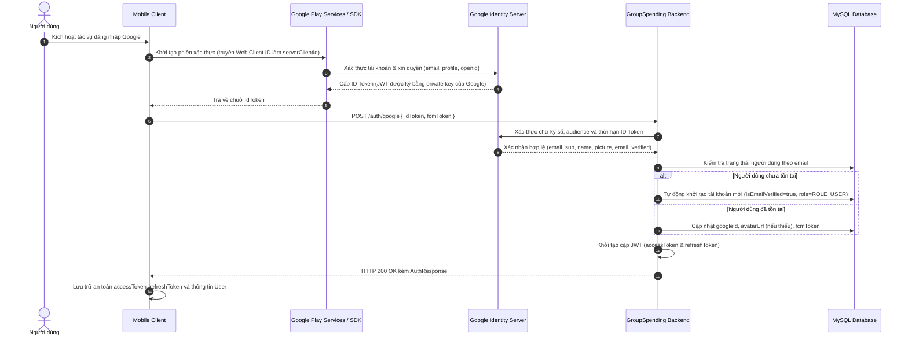

# TÀI LIỆU ĐẶC TẢ TÍCH HỢP API: ĐĂNG NHẬP BẰNG TÀI KHOẢN GOOGLE (GOOGLE SIGN-IN)

- **Dự án:** Group Spending & Reminder (Quản lý & Nhắc nhở Chi tiêu Nhóm)  
- **Phân hệ:** Xác thực tài khoản (Authentication)  
- **Nền tảng mục tiêu:** Mobile Client  
- **Phiên bản tài liệu:** v1.0.0  
- **Ngày cập nhật:** 03/10/2026  

---

## 1. QUY CHUẨN KỸ THUẬT CHUNG

### 1.1. Base URL & Giao thức
- **Production Base URL:** `https://api.groupspending.xyz/api/v1`
- **Development / Staging Base URL:** `http://localhost:8080/api/v1`
- **Giao thức:** HTTPS (bắt buộc)
- **Định dạng dữ liệu:** `application/json; charset=UTF-8`
- **Xác thực API:** Endpoint `/auth/google` là **Public Endpoint**, không yêu cầu header `Authorization: Bearer <token>`.

### 1.2. Cấu trúc chuẩn phản hồi (ApiResponse Standard)

#### Phản hồi thành công (HTTP 200 OK):
```json
{
  "success": true,
  "message": "Đăng nhập bằng Google thành công",
  "data": { ... },
  "timestamp": "2026-10-03T22:00:00Z"
}
```

#### Phản hồi thất bại nghiệp vụ (HTTP 400 / 401 / 403 / 500):
```json
{
  "success": false,
  "message": "Mô tả chi tiết nguyên nhân thất bại",
  "errors": null,
  "timestamp": "2026-10-03T22:00:00Z"
}
```

---

## 2. KIẾN TRÚC VÀ MÔ HÌNH XÁC THỰC (ID TOKEN VERIFICATION PATTERN)

Hệ thống áp dụng mô hình **Xác minh ID Token (OpenID Connect ID Token Verification)**. Mobile Client không xử lý trực tiếp thông tin nhạy cảm (như mật khẩu tài khoản Google hay mã bí mật `client_secret`), mà đóng vai trò trung chuyển token định danh được Google ký số.



---

## 3. THÔNG SỐ CẤU HÌNH GOOGLE CLOUD PHỤC VỤ MOBILE

Để Google Identity Services cấp phát ID Token tương thích hoàn toàn với backend GroupSpending, Mobile Client phải tuân thủ các thông số cấu hình sau:

### 3.1. Web Client ID (serverClientId)
- **Giá trị Client ID:** `417752871964-3plv3ntal9gjbou5s1bj7n1mqt6u4n2n.apps.googleusercontent.com`
- **Mục đích:** Khai báo làm `serverClientId` (hoặc `audience`) trong cấu hình Google Sign-In của ứng dụng Mobile. Điều này bảo đảm Google tạo ra ID Token với trường `aud` khớp chính xác với cấu hình của backend.

### 3.2. Cấu hình định danh nền tảng (Android / iOS Client ID)
1. **Nền tảng Android:**
   - Cần khai báo OAuth Client ID loại **Android** trong Google Cloud Console (`groupspendingapp`).
   - Cung cấp chính xác **Package name** của ứng dụng (ví dụ: `com.groupspending.app`).
   - Cung cấp mã vân tay chứng chỉ ký số (**SHA-1 Certificate Fingerprint**) cho cả môi trường phát triển (Debug keystore) và môi trường phát hành (Release keystore).
2. **Quyền truy cập yêu cầu (OAuth Scopes):**
   - `email` (Xem địa chỉ hòm thư điện tử).
   - `profile` (Xem thông tin cơ bản: họ tên, ảnh đại diện).
   - `openid` (Cấp phát mã định danh OpenID Connect ID Token).

---

## 4. ĐẶC TẢ CHI TIẾT ENDPOINT ĐĂNG NHẬP GOOGLE

### Endpoint Xác thực Google ID Token
Xác minh mã ID Token do Google cấp, hoàn tất đăng nhập hoặc tự động tạo tài khoản mới trên hệ thống.

- **Endpoint:** `/auth/google`
- **Method:** `POST`
- **Yêu cầu đăng nhập:** Không

#### Cấu trúc Request Body:
| Tên trường | Kiểu dữ liệu | Bắt buộc | Ràng buộc kỹ thuật | Ý nghĩa nghiệp vụ |
| :--- | :--- | :---: | :--- | :--- |
| `idToken` | `String` | **Có** | Chuỗi JWT định dạng hợp lệ của Google, không được rỗng | Mã ID Token nhận từ SDK Google sau khi người dùng xác thực thành công |
| `fcmToken` | `String` | Không | Chuỗi tối đa 500 ký tự | Token định danh thiết bị của Firebase Cloud Messaging (dùng để nhận thông báo đẩy) |

```json
{
  "idToken": "eyJhbGciOiJSUzI1NiIsImtpZCI6IjFhMmIzYyIs...",
  "fcmToken": "f7D8a9B0c1d2e3f4_example_token..."
}
```

#### Phản hồi thành công (HTTP 200 OK):
Trả về cặp mã JWT của hệ thống cùng hồ sơ chi tiết của người dùng.

```json
{
  "success": true,
  "message": "Đăng nhập bằng Google thành công",
  "data": {
    "accessToken": "eyJhbGciOiJIUzI1NiIsInR5cCI6IkpXVCJ9...",
    "refreshToken": "7a8b9c0d-1e2f-4a3b-9c8d-1e2f3a4b5c6d",
    "tokenType": "Bearer",
    "user": {
      "id": 15,
      "email": "user@gmail.com",
      "fullName": "Nguyễn Văn A",
      "phone": null,
      "avatarUrl": "https://lh3.googleusercontent.com/a/...",
      "role": "ROLE_USER",
      "isEmailVerified": true,
      "bankName": null,
      "bankAccountNumber": null,
      "bankAccountName": null,
      "createdAt": "2026-10-03T22:00:00Z"
    }
  },
  "timestamp": "2026-10-03T22:00:00Z"
}
```

#### Chi tiết các trường trong đối tượng `data`:
| Tên trường | Kiểu dữ liệu | Ý nghĩa |
| :--- | :--- | :--- |
| `accessToken` | `String` | Token định danh phiên làm việc (JWT) gửi trong header các API sau này. Thời hạn: **24 giờ (86.400.000 ms)** |
| `refreshToken` | `String` | Chuỗi mã duy nhất dùng để cấp lại `accessToken` mới. Thời hạn: **7 ngày (604.800.000 ms)** |
| `tokenType` | `String` | Luôn có giá trị `"Bearer"` |
| `user` | `Object` | Đối tượng thông tin cá nhân người dùng ([UserResponse](#chi-tiet-doi-tuong-user)) |

#### Chi tiết đối tượng `user`:
| Tên trường | Kiểu dữ liệu | Ý nghĩa |
| :--- | :--- | :--- |
| `id` | `Long` | ID duy nhất của người dùng trong hệ thống |
| `email` | `String` | Địa chỉ email tài khoản Google |
| `fullName` | `String` | Họ tên lấy từ hồ sơ Google (mặc định "Google User" nếu không có) |
| `phone` | `String` (Nullable) | Số điện thoại liên lạc |
| `avatarUrl` | `String` (Nullable) | Đường dẫn ảnh đại diện lấy từ tài khoản Google |
| `role` | `String` | Quyền hạn tài khoản (`"ROLE_USER"` hoặc `"ROLE_ADMIN"`) |
| `isEmailVerified` | `Boolean` | Trạng thái xác minh email (luôn là `true` khi đăng nhập Google) |
| `bankName` | `String` (Nullable) | Tên ngân hàng phục vụ thanh toán nợ |
| `bankAccountNumber` | `String` (Nullable) | Số tài khoản ngân hàng |
| `bankAccountName` | `String` (Nullable) | Tên chủ tài khoản ngân hàng |
| `createdAt` | `String` (ISO-8601) | Thời điểm tài khoản được khởi tạo trong hệ thống |

---

## 5. QUẢN LÝ PHIÊN LÀM VIỆC VÀ VÒNG ĐỜI TOKEN (LIFECYCLE)

### 5.1. Lưu trữ an toàn tại Client
- `accessToken` và `refreshToken` bắt buộc phải được lưu trữ trong phân vùng bộ nhớ an toàn của thiết bị (Android EncryptedSharedPreferences / Keystore, iOS Keychain).
- Tuyệt đối không lưu token thô vào bộ nhớ không mã hóa.

### 5.2. Gọi các API nghiệp vụ có bảo mật
- Mọi API cần bảo mật trong hệ thống đều yêu cầu đính kèm `accessToken` vào HTTP Header:
  ```http
  Authorization: Bearer <accessToken>
  ```

### 5.3. Cơ chế tự động làm mới Token (Refresh Token Flow)
Khi gọi API nghiệp vụ và nhận phản hồi HTTP `401 Unauthorized` do `accessToken` hết hạn:
1. Client tạm dừng các request đang chờ xử lý.
2. Gửi request `POST /auth/refresh-token` với body:
   ```json
   {
     "refreshToken": "<stored_refreshToken>"
   }
   ```
3. Nhận `accessToken` mới từ server, cập nhật lại bộ lưu trữ an toàn.
4. Tự động thực hiện lại các request ban đầu đã bị tạm dừng.
5. Nếu API refresh-token thất bại (HTTP 401 do hết hạn 7 ngày): Thu hồi phiên, xóa sạch bộ nhớ lưu trữ token, yêu cầu người dùng xác thực lại từ đầu.

### 5.4. Đăng xuất (Logout Flow)
Khi người dùng thực hiện hành động đăng xuất:
1. Gửi request `POST /auth/logout` kèm header `Authorization: Bearer <accessToken>` và body:
   ```json
   {
     "refreshToken": "<stored_refreshToken>"
   }
   ```
2. Server sẽ đưa `accessToken` vào danh sách đen (Blacklist) và xóa `refreshToken` khỏi cơ sở dữ liệu.
3. Client đồng thời thực hiện đăng xuất khỏi Google SDK trên thiết bị để xóa phiên Google cache cục bộ.

---

## 6. CÁC TRƯỜNG HỢP XỬ LÝ TÀI KHOẢN ĐẶC BIỆT

| Tình huống | Cơ chế xử lý của Backend | Hành vi mong đợi của Mobile Client |
| :--- | :--- | :--- |
| **Người dùng mới chưa từng có tài khoản** | Tự động đăng ký tài khoản mới với email Google, tự động kích hoạt `isEmailVerified = true`, cấp JWT | Lưu token và điều hướng trực tiếp vào luồng sử dụng của ứng dụng |
| **Email đã tồn tại từ đăng ký mật khẩu truyền thống** | Hệ thống tự động liên kết `googleId` vào tài khoản có sẵn, tự động xác minh email và cập nhật ảnh đại diện nếu đang trống | Đăng nhập thành công bình thường, không ghi đè mật khẩu cũ |
| **Tài khoản tạo qua Google muốn đổi mật khẩu** | Trường mật khẩu của tài khoản Google ban đầu là `null`. Nếu người dùng gọi API đổi mật khẩu (`PUT /users/change-password`), backend sẽ từ chối (`BAD_REQUEST`) | Không cho phép gọi API đổi mật khẩu thông thường khi tài khoản chưa được thiết lập mật khẩu ban đầu |
| **Tài khoản đã bị quản trị viên khóa** | Backend kiểm tra `isEnabled == false` và từ chối cấp token (`UNAUTHORIZED`) | Báo trạng thái tài khoản bị khóa và giữ người dùng ở trạng thái chưa đăng nhập |
| **Email Google chưa được xác minh (Unverified Email)** | Backend kiểm tra cờ `email_verified` trong ID Token; nếu `false`, backend từ chối (`ACCOUNT_NOT_VERIFIED`) | Từ chối đăng nhập và giữ phiên chưa xác thực |

---

## 7. BẢNG MÃ LỖI VÀ XỬ LÝ ĐẶC THÙ (ERROR CODES SPECIFICATION)

| Mã lỗi HTTP | Mã định danh nội bộ (`ErrorCode`) | Nguyên nhân kỹ thuật | Hướng xử lý logic của Mobile Client |
| :---: | :--- | :--- | :--- |
| `400` | `VALIDATION_ERROR` | Trường `idToken` bị bỏ trống trong request body | Kiểm tra lại logic lấy token từ SDK Google trước khi tạo request |
| `401` | `INVALID_TOKEN` | Token Google không đúng định dạng JWT, sai chữ ký số, sai audience, hoặc đã quá hạn | Buộc SDK Google lấy lại ID Token mới hoặc yêu cầu đăng nhập lại tài khoản Google |
| `403` | `ACCOUNT_NOT_VERIFIED` | Tài khoản Google chưa hoàn tất xác minh email của Google | Không cho phép tạo phiên đăng nhập |
| `403` | `UNAUTHORIZED` | Tài khoản đã bị khóa bởi người quản trị (`isEnabled = false`) | Hủy phiên đăng nhập, thông báo trạng thái tài khoản bị khóa |
| `500` | `INTERNAL_SERVER_ERROR` | Lỗi kết nối mạng giữa Backend với máy chủ Google Public Certs | Giữ nguyên trạng thái, cho phép thực hiện lại thao tác sau ít phút |
