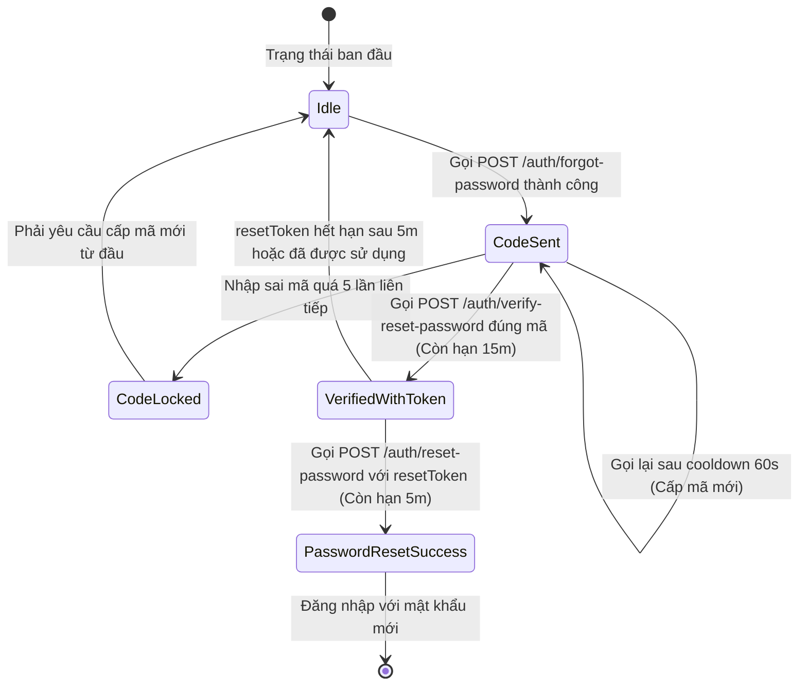

# TÀI LIỆU ĐẶC TẢ TÍCH HỢP API: QUÊN VÀ ĐẶT LẠI MẬT KHẨU

- **Dự án:** Group Spending & Reminder (Quản lý & Nhắc nhở Chi tiêu Nhóm)  
- **Phân hệ:** Xác thực tài khoản (Authentication)  
- **Nền tảng mục tiêu:** Mobile Client  
- **Phiên bản tài liệu:** v1.0.0  
- **Ngày cập nhật:** 03/10/2026  

---

## 1. QUY CHUẨN KỸ THUẬT CHUNG

### 1.1. Base URL & Giao thức mạng
- **Production Base URL:** `https://api.groupspending.xyz/api/v1`
- **Development / Staging Base URL:** `http://localhost:8080/api/v1`
- **Giao thức:** HTTPS (bắt buộc trên môi trường production)
- **Định dạng dữ liệu:** `application/json; charset=UTF-8`
- **Xác thực phiên:** Tất cả các endpoint trong quy trình Quên mật khẩu đều là **Public Endpoints**, không yêu cầu header `Authorization: Bearer <token>`.

### 1.2. Cấu trúc chuẩn phản hồi (ApiResponse Standard)

#### Phản hồi thành công (HTTP 200 OK):
```json
{
  "success": true,
  "message": "Thông điệp kết quả thao tác",
  "data": { ... },
  "timestamp": "2026-10-03T22:00:00Z"
}
```

#### Phản hồi thất bại nghiệp vụ (HTTP 400 / 401 / 403 / 429):
```json
{
  "success": false,
  "message": "Mô tả chi tiết nguyên nhân lỗi",
  "errors": null,
  "timestamp": "2026-10-03T22:00:00Z"
}
```

#### Phản hồi lỗi kiểm tra dữ liệu đầu vào (HTTP 400 Bad Request):
```json
{
  "success": false,
  "message": "Dữ liệu không hợp lệ",
  "errors": {
    "email": "Email không đúng định dạng",
    "code": "Mã xác thực phải gồm 8 ký tự"
  },
  "timestamp": "2026-10-03T22:00:00Z"
}
```

---

## 2. QUY TRÌNH NGHIỆP VỤ & MÁY TRẠNG THÁI (STATE MACHINE)

Quy trình khôi phục mật khẩu tuân thủ nghiêm ngặt mô hình xác thực 3 giai đoạn: **Yêu cầu mã → Xác thực mã → Đặt mật khẩu mới**.



### Quy tắc logic cốt lõi:
1. **Bảo mật phản hồi yêu cầu mã:** Endpoint gửi mã luôn trả về HTTP 200 thành công ngay cả khi email không tồn tại trong hệ thống (nhằm chống kỹ thuật dò quét email người dùng - User Enumeration Attack).
2. **Thời hạn mã OTP qua Email:** Mã gồm 8 ký tự Hex, có thời hạn hiệu lực chính xác **15 phút (900 giây)** kể từ thời điểm gửi.
3. **Giới hạn số lần thử (Rate Limiting nhập mã):** Tối đa **5 lần nhập sai** liên tiếp cho một phiên mã. Nếu nhập sai lần thứ 5, mã lập tức bị khóa (`RESET_CODE_LOCKED`). Client bắt buộc phải yêu cầu gửi lại mã mới.
4. **Thời gian chờ gửi lại (Cooldown):** Khoảng cách tối thiểu giữa 2 lần yêu cầu gửi mã tới cùng một email là **60 giây**. Nếu gọi sớm hơn 60 giây, hệ thống trả về mã lỗi HTTP 429 (`RESEND_OTP_RATE_LIMIT`).
5. **Chứng chỉ xác thực trung gian (`resetToken`):** Khi xác thực mã OTP thành công, backend cấp một chuỗi `resetToken` (32 bytes ngẫu nhiên, mã hóa Base64 URL-safe). `resetToken` có thời hạn sống **5 phút (300 giây)** và chỉ được sử dụng duy nhất một lần (One-Time Token).
6. **Thu hồi phiên đăng nhập:** Sau khi đổi mật khẩu thành công qua `resetToken`, toàn bộ Refresh Token của tài khoản sẽ bị hủy hiệu lực ngay lập tức.

---

## 3. ĐẶC TẢ CHI TIẾT CÁC ENDPOINT

### 3.1. Giai đoạn 1: Gửi yêu cầu mã xác thực qua Email
Gửi mã xác thực khôi phục mật khẩu đến hòm thư người dùng đã đăng ký.

- **Endpoint:** `/auth/forgot-password`
- **Method:** `POST`
- **Yêu cầu đăng nhập:** Không

#### Cấu trúc Request Body:
| Tên trường | Kiểu dữ liệu | Bắt buộc | Ràng buộc kỹ thuật | Ý nghĩa nghiệp vụ |
| :--- | :--- | :---: | :--- | :--- |
| `email` | `String` | **Có** | Định dạng email chuẩn RFC 5322, tối đa 150 ký tự | Địa chỉ hòm thư cần khôi phục mật khẩu |

```json
{
  "email": "user@example.com"
}
```

#### Phản hồi thành công (HTTP 200 OK):
```json
{
  "success": true,
  "message": "Nếu email tồn tại, hướng dẫn đặt lại mật khẩu đã được gửi.",
  "data": null,
  "timestamp": "2026-10-03T22:00:00Z"
}
```

#### Các lỗi nghiệp vụ có thể phát sinh:
- `429 Too Many Requests` (`RESEND_OTP_RATE_LIMIT`): Chưa hết thời gian cooldown 60 giây giữa các lần gửi.

---

### 3.2. Giai đoạn 2: Xác thực mã xác thực (OTP Verification)
Xác thực mã 8 ký tự người dùng nhận được trong email để lấy `resetToken`.

- **Endpoint:** `/auth/verify-reset-password`
- **Method:** `POST`
- **Yêu cầu đăng nhập:** Không

#### Cấu trúc Request Body:
| Tên trường | Kiểu dữ liệu | Bắt buộc | Ràng buộc kỹ thuật | Ý nghĩa nghiệp vụ |
| :--- | :--- | :---: | :--- | :--- |
| `email` | `String` | **Có** | Định dạng email hợp lệ | Email của tài khoản đang thực hiện xác thực |
| `code` | `String` | **Có** | Đúng 8 ký tự chữ và số `^[A-Za-z0-9]{8}$` | Mã xác thực nhận được qua hòm thư điện tử |

```json
{
  "email": "user@example.com",
  "code": "4F9A2B1C"
}
```

#### Phản hồi thành công (HTTP 200 OK):
| Tên trường | Kiểu dữ liệu | Mô tả |
| :--- | :--- | :--- |
| `resetToken` | `String` | Chuỗi token bảo mật dùng để đặt mật khẩu mới |
| `expiresIn` | `Long` | Thời gian sống của token tính bằng giây (mặc định: 300 giây) |

```json
{
  "success": true,
  "message": "Xác thực mã thành công",
  "data": {
    "resetToken": "c1f7a8b9-1e2f-4a3b-9c8d-1e2f3a4b5c6d",
    "expiresIn": 300
  },
  "timestamp": "2026-10-03T22:01:00Z"
}
```

#### Các lỗi nghiệp vụ có thể phát sinh:
- `400 Bad Request` (`INVALID_OTP`): Mã không đúng hoặc mã đã hết hạn 15 phút.
- `400 Bad Request` (`RESET_CODE_LOCKED`): Mã đã bị khóa do nhập sai quá 5 lần.

---

### 3.3. Giai đoạn 3: Thiết lập mật khẩu mới (Password Reset Execution)
Gửi `resetToken` cùng mật khẩu mới để hoàn tất việc cập nhật thông tin đăng nhập.

- **Endpoint:** `/auth/reset-password`
- **Method:** `POST`
- **Yêu cầu đăng nhập:** Không

#### Cấu trúc Request Body:
| Tên trường | Kiểu dữ liệu | Bắt buộc | Ràng buộc kỹ thuật | Ý nghĩa nghiệp vụ |
| :--- | :--- | :---: | :--- | :--- |
| `resetToken` | `String` | **Có** | Chuỗi token nhận được từ bước 2 | Token chứng thực quyền đặt lại mật khẩu |
| `newPassword` | `String` | **Có** | Tối thiểu 6 ký tự | Mật khẩu mới người dùng muốn thiết lập |

```json
{
  "resetToken": "c1f7a8b9-1e2f-4a3b-9c8d-1e2f3a4b5c6d",
  "newPassword": "MyNewPassword123@"
}
```

#### Phản hồi thành công (HTTP 200 OK):
```json
{
  "success": true,
  "message": "Đặt lại mật khẩu thành công. Bạn có thể đăng nhập bằng mật khẩu mới.",
  "data": null,
  "timestamp": "2026-10-03T22:02:00Z"
}
```

#### Các lỗi nghiệp vụ có thể phát sinh:
- `400 Bad Request` (`INVALID_RESET_TOKEN`): `resetToken` không hợp lệ, đã hết hạn 5 phút, hoặc đã được sử dụng trước đó.

---

## 4. QUẢN LÝ PHIÊN VÀ RÀNG BUỘC KỸ THUẬT PHÍA CLIENT

### 4.1. Bộ đếm thời gian (Timers)
1. **Cooldown Timer (60s):** Kích hoạt sau mỗi lần gọi thành công `POST /auth/forgot-password`. Trong thời gian này, client không gửi request mới lên server.
2. **OTP Expiry Timer (900s):** Đếm ngược hạn sử dụng của mã OTP. Khi hết 15 phút, mã vô hiệu, client chuyển về trạng thái cần cấp lại mã.
3. **Reset Token Expiry Timer (300s):** Đếm ngược hạn sử dụng của `resetToken`. Sau 5 phút, `resetToken` không còn hợp lệ để gọi API đổi mật khẩu.

### 4.2. Lưu trữ dữ liệu phiên
- `resetToken` chỉ lưu tạm thời trong bộ nhớ phiên làm việc (in-memory state management), tuyệt đối không lưu trữ lâu dài vào Persistent Storage (như SharedPreferences hoặc SQLite).
- Ngay sau khi nhận phản hồi HTTP 200 từ `POST /auth/reset-password`, client giải phóng toàn bộ dữ liệu tạm liên quan đến quy trình khôi phục mật khẩu (`email`, `code`, `resetToken`).

---

## 5. BẢNG MÃ LỖI VÀ XỬ LÝ ĐẶC THÙ (ERROR CODES SPECIFICATION)

| Mã lỗi HTTP | Mã định danh nội bộ (`ErrorCode`) | Nguyên nhân kỹ thuật | Hướng xử lý logic của Mobile Client |
| :---: | :--- | :--- | :--- |
| `400` | `VALIDATION_ERROR` | Thiếu trường, email sai định dạng, mã khác 8 ký tự, mật khẩu < 6 ký tự | Đọc chi tiết các trường trong đối tượng `errors` của response để định vị trường không hợp lệ |
| `400` | `INVALID_OTP` | Mã xác thực không khớp với dữ liệu máy chủ hoặc đã quá hạn 15 phút | Giữ nguyên trạng thái để thử lại mã khác; nếu đã hết hạn, chuyển về bước yêu cầu cấp lại mã |
| `400` | `RESET_CODE_LOCKED` | Nhập sai liên tiếp từ lần thứ 5 trở lên | Xóa mã đang có, hủy phiên hiện tại và bắt buộc chuyển về bước gửi lại yêu cầu mã mới |
| `400` | `INVALID_RESET_TOKEN` | Token đặt lại mật khẩu sai cú pháp, hết hạn 5 phút hoặc đã qua sử dụng | Hủy bỏ `resetToken` đã lưu, kết thúc phiên đổi mật khẩu và chuyển về bước đầu tiên |
| `429` | `RESEND_OTP_RATE_LIMIT` | Gửi yêu cầu lại trước khi kết thúc 60 giây chờ | Kích hoạt lại bộ đếm thời gian 60 giây, chặn thao tác gửi cho đến khi hết thời gian chờ |
| `500` | `INTERNAL_SERVER_ERROR` | Lỗi dịch vụ gửi mail SMTP hoặc sự cố máy chủ nội bộ | Giữ nguyên dữ liệu người dùng đã nhập, cho phép thực hiện lại thao tác sau thời gian chờ |
