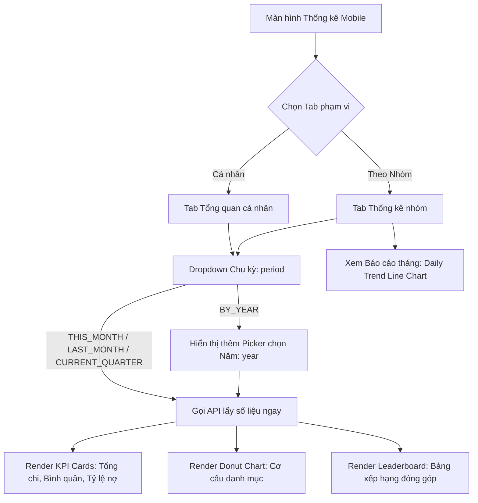

# TÀI LIỆU ĐẶC TẢ TÍCH HỢP API THỐNG KÊ & BÁO CÁO CHI TIÊU (MOBILE)

**Dự án:** Group Spending & Reminder (Quản lý & Nhắc nhở Chi tiêu Nhóm)  
**Phân hệ:** Thống kê, Báo cáo & Xếp hạng Chi tiêu (Expense Statistics & Reporting)  
**Nền tảng mục tiêu:** Mobile App (iOS / Android / Flutter / React Native)  
**Phiên bản tài liệu:** v1.0.0  
**Ngày cập nhật:** 2026-09-28  

---

## MỤC LỤC
1. [Quy chuẩn chung & Định dạng dữ liệu](#1-quy-chuẩn-chung--định-dạng-dữ-liệu)
   - [1.1. Base URL & Authentication](#11-base-url--authentication)
   - [1.2. Cấu trúc phản hồi chung (ApiResponse Pattern)](#12-cấu-trúc-phản-hồi-chung-apiresponse-pattern)
   - [1.3. Bảng Enum dùng chung](#13-bảng-enum-dùng-chung)
   - [1.4. Quy ước tiền tệ & Đơn vị tính](#14-quy-ước-tiền-tệ--đơn-vị-tính)
   - [1.5. Cơ chế phân giải khoảng thời gian (Date Range Resolution)](#15-cơ-chế-phân-giải-khoảng-thời-gian-date-range-resolution)
2. [Mô hình nghiệp vụ & Luồng tương tác (Business Flow)](#2-mô-hình-nghiệp-vụ--luồng-tương-tác-business-flow)
   - [2.1. Hai cấp độ thống kê (Personal vs Group Level)](#21-hai-cấp-độ-thống-kê-personal-vs-group-level)
   - [2.2. Các chỉ số KPI cốt lõi & Công thức nghiệp vụ](#22-các-chỉ-số-kpi-cốt-lõi--công-thức-nghiệp-vụ)
   - [2.3. Sơ đồ tương tác bộ lọc màn hình thống kê](#23-sơ-đồ-tương-tác-bộ-lọc-màn-hình-thống-kê)
3. [Đặc tả chi tiết các API Endpoints](#3-đặc-tả-chi-tiết-các-api-endpoints)
   - [3.1. Thống kê tổng quan cá nhân (Get Personal Expense Overview)](#31-thống-kê-tổng-quan-cá-nhân-get-personal-expense-overview)
   - [3.2. Thống kê chi tiết cá nhân theo chu kỳ thời gian (Get Personal Statistics Details)](#32-thống-kê-chi-tiết-cá-nhân-theo-chu-kỳ-thời-gian-get-personal-statistics-details)
   - [3.3. Bảng xếp hạng đóng góp chi tiêu toàn bộ các nhóm (Get Global Contribution Leaderboard)](#33-bảng-xếp-hạng-đóng-góp-chi-tiêu-toàn-bộ-các-nhóm-get-global-contribution-leaderboard)
   - [3.4. Thống kê tổng quan nhóm theo chu kỳ thời gian (Get Group Statistics)](#34-thống-kê-tổng-quan-nhóm-theo-chu-kỳ-thời-gian-get-group-statistics)
   - [3.5. Bảng xếp hạng đóng góp chi tiêu trong nhóm (Get Group Member Leaderboard)](#35-bảng-xếp-hạng-đóng-góp-chi-tiêu-trong-nhóm-get-group-member-leaderboard)
   - [3.6. Báo cáo chi tiêu tháng & Xu hướng chi tiêu theo ngày (Get Group Monthly Report & Daily Trend)](#36-báo-cáo-chi-tiêu-tháng--xu-hướng-chi-tiêu-theo-ngày-get-group-monthly-report--daily-trend)
   - [3.7. Xuất file báo cáo chi tiêu nhóm dạng CSV (Export Group Expenses to CSV)](#37-xuất-file-báo-cáo-chi-tiêu-nhóm-dạng-csv-export-group-expenses-to-csv)
   - [3.8. Lịch sử chi tiêu tổng hợp có lọc thời gian (Get All Groups Expense History)](#38-lịch-sử-chi-tiêu-tổng-hợp-có-lọc-thời-gian-get-all-groups-expense-history)
4. [Bảng mã lỗi (Error Codes) & Hướng dẫn xử lý UI](#5-bảng-mã-lỗi-error-codes--hướng-dẫn-xử-lý-ui)

---

## 1. QUY CHUẨN CHUNG & ĐỊNH DẠNG DỮ LIỆU

### 1.1. Base URL & Authentication

- **Base URL:** `https://api.groupspending.xyz/api/v1` (Production) hoặc `http://<host>:8080/api/v1` (Local / Staging)
- **Header bắt buộc:** Tất cả API thống kê đều yêu cầu Access Token hợp lệ của người dùng qua Authorization Bearer Header:
  ```http
  Authorization: Bearer <accessToken>
  Content-Type: application/json; charset=UTF-8
  Accept: application/json
  ```

---

### 1.2. Cấu trúc phản hồi chung (ApiResponse Pattern)

Mọi phản hồi từ server đều được bao bọc bởi chuẩn ApiResponse:

#### Phản hồi thành công (HTTP 200 OK):
```json
{
  "success": true,
  "message": "Thành công",
  "data": { ... },
  "timestamp": "2026-09-28T08:00:00Z"
}
```

#### Phản hồi thất bại do phân quyền hoặc nghiệp vụ (HTTP 400 / 401 / 403 / 404):
```json
{
  "success": false,
  "message": "Bạn không phải là thành viên của nhóm này",
  "errors": null,
  "timestamp": "2026-09-28T08:00:00Z"
}
```

---

### 1.3. Bảng Enum dùng chung

#### 1. `StatisticsPeriod` (Chu kỳ thống kê chi tiêu)
Được dùng làm query parameter `period` trong hầu hết các màn hình dashboard thống kê:

| Enum Key | Tên hiển thị gợi ý (Dropdown / Segment) | Diễn giải chu kỳ thời gian |
| :--- | :--- | :--- |
| `THIS_MONTH` *(Default)* | **Tháng này** | Từ ngày 01 đến ngày cuối cùng của tháng hiện tại. |
| `LAST_MONTH` | **Tháng trước** | Từ ngày 01 đến ngày cuối cùng của tháng liền kề trước đó. |
| `CURRENT_QUARTER` | **Quý này** | Từ ngày đầu của tháng đầu tiên đến ngày cuối của tháng thứ 3 trong quý hiện tại. |
| `BY_YEAR` | **Theo năm** | Từ ngày 01/01 đến 31/12 của năm chỉ định (qua param `year`). |

#### 2. `ExpenseTimeFilter` (Bộ lọc thời gian lịch sử chi tiêu)
Dùng trong API lấy lịch sử chi tiêu toàn bộ nhóm (`GET /expenses/history`):

| Enum Key | Ý nghĩa |
| :--- | :--- |
| `ALL` *(Default)* | Tất cả các khoản chi từ trước đến nay. |
| `THIS_MONTH` | Khoản chi phát sinh trong tháng này. |
| `LAST_MONTH` | Khoản chi phát sinh trong tháng trước. |
| `THIS_QUARTER` | Khoản chi phát sinh trong quý hiện tại. |
| `THIS_YEAR` | Khoản chi phát sinh trong năm nay. |

---

### 1.4. Quy ước tiền tệ & Đơn vị tính

Nhằm tối ưu cho Mobile xử lý linh hoạt:
- **Trường tiền tệ thường (`amount`, `totalSpending`, `contributedAmount`, `averageSpendingPerPerson`):** Đơn vị nghìn Đồng (k VNĐ). Ví dụ: `150` tương ứng 150.000 VNĐ.
- **Trường tiền tệ có hậu tố `Vnd` (`amountVnd`, `totalSpendingVnd`, `contributedAmountVnd`, `averageSpendingPerPersonVnd`):** Đơn vị VNĐ số nguyên đầy đủ (`amount * 1000`). Ví dụ: `150000`.

> [!TIP]
> **Khuyến nghị cho Mobile:** Luôn ưu tiên binding trực tiếp các trường có hậu tố **`Vnd`** vào giao diện và dùng hàm format tiền tệ chuẩn:
> - **Flutter:** `NumberFormat.currency(locale: 'vi_VN', symbol: '₫').format(data.totalSpendingVnd)` -> `1.500.000 ₫`
> - **React Native:** `new Intl.NumberFormat('vi-VN', { style: 'currency', currency: 'VND' }).format(data.totalSpendingVnd)` -> `1.500.000 ₫`

---

### 1.5. Cơ chế phân giải khoảng thời gian (Date Range Resolution)

Server tự động tính toán chính xác cặp ngày `startDate` và `endDate` (định dạng `YYYY-MM-DD`) trả về trong response dựa trên bộ lọc:
- **`THIS_MONTH`:** Ví dụ hôm nay là `2026-09-28` -> `startDate: "2026-09-01"`, `endDate: "2026-09-30"`.
- **`LAST_MONTH`:** `startDate: "2026-08-01"`, `endDate: "2026-08-31"`.
- **`CURRENT_QUARTER`:** Tháng 9 thuộc Quý 3 (Tháng 7, 8, 9) -> `startDate: "2026-07-01"`, `endDate: "2026-09-30"`.
- **`BY_YEAR`:** Nếu truyền `year=2025` -> `startDate: "2025-01-01"`, `endDate: "2025-12-31"`. Nếu không truyền `year`, server tự lấy năm hiện tại (`2026`).

---

## 2. MÔ HÌNH NGHIỆP VỤ & LUỒNG TƯƠNG TÁC (BUSINESS FLOW)

### 2.1. Hai cấp độ thống kê (Personal vs Group Level)

Ứng dụng cung cấp 2 không gian thống kê riêng biệt:
1. **Cấp độ cá nhân (Personal Dashboard / Màn hình Thống kê chung):**
   - Tổng hợp số liệu từ **tất cả các nhóm `ACTIVE`** mà người dùng tham gia.
   - Thống kê tỷ lệ chi theo từng nhóm danh mục chi tiêu.
   - Bảng xếp hạng "Đại gia chi tiêu" (Top Contributors) trên toàn bộ mạng lưới nhóm của người dùng.
2. **Cấp độ từng nhóm (Group Dashboard / Tab Thống kê trong Chi tiết nhóm):**
   - Đi sâu vào chi tiết của 1 nhóm (`groupId`).
   - Phân tích bình quân đầu người của thành viên nhóm.
   - Tỷ lệ tất toán công nợ của nhóm trong kỳ.
   - Bảng xếp hạng chi tiêu nội bộ giữa các thành viên trong nhóm.
   - Báo cáo chi tiêu tháng và biểu đồ đường xu hướng chi tiêu theo từng ngày.

---

### 2.2. Các chỉ số KPI cốt lõi & Công thức nghiệp vụ

| Chỉ số (KPI) | Trường API | Ý nghĩa & Công thức tính trên Backend |
| :--- | :--- | :--- |
| **Tổng chi tiêu** | `totalSpendingVnd` | Tổng số tiền của các hóa đơn có trạng thái `ACTIVE` trong kỳ lọc. |
| **Bình quân đầu người** | `averageSpendingPerPersonVnd` | `Tổng chi tiêu / Số lượng thành viên duy nhất tham gia nhóm`. Cho biết mỗi người gánh trung bình bao nhiêu tiền chi tiêu. |
| **Tỷ lệ tất toán nợ** | `debtSettlementRate` | `(Số tiền nợ đã SETTLED / Tổng tiền nợ phát sinh trong kỳ) * 100%`. Đo lường mức độ sòng phẳng và minh bạch của nhóm. |
| **Tỷ lệ phần trăm danh mục** | `percentage` | `(Tổng tiền danh mục / Tổng chi tiêu trong kỳ) * 100%`. Làm tròn 2 chữ số thập phân. |
| **Xếp hạng đóng góp** | `rank`, `contributedAmountVnd` | Sắp xếp giảm dần theo số tiền thành viên thực tế đã đứng ra trả tiền trước (`paidBy`). Nếu bằng nhau, sắp xếp theo tên A-Z. |
| **Số dư ròng tháng** | `netBalanceVnd` | `Tổng tiền đã trả (totalPaid) - Tổng tiền phải chịu (totalOwed)`. Dương: Đang được nhận lại tiền; Âm: Đang phải trả bù. |

---

### 2.3. Sơ đồ tương tác bộ lọc màn hình thống kê



---

## 3. ĐẶC TẢ CHI TIẾT CÁC API ENDPOINTS

### 3.1. Thống kê tổng quan cá nhân (Get Personal Expense Overview)

Lấy các chỉ số tổng quan nhanh nhất của người dùng hiện tại (thường dùng hiển thị các thẻ KPI đầu trang màn hình Thống kê cá nhân hoặc Home).

- **Method:** `GET`
- **Path:** `/expenses/statistics/overview`
- **Full URL:** `/api/v1/expenses/statistics/overview`
- **Header:**
  ```http
  Authorization: Bearer <accessToken>
  ```
- **Query Parameters:** Không có.
- **Mã phản hồi thành công:** `200 OK`
- **Response Body mẫu:**
```json
{
  "success": true,
  "message": "Thành công",
  "data": {
    "totalSpending": 15000,
    "totalSpendingVnd": 15000000,
    "activeGroupCount": 3,
    "totalExpenses": 25,
    "myExpenseCount": 12
  },
  "timestamp": "2026-09-28T08:00:00Z"
}
```

- **Giải thích các trường:**
  - `totalSpendingVnd`: Tổng số tiền chi tiêu của tất cả các nhóm mà người dùng đang tham gia (đơn vị VNĐ).
  - `activeGroupCount`: Số nhóm `ACTIVE` người dùng là thành viên.
  - `totalExpenses`: Tổng số khoản chi tiêu đã ghi nhận trong tất cả các nhóm trên.
  - `myExpenseCount`: Số khoản chi do chính người dùng hiện tại tạo ra (đứng tên người tạo).

> [!NOTE]
> Nếu người dùng chưa tham gia nhóm nào hoặc các nhóm đều không có khoản chi, server trả về tất cả các chỉ số bằng `0` (không trả về lỗi).

---

### 3.2. Thống kê chi tiết cá nhân theo chu kỳ thời gian (Get Personal Statistics Details)

Lấy số liệu phân tích chuyên sâu cá nhân gồm: tổng chi, bình quân đầu người, tỷ lệ tất toán nợ và cơ cấu danh mục chi tiêu theo chu kỳ thời gian được chọn.

- **Method:** `GET`
- **Path:** `/expenses/statistics/details`
- **Full URL:** `/api/v1/expenses/statistics/details`
- **Header:**
  ```http
  Authorization: Bearer <accessToken>
  ```
- **Query Parameters:**

| Tên tham số | Kiểu dữ liệu | Bắt buộc | Mặc định | Mô tả |
| :--- | :--- | :--- | :--- | :--- |
| `period` | String (`StatisticsPeriod`) | Không | `THIS_MONTH` | `THIS_MONTH`, `LAST_MONTH`, `CURRENT_QUARTER`, `BY_YEAR` |
| `year` | Integer | Không | *Năm hiện tại* | Chỉ có hiệu lực khi `period=BY_YEAR`. Ví dụ: `2026` |

- **Mã phản hồi thành công:** `200 OK`
- **Response Body mẫu:**
```json
{
  "success": true,
  "message": "Thành công",
  "data": {
    "period": "THIS_MONTH",
    "startDate": "2026-09-01",
    "endDate": "2026-09-30",
    "totalSpending": 4500,
    "totalSpendingVnd": 4500000,
    "totalExpenseCount": 18,
    "averageSpendingPerPerson": 750.0,
    "averageSpendingPerPersonVnd": 750000.0,
    "totalUniqueMembers": 6,
    "debtSettlementRate": 85.5,
    "totalDebtAmount": 2000,
    "settledDebtAmount": 1710,
    "totalDebtCount": 8,
    "settledDebtCount": 7,
    "categoryDistributions": [
      {
        "categoryId": 1,
        "categoryName": "Ăn uống",
        "icon": "restaurant",
        "amount": 2250,
        "amountVnd": 2250000,
        "percentage": 50.0,
        "expenseCount": 10
      },
      {
        "categoryId": 2,
        "categoryName": "Di chuyển",
        "icon": "directions_car",
        "amount": 1350,
        "amountVnd": 1350000,
        "percentage": 30.0,
        "expenseCount": 5
      },
      {
        "categoryId": 3,
        "categoryName": "Giải trí",
        "icon": "movie",
        "amount": 900,
        "amountVnd": 900000,
        "percentage": 20.0,
        "expenseCount": 3
      }
    ]
  },
  "timestamp": "2026-09-28T08:00:00Z"
}
```

---

### 3.3. Bảng xếp hạng đóng góp chi tiêu toàn bộ các nhóm (Get Global Contribution Leaderboard)

Lấy danh sách xếp hạng các thành viên (từ tất cả các nhóm người dùng tham gia) đóng góp nhiều tiền chi tiêu nhất trong khoảng thời gian đã lọc. Giúp hiển thị bảng vinh danh (Top Spenders).

- **Method:** `GET`
- **Path:** `/expenses/statistics/leaderboard`
- **Full URL:** `/api/v1/expenses/statistics/leaderboard`
- **Header:**
  ```http
  Authorization: Bearer <accessToken>
  ```
- **Query Parameters:**

| Tên tham số | Kiểu dữ liệu | Bắt buộc | Mặc định | Mô tả |
| :--- | :--- | :--- | :--- | :--- |
| `period` | String (`StatisticsPeriod`) | Không | `THIS_MONTH` | Chu kỳ lọc thời gian |
| `year` | Integer | Không | *Năm hiện tại* | Áp dụng khi `period=BY_YEAR` |

- **Mã phản hồi thành công:** `200 OK`
- **Response Body mẫu:**
```json
{
  "success": true,
  "message": "Thành công",
  "data": {
    "period": "THIS_MONTH",
    "startDate": "2026-09-01",
    "endDate": "2026-09-30",
    "totalSpending": 5000,
    "totalSpendingVnd": 5000000,
    "totalMembers": 4,
    "leaderboard": [
      {
        "rank": 1,
        "userId": 5,
        "fullName": "Trần Văn B",
        "avatarUrl": "https://res.cloudinary.com/demo/image/upload/avatar1.jpg",
        "email": "tranvanb@example.com",
        "contributedAmount": 2500,
        "contributedAmountVnd": 2500000,
        "percentage": 50.0
      },
      {
        "rank": 2,
        "userId": 1,
        "fullName": "Nguyễn Văn A (Tôi)",
        "avatarUrl": "https://res.cloudinary.com/demo/image/upload/avatar2.jpg",
        "email": "user@example.com",
        "contributedAmount": 1500,
        "contributedAmountVnd": 1500000,
        "percentage": 30.0
      },
      {
        "rank": 3,
        "userId": 8,
        "fullName": "Lê Thị C",
        "avatarUrl": null,
        "email": "lethic@example.com",
        "contributedAmount": 1000,
        "contributedAmountVnd": 1000000,
        "percentage": 20.0
      },
      {
        "rank": 4,
        "userId": 9,
        "fullName": "Đỗ Văn D",
        "avatarUrl": null,
        "email": "dovand@example.com",
        "contributedAmount": 0,
        "contributedAmountVnd": 0,
        "percentage": 0.0
      }
    ]
  },
  "timestamp": "2026-09-28T08:00:00Z"
}
```

---

### 3.4. Thống kê tổng quan nhóm theo chu kỳ thời gian (Get Group Statistics)

Lấy số liệu phân tích chuyên sâu cho 1 nhóm cụ thể.

- **Method:** `GET`
- **Đường dẫn hỗ trợ (2 URL tương đương):**
  - Chuẩn 1: `/api/v1/expenses/statistics/groups/{groupId}`
  - Chuẩn 2 (Alias tiện ích): `/api/v1/groups/{groupId}/statistics`
- **Path Variables:**

| Tên biến | Kiểu dữ liệu | Bắt buộc | Mô tả |
| :--- | :--- | :--- | :--- |
| `groupId` | Long | Có | ID của nhóm cần thống kê |

- **Query Parameters:**

| Tên tham số | Kiểu dữ liệu | Bắt buộc | Mặc định | Mô tả |
| :--- | :--- | :--- | :--- | :--- |
| `period` | String (`StatisticsPeriod`) | Không | `THIS_MONTH` | Chu kỳ lọc thời gian |
| `year` | Integer | Không | *Năm hiện tại* | Áp dụng khi `period=BY_YEAR` |

- **Header:**
  ```http
  Authorization: Bearer <accessToken>
  ```
- **Mã phản hồi thành công:** `200 OK`
- **Response Body mẫu:**
```json
{
  "success": true,
  "message": "Thành công",
  "data": {
    "groupId": 10,
    "groupName": "Chuyến đi Đà Lạt 2026",
    "period": "THIS_MONTH",
    "startDate": "2026-09-01",
    "endDate": "2026-09-30",
    "totalSpending": 3200,
    "totalSpendingVnd": 3200000,
    "averageSpendingPerPerson": 800.0,
    "averageSpendingPerPersonVnd": 800000.0,
    "memberCount": 4,
    "totalExpenseCount": 12,
    "debtSettlementRate": 75.0,
    "totalDebtAmount": 1600,
    "settledDebtAmount": 1200,
    "totalDebtCount": 6,
    "settledDebtCount": 4,
    "categoryDistributions": [
      {
        "categoryId": 1,
        "categoryName": "Khách sạn & Lưu trú",
        "icon": "hotel",
        "amount": 1600,
        "amountVnd": 1600000,
        "percentage": 50.0,
        "expenseCount": 2
      },
      {
        "categoryId": 2,
        "categoryName": "Ăn uống",
        "icon": "restaurant",
        "amount": 1120,
        "amountVnd": 1120000,
        "percentage": 35.0,
        "expenseCount": 8
      },
      {
        "categoryId": 3,
        "categoryName": "Vé tham quan",
        "icon": "confirmation_number",
        "amount": 480,
        "amountVnd": 480000,
        "percentage": 15.0,
        "expenseCount": 2
      }
    ]
  },
  "timestamp": "2026-09-28T08:00:00Z"
}
```

- **Mã lỗi thường gặp:**
  - `403 Forbidden`: `NOT_GROUP_MEMBER` - Người dùng không thuộc nhóm này.
  - `404 Not Found`: `GROUP_NOT_FOUND` - Nhóm không tồn tại.

---

### 3.5. Bảng xếp hạng đóng góp chi tiêu trong nhóm (Get Group Member Leaderboard)

Lấy bảng xếp hạng mức độ đóng góp (ai chi trả nhiều nhất) của từng thành viên trong một nhóm cụ thể.

- **Method:** `GET`
- **Đường dẫn hỗ trợ (2 URL tương đương):**
  - Chuẩn 1: `/api/v1/expenses/statistics/groups/{groupId}/leaderboard`
  - Chuẩn 2 (Alias tiện ích): `/api/v1/groups/{groupId}/leaderboard`
- **Path Variables:**

| Tên biến | Kiểu dữ liệu | Bắt buộc | Mô tả |
| :--- | :--- | :--- | :--- |
| `groupId` | Long | Có | ID của nhóm |

- **Query Parameters:**

| Tên tham số | Kiểu dữ liệu | Bắt buộc | Mặc định | Mô tả |
| :--- | :--- | :--- | :--- | :--- |
| `period` | String (`StatisticsPeriod`) | Không | `THIS_MONTH` | Chu kỳ lọc thời gian |
| `year` | Integer | Không | *Năm hiện tại* | Áp dụng khi `period=BY_YEAR` |

- **Header:**
  ```http
  Authorization: Bearer <accessToken>
  ```
- **Mã phản hồi thành công:** `200 OK`
- **Response Body mẫu:**
```json
{
  "success": true,
  "message": "Thành công",
  "data": [
    {
      "rank": 1,
      "userId": 2,
      "fullName": "Trần Thị Bích",
      "avatarUrl": "https://res.cloudinary.com/demo/image/upload/avatar_b.jpg",
      "contributedAmount": 1800,
      "contributedAmountVnd": 1800000,
      "percentage": 56.25,
      "expenseCount": 5
    },
    {
      "rank": 2,
      "userId": 1,
      "fullName": "Nguyễn Văn An",
      "avatarUrl": "https://res.cloudinary.com/demo/image/upload/avatar_a.jpg",
      "contributedAmount": 1000,
      "contributedAmountVnd": 1000000,
      "percentage": 31.25,
      "expenseCount": 4
    },
    {
      "rank": 3,
      "userId": 3,
      "fullName": "Lê Hoàng Nam",
      "avatarUrl": null,
      "contributedAmount": 400,
      "contributedAmountVnd": 400000,
      "percentage": 12.5,
      "expenseCount": 3
    },
    {
      "rank": 4,
      "userId": 4,
      "fullName": "Phạm Quỳnh Chi",
      "avatarUrl": null,
      "contributedAmount": 0,
      "contributedAmountVnd": 0,
      "percentage": 0.0,
      "expenseCount": 0
    }
  ],
  "timestamp": "2026-09-28T08:00:00Z"
}
```

- **Giải thích:**
  - `expenseCount`: Số lượng hóa đơn thành viên này đã trực tiếp thanh toán.
  - Các thành viên chưa trả hóa đơn nào vẫn nằm trong danh sách với `contributedAmount: 0`, `rank` ở cuối.

---

### 3.6. Báo cáo chi tiêu tháng & Xu hướng chi tiêu theo ngày (Get Group Monthly Report & Daily Trend)

API chuyên biệt cho màn hình **Báo cáo tài chính tháng (Monthly Report)** của nhóm. Cung cấp:
1. Cơ cấu danh mục chi tiêu.
2. Thống kê chi tiết từng thành viên: **Tổng đã trả** (`totalPaid`), **Tổng phải chịu** (`totalOwed`), **Số dư ròng** (`netBalance`).
3. **Mảng xu hướng theo ngày (`dailyTrend`):** Dữ liệu để vẽ biểu đồ đường (Line Chart) biến thiên chi tiêu qua các ngày trong tháng.

- **Method:** `GET`
- **Path:** `/groups/{groupId}/reports/monthly`
- **Full URL:** `/api/v1/groups/{groupId}/reports/monthly`
- **Path Variables:**

| Tên biến | Kiểu dữ liệu | Bắt buộc | Mô tả |
| :--- | :--- | :--- | :--- |
| `groupId` | Long | Có | ID của nhóm |

- **Query Parameters:**

| Tên tham số | Kiểu dữ liệu | Bắt buộc | Mặc định | Mô tả |
| :--- | :--- | :--- | :--- | :--- |
| `month` | Integer (1 - 12) | Không | *Tháng hiện tại* | Tháng cần báo cáo |
| `year` | Integer | Không | *Năm hiện tại* | Năm cần báo cáo |

- **Header:**
  ```http
  Authorization: Bearer <accessToken>
  ```
- **Mã phản hồi thành công:** `200 OK`
- **Response Body mẫu:**
```json
{
  "success": true,
  "message": "Thành công",
  "data": {
    "groupId": 10,
    "groupName": "Chuyến đi Đà Lạt 2026",
    "month": 9,
    "year": 2026,
    "totalSpending": 3500,
    "totalSpendingVnd": 3500000,
    "totalExpenseCount": 6,
    "spendingByCategory": [
      {
        "categoryId": 1,
        "categoryName": "Ăn uống",
        "icon": "restaurant",
        "amount": 2000,
        "amountVnd": 2000000,
        "percentage": 57.14
      },
      {
        "categoryId": 2,
        "categoryName": "Di chuyển",
        "icon": "directions_car",
        "amount": 1500,
        "amountVnd": 1500000,
        "percentage": 42.86
      }
    ],
    "spendingByMember": [
      {
        "userId": 1,
        "fullName": "Nguyễn Văn A",
        "avatarUrl": "https://res.cloudinary.com/demo/image/upload/avatar_a.jpg",
        "totalPaid": 2500,
        "totalPaidVnd": 2500000,
        "totalOwed": 1166,
        "totalOwedVnd": 1166000,
        "netBalance": 1334,
        "netBalanceVnd": 1334000
      },
      {
        "userId": 2,
        "fullName": "Trần Văn B",
        "avatarUrl": "https://res.cloudinary.com/demo/image/upload/avatar_b.jpg",
        "totalPaid": 1000,
        "totalPaidVnd": 1000000,
        "totalOwed": 1167,
        "totalOwedVnd": 1167000,
        "netBalance": -167,
        "netBalanceVnd": -167000
      },
      {
        "userId": 3,
        "fullName": "Lê Văn C",
        "avatarUrl": null,
        "totalPaid": 0,
        "totalPaidVnd": 0,
        "totalOwed": 1167,
        "totalOwedVnd": 1167000,
        "netBalance": -1167,
        "netBalanceVnd": -1167000
      }
    ],
    "dailyTrend": [
      {
        "date": "2026-09-05",
        "amount": 1200,
        "amountVnd": 1200000,
        "expenseCount": 2
      },
      {
        "date": "2026-09-12",
        "amount": 800,
        "amountVnd": 800000,
        "expenseCount": 1
      },
      {
        "date": "2026-09-20",
        "amount": 1500,
        "amountVnd": 1500000,
        "expenseCount": 3
      }
    ]
  },
  "timestamp": "2026-09-28T08:00:00Z"
}
```

> [!TIP]
> **Ứng dụng của `spendingByMember`:**
> - `netBalanceVnd > 0`: Thành viên này chi nhiều hơn mức hưởng -> Hiển thị text màu xanh lá (Được nhận lại `+1.334.000 ₫`).
> - `netBalanceVnd < 0`: Thành viên này chi ít hơn mức hưởng -> Hiển thị text màu đỏ (Cần trả bù `-167.000 ₫`).

---

### 3.7. Xuất file báo cáo chi tiêu nhóm dạng CSV (Export Group Expenses to CSV)

Tải file CSV chứa toàn bộ danh sách các khoản chi tiêu trong tháng hoặc cả năm của nhóm để người dùng mở bằng Excel, Google Sheets hoặc chia sẻ qua Zalo/Mail. File có đính kèm UTF-8 BOM chuẩn để Excel hiển thị tiếng Việt không bị lỗi font.

- **Method:** `GET`
- **Path:** `/groups/{groupId}/reports/export-csv`
- **Full URL:** `/api/v1/groups/{groupId}/reports/export-csv`
- **Path Variables:**

| Tên biến | Kiểu dữ liệu | Bắt buộc | Mô tả |
| :--- | :--- | :--- | :--- |
| `groupId` | Long | Có | ID của nhóm |

- **Query Parameters:**

| Tên tham số | Kiểu dữ liệu | Bắt buộc | Mô tả |
| :--- | :--- | :--- | :--- |
| `month` | Integer | Không | Tháng cần xuất (1 - 12). Nếu bỏ trống sẽ xuất toàn bộ các tháng của năm. |
| `year` | Integer | Không | Năm cần xuất. Nếu bỏ trống mặc định lấy năm hiện tại. |

- **Header:**
  ```http
  Authorization: Bearer <accessToken>
  ```
- **Response Headers từ server:**
  ```http
  Content-Type: text/csv; charset=UTF-8
  Content-Disposition: attachment; filename="expenses_group_10_2026_9.csv"
  ```
- **Response Body:** File nhị phân (Binary CSV Stream).
- **Cấu trúc cột trong file CSV:**
  ```csv
  "ID","Tiêu đề","Danh mục","Ngày chi","Người trả","Tổng tiền (VNĐ)","Ghi chú"
  "101","Tiền thuê Homestay","Khách sạn & Lưu trú","05/09/2026","Nguyễn Văn A","1200000","Đặt cọc trước 50%"
  "102","Ăn tối lẩu gà lá é","Ăn uống","05/09/2026","Trần Văn B","800000",""
  ```

---

### 3.8. Lịch sử chi tiêu tổng hợp có lọc thời gian (Get All Groups Expense History)

Hỗ trợ tab "Lịch sử chi tiêu" (giao diện danh sách dạng Feed/Timeline) của người dùng trên toàn bộ các nhóm, có kèm bộ lọc thời gian.

- **Method:** `GET`
- **Path:** `/expenses/history`
- **Full URL:** `/api/v1/expenses/history`
- **Header:**
  ```http
  Authorization: Bearer <accessToken>
  ```
- **Query Parameters:**

| Tên tham số | Kiểu dữ liệu | Bắt buộc | Mặc định | Mô tả |
| :--- | :--- | :--- | :--- | :--- |
| `timeFilter` | String (`ExpenseTimeFilter`) | Không | `ALL` | `ALL`, `THIS_MONTH`, `LAST_MONTH`, `THIS_QUARTER`, `THIS_YEAR` |

- **Mã phản hồi thành công:** `200 OK`
- **Response Body mẫu:**
```json
{
  "success": true,
  "message": "Thành công",
  "data": [
    {
      "id": 105,
      "groupId": 10,
      "groupName": "Chuyến đi Đà Lạt 2026",
      "title": "Ăn trưa bánh ướt lòng gà",
      "expenseDate": "2026-09-20",
      "totalAmount": 450,
      "totalAmountVnd": 450000,
      "categoryName": "Ăn uống",
      "paidByUserName": "Nguyễn Văn A"
    },
    {
      "id": 101,
      "groupId": 10,
      "groupName": "Chuyến đi Đà Lạt 2026",
      "title": "Tiền phòng Homestay",
      "expenseDate": "2026-09-05",
      "totalAmount": 1200,
      "totalAmountVnd": 1200000,
      "categoryName": "Khách sạn & Lưu trú",
      "paidByUserName": "Nguyễn Văn A"
    }
  ],
  "timestamp": "2026-09-28T08:00:00Z"
}
```

---

## 4. BẢNG MÃ LỖI (ERROR CODES) & HƯỚNG DẪN XỬ LÝ UI

| HTTP Status | Error Code / Message | Nguyên nhân | Hướng dẫn xử lý trên Mobile UI |
| :---: | :--- | :--- | :--- |
| `401` | `INVALID_TOKEN` | Token hết hạn hoặc không hợp lệ. | Điều hướng người dùng về màn hình Đăng nhập (Login). |
| `403` | `NOT_GROUP_MEMBER` | Người dùng không phải thành viên nhóm chi tiêu khi gọi API thống kê nhóm. | Hiển thị Toast thông báo: *"Bạn không có quyền truy cập nhóm này"* và quay lại trang danh sách nhóm. |
| `404` | `GROUP_NOT_FOUND` | Nhóm không tồn tại hoặc đã bị xóa vĩnh viễn. | Hiển thị thông báo Toast và xóa nhóm khỏi danh sách cache cục bộ trên máy. |
| `400` | *Dữ liệu đầu vào không hợp lệ* | Truyền `period` hoặc `timeFilter` không đúng định dạng enum. | Kiểm tra lại giá trị query param trước khi gửi. |
| `500` | `INTERNAL_SERVER_ERROR` | Lỗi máy chủ ngoài dự kiến. | Hiển thị nút *"Thử lại"* (Retry Button) để người dùng tải lại trang. |

---


---

## 5. CHECKLIST HOÀN THIỆN MÀN HÌNH THỐNG KÊ (MOBILE QA/DEV)

Trước khi phát hành tính năng thống kê lên bản thử nghiệm hoặc Production, đội ngũ phát triển Mobile cần rà soát các tiêu chí sau:

- [ ] **Định dạng tiền tệ:** Đã dùng thống nhất các trường có đuôi `Vnd` kết hợp với thư viện định dạng tiền tệ VNĐ chuẩn (`₫`), không tự thực hiện phép nhân `amount * 1000` ở client.
- [ ] **Bộ lọc chu kỳ (`StatisticsPeriod`):** Mặc định chọn `THIS_MONTH`. Khi chuyển sang `BY_YEAR`, tự động hiển thị Year Picker (hoặc chọn năm hiện tại).
- [ ] **Biểu đồ tròn (Donut Chart):** Các quạt hiển thị đúng màu theo danh mục, tooltip hiển thị rõ số tiền và tỷ lệ phần trăm (%), không bị chồng lấn nhãn khi phần trăm nhỏ.
- [ ] **Biểu đồ đường (Line Chart `dailyTrend`):** Trục hoành format ngày dạng `dd/MM`, chạm vào điểm mốc xem được tổng tiền chi tiêu trong ngày đó.
- [ ] **Leaderboard:** Hiển thị nổi bật Top 1 (vương miện vàng), Top 2, Top 3. Gắn tag nhận diện rõ ràng nếu người dùng hiện tại nằm trong bảng xếp hạng.
- [ ] **Trạng thái rỗng (Empty State):** Kiểm tra giao diện khi tổng chi tiêu bằng 0; có hình vẽ minh họa và nút điều hướng tạo khoản chi mới tiện lợi.
- [ ] **Xử lý xoay ngang / Màn hình nhỏ:** Layout của các thẻ KPI và biểu đồ tự co giãn mượt mà, không bị tràn màn hình (Overflow/Truncated text).
- [ ] **Xuất file CSV:** Đã cấu hình mở file thành công trên cả iOS (Share Sheet / Files) và Android (Intents / OpenFile).
